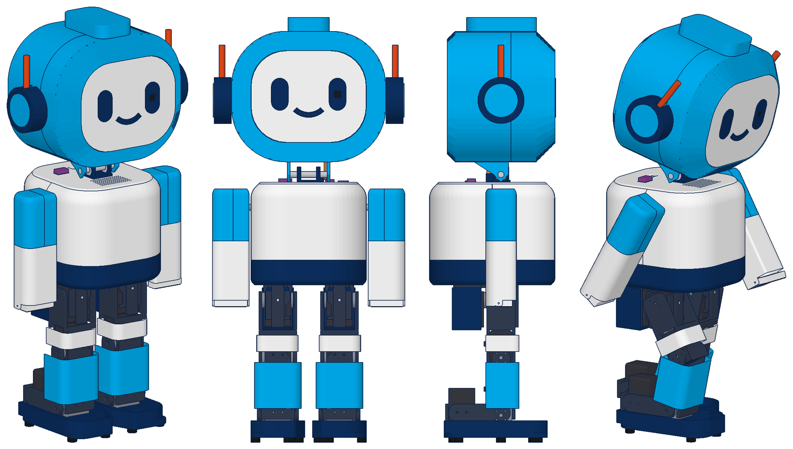
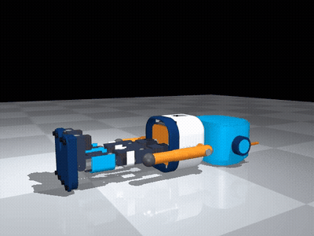
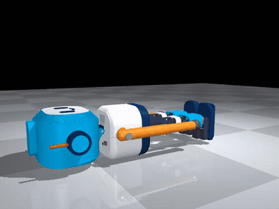
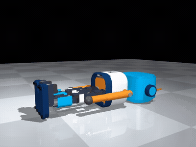
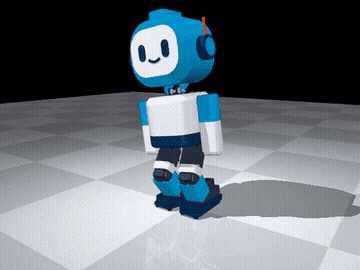
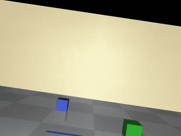
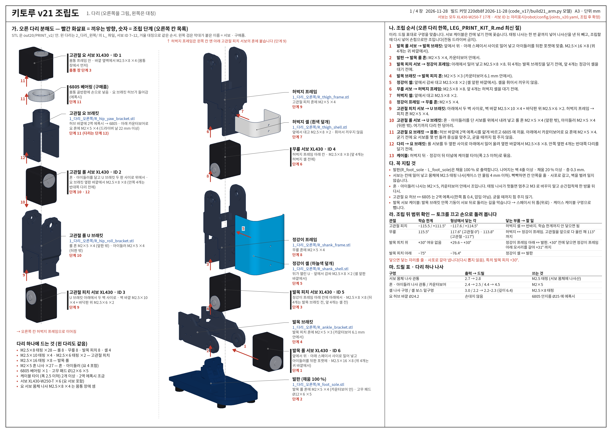
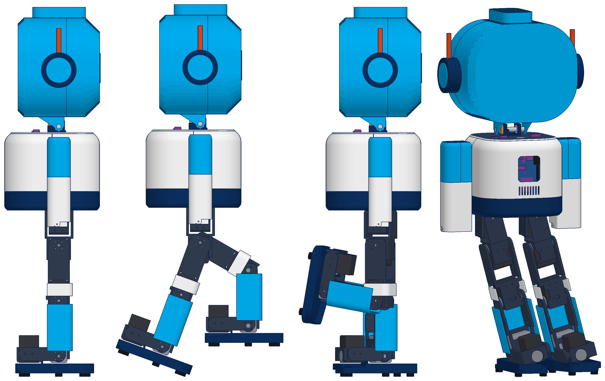
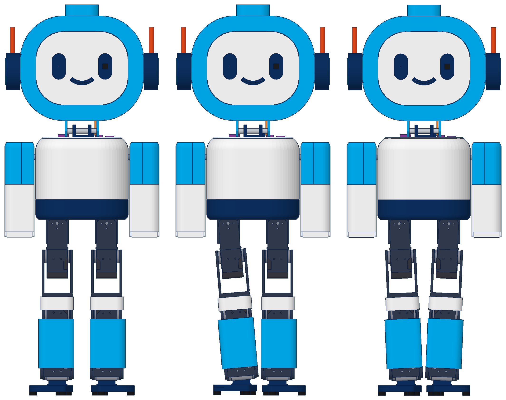

# 키토루 (Make_kirotoo)

KIRO 마스코트 모양의 2족보행 로봇(키 633 mm, v20 에서 다리를 늘린 뒤 설계 값)을 3D 프린팅으로 만들고, 걷기를 강화학습으로 가르치는 프로젝트입니다.

- **지금 단계 (2026-11-27):** 실제로 출력해 조립하는 판 v20 다리를 출력하는 중입니다. 이 판은 모든 관절을 XL430-W250-T 로 씁니다.
- **아직 실물로 돌려 본 적은 없습니다.** 아래 영상은 모두 MuJoCo 시뮬레이터 결과입니다.
- 지금 상태와 할 일은 [`STATUS.md`](STATUS.md) 에 있습니다.

## 시뮬레이션 영상

아래 GIF 는 줄인 것입니다. 원본 mp4 는 각 영상 아래 링크에 있습니다.

### 일어나기

| 엎드림에서 일어나기 — 모두 XL430, 팔꿈치 팔 100+100 mm | 누움에서 뒤로 굴러 일어나기 — 어깨 · 팔꿈치 XM430 가정 |
|---|---|
|  |  |
| 팔굽혀펴기 → 다리를 편 ㅅ자 → 반동으로 쪼그림 → 일어섬. 시뮬레이터에서 한 번만 섰고 조건을 조금만 바꿔도 실패합니다(15 조건 중 1). [mp4](sim/getup/results/getup_elbow100_XL_prone.mp4) | 머리와 두 손으로 물구나무를 서듯 뒤로 넘어갑니다. 지금 재고에 없는 강한 서보를 가정한 결과입니다. [mp4](sim/getup/results/getup_elbow140_XM_supine.mp4) |

- 지금 팔(팔꿈치 없음)로는 일어나지 못합니다. 팔이 짧아서, 무게가 손에서 발로 넘어가는 순간 손이 바닥에 닿지 않습니다.
- 그래서 팔꿈치를 더한 팔 설계를 따로 만들어 두었습니다([`out21_arm/ARM_ELBOW_v21.md`](out21_arm/ARM_ELBOW_v21.md), 채택 전).
- 머리를 받침으로 쓰고 팔꿈치에 모터를 넣지 않는 방법(꺾어 고정한 팔 · 용수철 팔꿈치)은 시뮬레이터에서 한 번도 서지 못했습니다(각 10,560 번 중 0 번). 머리 끄덕임 서보도 몸을 받치기엔 힘이 모자랍니다(필요 2.2–2.5 N·m, XL430 1.4 N·m). 자세한 것은 [`sim/getup/GETUP_STUDY.md`](sim/getup/GETUP_STUDY.md) 「머리 받침 + 모터 없는 팔꿈치」 절에 있습니다.

| 엎드림에서 일어나기 — 모두 XL430, 팔꿈치 서보 팔 110+110 mm (2026-11-27) |
|---|
|  |
| 이번에 선 유일한 팔입니다. 중간에 팔을 0.25 초 만에 크게 휘둘러 반동을 씁니다. 조건 15 가지 중 3 가지에서만 서서, 이 동작을 그대로 실물에 쓰기는 어렵습니다. 실물에서는 센서를 보며 고치는 제어나 강화학습이 필요합니다. [mp4](sim/getup/results/getup_elbow110_XL_head_pike.mp4) |

### 걷기

| 옆에서 본 걷기 (초속 0.076 m) | 눈 카메라 시점 (머리를 1초에 한 번 끄덕이며) |
|---|---|
|  |  |
| [mp4](sim/walk/results/walk_side_0.076mps.mp4) | [mp4](sim/walk/results/camera_eye_nod1Hz.mp4) · [옆 시점 mp4](sim/walk/results/camera_side_nod1Hz.mp4) |

- 두 걷기 영상은 v20 의 고관절 롤(안 A)과 모두 XL 결정 이전 모델입니다(XM · XC 서보 섞음). 지금 설계와 조금 다릅니다.
- 모두 XL430 으로는 초속 약 0.04 m 로 짧게 걷고 쉬는 식이 됩니다(시뮬 + 열 추정, [`sim/walk/allxl/ALLXL_v20A.md`](sim/walk/allxl/ALLXL_v20A.md)). 실물 발열 시험 뒤 다시 정합니다.
- 달리기(두 발이 모두 뜨는 걸음)는 X430 계열 서보로는 안 됩니다. 무릎 서보가 충분히 빠르지 않습니다([`sim/walk/speed/SPEED_STUDY.md`](sim/walk/speed/SPEED_STUDY.md)).

## 조립도 (A3 네 장, 2026-11-28 · `PRINT_v2` 52개 판)

부품 이름 · `PRINT_v2` STL 이름 · 서보 ID · 나사(종류 × 개수) · 조립 단계 · 조립 주의가 그림 안에 적혀 있습니다. 인쇄용은 네 장을 묶은 [PDF](out20/assembly_drawing/kitoru_v21_assembly.pdf) 입니다(만드는 코드 `code_v17/assembly_drawing21.py`).

1. [다리 (오른쪽, 왼쪽은 대칭)](out20/assembly_drawing/kitoru_v21_assembly_p1_leg.png) — 분해도 · 조립 13단계 · 조립 뒤 범위 확인 · 드릴 표
2. [몸통](out20/assembly_drawing/kitoru_v21_assembly_p2_torso.png) — 안쪽 · 바깥(덮개 도브테일) 분해도 · 단계 1–8
3. [머리](out20/assembly_drawing/kitoru_v21_assembly_p3_head.png) — 분해도 · 단계 9–14
4. [팔꿈치 팔 · 전체](out20/assembly_drawing/kitoru_v21_assembly_p4_arm_total.png) — 팔 분해도 · 완성 정면 · 옆 · 서보 17개 표 · 나사 · 구매품 합계

- 옛 판: [v20 한 장 조립도](out20/assembly_drawing/kitoru_v20_assembly.png)(2026-11-27, 2차 보강 · 팔꿈치 팔 전 — 지금 출력 묶음과 다름)

## 출력하기 (다리)

- **출력은 [`out20/PRINT_v2/`](out20/PRINT_v2/) 하나만** — 다리 오른쪽 8 · 왼쪽 8 · 몸통 · 머리 26 · 팔 10, 모두 52개(2026-11-28 내구 보강 2차 판). 폴더마다 모아 보기 그림, 파일마다 놓는 법은 그 폴더 `README.md`. 출력 방향이 이미 반영돼 있습니다.
- STL 원본: [`out20/print_parts_stl/`](out20/print_parts_stl/)(다리 · 몸통 · 머리), [`out21_arm/print_parts_stl/`](out21_arm/print_parts_stl/)(팔)
- 출력 설정 · 방향 · 서포트 · 조립 순서: [`out20/LEG_PRINT_KIT_R.md`](out20/LEG_PRINT_KIT_R.md)
- 사야 할 것: [`out20/BUY_LIST_v20.md`](out20/BUY_LIST_v20.md)
- 프린터는 큐비콘 Style Neo, 재료는 PLA 입니다. 슬라이서가 STEP 을 못 읽어 STL 로 냅니다.

| 고관절 롤을 넣은 다리 (안 A) | 고관절 롤 안쪽 범위 넓히기 전 → 후 |
|---|---|
|  |  |

## 폴더

| 폴더 | 무엇 |
|---|---|
| `code_v17/` | 형상 코드. 정본은 `build20.py` (다리 · 몸통 · 머리), v21 덧판은 `build21_head.py` · `build21_arm.py` |
| `out20/` | v20 산출물: 전체 STEP, 부품 STEP(`print_parts/`), 다리 STL, 출력 키트 문서, 그림 |
| `out21_arm/` | 팔꿈치 팔(팔 모터 4개) 제안 — 부품 STEP · STL 10개, 문서 |
| `sim/` | MuJoCo 시뮬레이션(mujoco 4.0.1, `sim/.venv`): 걷기 `walk/`, 일어나기 `getup/`, 강건성 `robust/` |
| `robot/` | 실물 서보 제어 기초 코드(OpenCR · Dynamixel). 실물 첫 순서는 [`robot/README.md`](robot/README.md) 6절 |
| `print_tests/` | 공차 시험편과 STEP → STL 변환 도구 |
| `out18/` · `out19/` | 예전 판. 출력에 쓰지 않습니다 |

## 관절과 서보

- 다리 한쪽 6축: 고관절 요 → 고관절 롤 → 고관절 피치 → 무릎 → 발목 피치 → 발목 롤
- 팔 한쪽 1축(어깨), 머리 끄덕임 1축. 지금 관절 표([`robot/config/joints_v20.yaml`](robot/config/joints_v20.yaml))는 15개이고, 전부 XL430-W250-T 입니다.
- 팔꿈치 팔을 채택하면 팔에 1축씩 더해 17개가 됩니다. 걷기 · 발열 조사의 「17개」가 이 구성입니다.
