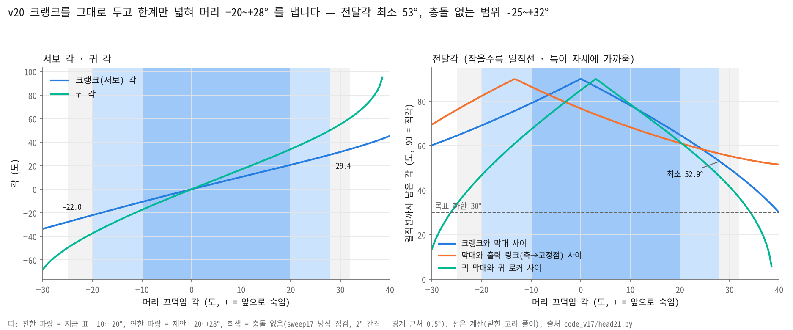

# 머리 끄덕임 크랭크 v21 — 링크는 그대로, 한계만 −20 ~ +28° 로

작성 2026-11-26 (KST). 계산 · 그림 `code_v17/head21.py`, 충돌 점검 `head21.py --sweep`(`sweep_head21.json`), 관절 표만 바꾼 모델 `code_v17/build21_head.py`.
출처 표시: **계산** = head21.py 닫힌 고리 풀이 · 가상일, **점검** = sweep17 방식 점 표본 충돌 검사(간격 0.6 mm, 겹침 0.05 mm 이상), **e-manual** = ROBOTIS XL430-W250 문서, **추정** = 가정이 들어간 값.

## 결론

1. **v20 크랭크 링크는 지금 모양 그대로 머리 −20 ~ +28° 를 낼 수 있습니다.** 크랭크 반지름 14 mm, 몸통 고정점 (−14.75, 345), 막대 38.45 mm 를 바꿀 필요가 없습니다(계산 · 점검).
2. 지금 −10 ~ +20° 는 링크 한계가 아니라 v14 때 관절 표에 적은 값입니다(`build14.py` 597줄). 링크 고리는 −30 ~ +40° 에서도 풀리고, 토글(일직선) 자세는 +46° 너머에야 옵니다(계산).
3. 실제로 먼저 닿는 것은 **머리 껍데기와 몸통 덮개(`lid`)** 입니다. −25.5° 에서 머리 뒤쪽, +32.5° 에서 머리 앞쪽이 닿습니다(점검). 그래서 충돌 없는 범위는 **−25 ~ +32°**, 목표 끝까지 남는 여유는 −쪽 5°, +쪽 4° 입니다. v19 범위 표의 −25.8 / +33.0 과 맞습니다.
4. 새로 걸리는 곳은 **팔 하나**입니다. 머리를 −20° 로 젖히고 팔을 +120° 로 들면 손이 머리 뒤에 닿고, 머리를 +28° 로 숙이고 팔을 −120° 로 들면 손이 머리 앞에 닿습니다(점검). 팔을 ±115° 안에 두면 머리 범위 전체에서 닿지 않습니다. 귀는 팔과 닿지 않았습니다.
5. 일부러 크랭크를 바꾼 안(반지름 17 mm 등)은 전달각이 53° → 67° 로 좋아지지만, 같은 머리 토크에 서보 토크가 1.2–2 배 들고 고정점이 머리 바닥에 4 mm 쯤 가까워집니다. 그래서 채택하지 않았습니다(아래 「다른 안」).



그림 제목: **v20 크랭크를 그대로 두고 한계만 넓혀 머리 −20 ~ +28° 를 냅니다. 전달각 최소 53°, 충돌 없는 범위 −25 ~ +32°.** 왼쪽은 머리 각에 따른 서보 각과 귀 각입니다. 오른쪽은 세 전달각입니다. 전달각은 일직선 자세까지 남은 각이고, 90° 는 직각, 0° 는 일직선입니다. 선은 계산값이고, 회색 띠는 점검(2° 간격, 경계 근처 0.5° 간격)에서 나온 충돌 없는 범위입니다.

## 전후 표

| 항목 | v20 (지금 표) | v21 제안 | 출처 |
|---|---|---|---|
| 머리 끄덕임 관절 범위 | −10 ~ +20° | **−20 ~ +28°** | 소유자 목표 |
| 크랭크 반지름 `NOD_R` | 14 mm | 14 mm (그대로) | — |
| 크랭크 중심 `NOD_S` | (−28.75, 383.45) | 그대로 (서보 자리 그대로) | — |
| 몸통 고정점 `NOD_A` | (−14.75, 345) | 그대로 | — |
| 막대 길이 | 38.45 mm | 그대로 | 계산 |
| 끄덕임 축 `ZT9` | 348.5 | 그대로 | build20 에서 import 해 확인 |
| 크랭크(서보) 각 | −10.8 ~ +20.7° | **−22.0 ~ +29.4°** (폭 51.4°) | 계산 |
| 귀 각 | −17.5 ~ +34.0° | **−37.5 ~ +50.3°** (표 한계 ±60° 안) | 계산 · 점검 |
| 전달각 최소: 크랭크와 막대 사이 | 64.8° | **52.9°** (+28° 끝) | 계산 |
| 전달각 최소: 막대와 출력 링크(끄덕임 축→고정점) 사이 | 61.1° | **56.4°** (+28° 끝) | 계산 |
| 전달각 최소: 귀 막대와 귀 로커 사이 | 61.6° | **46.1°** (+28° 끝) | 계산 |
| 머리 각 / 크랭크 각 비 | 0.91 – 0.97 | 0.87 – 0.97 | 계산 |
| 서보가 버티는 정지 토크 (머리 + 귀 무게) | 0.143 N·m (+20°), 정지토크의 10.2 % | **0.179 N·m (+28°), 12.8 %** · −20° 에서 0.116 N·m, 8.3 % | 계산(질량 `out20/link_mass_v20.csv`), 정지토크 1.4 N·m 는 e-manual |
| 1 Hz 로 −20 ~ +28° 끄덕일 때 끝점 토크 | — | **0.262 N·m (+28°), 18.7 %** · −20° 에서 0.198 N·m, 14.2 % | 추정(사인 운동 가정, 관성 0.0057 kg·m²) |
| 머리 · 링크 충돌 (머리, 크랭크, 막대, 귀, 귀 막대 ↔ 몸통 · 머리) | 없음 | **없음, −25 ~ +32° 까지** | 점검 |
| 팔 ↔ 머리 · 귀 | ±120° 에서 없음 (머리 −10, +20 만 확인) | 팔 ±115° 면 없음, ±120° 는 끝에서 닿음 | 점검 |

크랭크 각 범위 51.4° 는 XL430 이 위치 제어 모드에서 도는 360°(0–4095 눈금, e-manual) 안에 넉넉히 들어갑니다.

## 여유 거리 (계산, 머리 −20 ~ +28° 전체에서 가장 작은 값)

| 사이 | 최소 여유 |
|---|---|
| 몸통 고정점 팔(요크)과 막대 끝 ↔ 머리 바닥 아랫면 | 8.5 mm |
| 막대 ↔ 머리 바닥 막대 구멍 뒤 끝(x −30) | 11.1 mm |
| 막대 ↔ 막대 구멍 앞 끝(x 4) | 15.0 mm |
| 크랭크 핀 둘레(반지름 4) ↔ 서보 받침 윗면 | 3.4 mm |
| 막대 끝(반지름 3.5) ↔ 머리 바닥 윗면 | 6.9 mm |

막대 구멍은 지금 크기로 충분해서 머리 바닥도 바꿀 필요가 없습니다.

## 팔과 머리가 함께 움직일 때 (점검, 팔 5° 간격 · 머리 4° 간격)

| 머리 각 | 팔이 닿지 않는 범위 (양팔 같음) | 처음 닿는 곳 |
|---|---|---|
| −20° | −150 ~ +115° | +120° 에서 손 ↔ 머리 뒤 |
| −16° | −145 ~ +115° | +120° 에서 손 ↔ 머리 뒤 |
| −12° | −145 ~ +120° | |
| 0° | −135 ~ +130° | |
| +24° | −120 ~ +145° | |
| +28° | −115 ~ +150° | −120° 에서 손 ↔ 머리 앞 |

머리 −16° 보다 더 젖힐 때 팔 +120° 가 막히고, +28° 끝에서 팔 −120° 가 막힙니다. 고르는 길은 두 가지입니다. ① 팔 관절 표를 ±115° 로 줄입니다(가장 간단, 팔 5° 손해). ② 팔 ±120° 는 그대로 두고 소프트웨어에서 「머리 < −12° 면 팔 ≤ +115°, 머리 > +24° 면 팔 ≥ −115°」 를 겁니다. 손이나 머리를 깎는 길도 있지만 외형이 바뀝니다. 추천은 ① 입니다.

## 다른 안 (계산, 채택 안 함)

크랭크 반지름 10–18 mm, 고정점 x −40 ~ +5, z 343.5 ~ 352 를 1 mm · 0.5 mm 간격으로 훑었습니다. 조건은 −20 ~ +28° 전체에서 고리가 풀리고 한 방향으로만 움직이며, 고정점 팔이 머리 바닥에서 1 mm 이상 떨어지는 것입니다. 2732 개가 통과했습니다. 전달각이 큰 순서로 위 다섯 개입니다.

| 크랭크 반지름 | 고정점 (x, z) | 막대 | 전달각 최소 | 크랭크 각 | 머리 각 / 크랭크 각 최대 | 고정점 ↔ 머리 바닥 |
|---|---|---|---|---|---|---|
| **14 (지금)** | **(−14.75, 345)** | **38.45** | **52.9°** | **−22.0 ~ +29.4°** | **0.97** | **8.5 mm** |
| 17 | (−11, 348.5) | 34.96 | 66.7° | −12.6 ~ +18.1° | 1.65 | 6.5 mm |
| 17 | (−14, 349.5) | 34.02 | 66.5° | −16.4 ~ +22.9° | 1.26 | 4.5 mm |
| 17 | (−9, 348) | 35.56 | 66.3° | −10.3 ~ +14.9° | 2.02 | 7.7 mm |
| 18 | (−10, 348.5) | 34.96 | 66.2° | −10.8 ~ +15.4° | 1.93 | 6.8 mm |
| 18 | (−13, 349.5) | 34.02 | 66.2° | −14.3 ~ +20.0° | 1.45 | 4.9 mm |

채택하지 않은 이유는 셋입니다.
- 목표 30° 는 지금 링크로도 넘깁니다(52.9°).
- 다른 안은 크랭크가 덜 돌아 같은 머리 토크에 서보 토크가 1.2–2 배 듭니다.
- 고정점이 머리 바닥에 가까워집니다. 게다가 이 탐색에는 귀 연동과 충돌 점검이 들어 있지 않습니다. 크랭크 · 막대 · 요크 부품을 다시 뽑아야 하는 비용도 있습니다.

## build21_head.py 와 STEP

`build21_head.py` 는 `build20` 을 그대로 상속하고 관절 표만 바꿉니다. 머리 끄덕임 −20 ~ +28°, 크랭크 −22.0 ~ +29.4°, 귀 −37.5 ~ +50.3° 입니다. 부품 모양이 v20 과 같아서 머리 부품 STEP 은 따로 내보내지 않았습니다. 내보내도 `out20/biped_robot_v20.stp` 의 머리 부품과 같습니다.

## 다시 돌리기

```
cd code_v17
../sim/.venv/bin/python head21.py           # 표 · 그림 · head21.json (약 1분 30초, 대부분 다른 안 탐색)
../sim/.venv/bin/python head21.py --sweep   # 충돌 점검 → sweep_head21.json (모델 빌드 2분 + 점검 약 20분)
```

## 남은 것 (이 작업에서 고치지 않음)

- `sim/export_mjcf.py` 는 고리 다항식 맞춤과 `RANGE["head_nod"]` 를 −10 ~ +20° 로 박아 두었습니다. MuJoCo 모델 `kitoru_v20.xml` 을 새 범위로 다시 맞춰야 합니다. 다항식을 −20 ~ +28° 에서 다시 맞추고, 4차 다항식 잔차도 확인해야 합니다.
- `robot/config/joints_v20.yaml` 의 `nod_crank` 소프트 한계는 −70 ~ +40° 입니다. 새 크랭크 범위는 −22.0 ~ +29.4° 이고, 눈금으로는 영점 2048 기준 1797 ~ 2382 입니다(계산).
- `sim/walk/ranges/make_report.py` 50줄 근처는 머리 각을 크랭크 각으로 바꾸지 않고 바로 Dynamixel 눈금으로 옮깁니다. 그래서 v19 표의 1812 / 2367 은 크랭크 기준과 1.5–2° 어긋납니다.
- 귀 각 범위가 문서마다 다릅니다(`키토루_인계_v17.md`, `out18/README_print_assembly_v18.md` 는 −17.5 ~ +34°).
- 머리 케이블 여유가 바뀝니다. README 는 30° 폭에 1–2 cm 라고 적었는데, 새 폭은 48° 라 약 1.6–3.2 cm 가 필요합니다(추정, 비례).
- 팔 ±115° 로 줄일지, 소프트웨어 연동으로 갈지 정해야 합니다(위 표).
- 점검은 점 표본 방식이라 0.6 mm 보다 얇은 틈은 놓칠 수 있습니다. 덮개와 닿는 끝점 근처만 0.5° 간격으로 다시 봤습니다.
