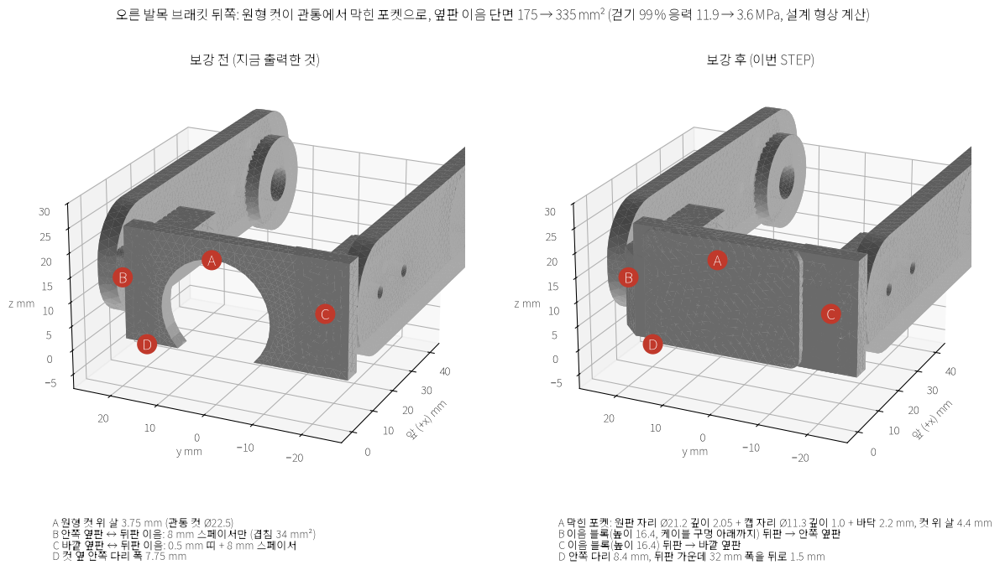

# 오른 다리 출력 · 조립 키트 (v20 안 A, 2026-11-26)

## 2026-11-28 STEP 솔리드 고침

- **무엇이 막혔나:** 다리 10개 부품의 서보 몸체 나사 구멍(Ø2.7, M2.5 태핑) **60개**(다리 하나에 30개)가 STEP · STL 에서 메워져 있었습니다.
  - 부품마다(다리 하나): 고관절 요 브래킷 8 · 허벅지 프레임 8 · 정강이 프레임 6 · 발목 브래킷 4 · 고관절 롤 U 브래킷 4.
  - 모두 서보 칸 입구의 0.5 mm 단(`build20.py` `entry_relief`) 옆에 있는 구멍입니다.
- **왜:** 0.5 mm 단을 따로 떼어 낸 얇은 띠 솔리드가 원래 판의 구멍 목록을 그대로 물려받았습니다. 그런데 그 구멍들은 띠 바깥에 있습니다. STEP 을 읽는 프로그램(OCC)은 띠 밖의 구멍 원을 따로 떨어진 원기둥 솔리드로 만들었고, 그 원기둥이 옆 판의 구멍 안에 놓여 구멍을 메웠습니다. 표시는 「솔리드 수」입니다. 예를 들어 고관절 요 브래킷은 STEP 에 쓴 솔리드가 9개인데 17개로 읽혔습니다.
- **고친 것:**
  - `code_v17/build20.py` `entry_relief`: 띠에는 구멍을 주지 않습니다. 구멍은 원래 판이 그대로 갖습니다.
  - 같은 종류가 다시 생기지 않게 `code_v17/build4.py` `check_profile` 을 넣었습니다. 출력 STEP 을 쓰는 세 곳(`export_parts` · `build21_body` · `arm21`)이 모두 지나는 `build4.write` 가 쓰기 전에 검사합니다.
    - 판 밖의 구멍과 열린 자리 안의 구멍은 뺍니다. 이런 구멍은 아무것도 깎지 않습니다.
    - 구멍이 외곽선에 걸치거나, 외곽선이 스스로 교차하거나, 안쪽 고리가 외곽선을 넘으면 오류로 멈춥니다. 그때는 설계에서 고칩니다.
    - 이 규칙에 걸리는 부품은 이 10개뿐이었습니다. 몸통 · 머리 · 팔 부품에는 판 밖 구멍이 없었습니다 [설계 모델 검사, build20 · build21_body · build21_arm].
- **고친 뒤** [STEP 을 gmsh 로 잼, `print_tests/tools/step_audit.py`, 결과 `print_parts/STEP_AUDIT.md`]: 읽힌 솔리드 수가 쓴 수와 같습니다.

  | 부품 (좌우 같음) | 쓴 솔리드 → 읽힌 솔리드, 전 | 후 | 합친 부피 cm³, 전 → 후 |
  |---|---|---|---|
  | 고관절 요 브래킷 | 9 → 17 | 9 → 9 | 22.88 → 22.73 |
  | 허벅지 프레임 | 27 → 35 | 27 → 27 | 37.08 → 36.97 |
  | 정강이 프레임 | 33 → 39 | 33 → 33 | 34.09 → 34.02 |
  | 발목 브래킷 | 25 → 29 | 25 → 25 | 33.72 → 33.26 (아래 무릎 고침 포함) |
  | 고관절 롤 U 브래킷 | 13 → 17 | 13 → 13 | 30.52 → 30.40 |

  - 합친 부피가 준 것이 다시 뚫린 구멍입니다.
  - `parts.json` 부피는 전에는 띠 밖의 구멍까지 빼서 셌습니다. 그래서 0.1–0.2 cm³ 늘었습니다.
- **이미 뽑은 다리 부품:** 막힌 구멍 자리를 **드릴 Ø2.8** 로 뚫으면 됩니다(드릴 표의 몸체 구멍과 같습니다).
  - 자리는 새 STL 의 구멍 자리입니다.
  - 메운 원기둥이 판 바깥 면부터 칸 쪽 0.5 mm 앞까지만 차 있었으니, 칸 안쪽 면에 얕은 구멍 자국이 남아 있을 수 있습니다 [설계 형상에서 추정].
- **무릎 처음 닿는 각 되돌림:**
  - 원인: 서포트 없애기(220db8f)에서 발목 브래킷 안쪽 귀 기둥 밑에 넣은 기둥이 서보 뒤로 나와 있었습니다. 무릎을 끝까지 굽히면 고관절 롤 브래킷과 고관절 피치 서보가 그 기둥에 먼저 닿았습니다.
  - 고친 것: 기둥의 서보 쪽 면을 다리 가운데에서 14.5 → 17.4 mm 로 옮겼습니다(`build20.py` `NS_COL_CASE`). 고관절 피치 서보 면(23.0)과 0.4 mm 떨어집니다.
  - 귀 기둥 밑면에 받침 없이 남는 띠는 2.9 mm 입니다. 한쪽이 붙은 턱 3 mm 규칙 안이라 서포트가 다시 생기지 않습니다. 발목 브래킷 서포트는 **19 mm² 그대로**입니다 [복셀 검사, `parts.json`].

  | 무릎 처음 닿는 각 (고관절 피치) | 220db8f 전 | 220db8f 뒤 (고치기 전) | 고친 뒤 |
  |---|---|---|---|
  | −117° | 113.84° | 112.5° (롤 브래킷 ↔ 발목 브래킷) | **113.84°** (롤 브래킷 ↔ 발목 롤 서보) |
  | −110° | 112.12° | 111.81° | **112.12°** |
  | −60° | 109.72° | 108.69° | **109.72°** |
  | −115 · −112 · −105 · −100 · −90 · −80 · −70 · −50 · −40° | 113.12 · 112.19 · 113.41 · 111.97 · 108.94 · 109.84 · 110.16 · 109.47 · 112.94° | — | 모두 같음 |

  [정적 훑기: `sim/tests/shape_contact_v22.py` 의 훑기 함수, 220db8f~1 사본과 고친 뒤를 같은 스크립트로. json 은 덮어쓰지 않음]
- **나머지 범위(고친 뒤, 같은 훑기):**
  - 발목 피치 위 +30° 쪽 첫 닿음 +29.62° · 아래 −76.41°(롤 0), 롤 ±20 에서 +26.38 / −52.03°
  - 무릎 117.59°(고관절 0°)
  - 고관절 피치 −117.56 / +114.53°
  - 고관절 롤 바깥 −7.19°

  모두 고치기 전과 같습니다. 무릎(고관절 +60°) 74.03 → 74.0° 은 220db8f 의 다른 추가분(반바지 ↔ 발목 브래킷)에서 온 것이고, 이번 고침 전과 같습니다. 고관절 요는 기둥을 줄이기만 해서 줄 수 없습니다.
- `exact_check4 build20`: 링크 사이 간섭 0, 링크 안 체결 문제 0(전 · 후 같음).

## 2026-11-28 서포트 없애기

소유자: 「서포트랑 겹쳐서 이음매 부분이 약하면 서포트 떼어내다가 부러지는 경우가 많다」. 출력 방향은 그대로입니다(발목 브래킷은 뒤판을 판에, 위 = +x). 코드 `code_v17/build20.py` `no_support`. **다시 쓴 STEP 은 `R_ankle_bracket` · `L_ankle_bracket` 둘**이고 다른 다리 STEP 은 그대로입니다.

| 자리 (발목 브래킷, 좌우 같음) | 무엇이 떠 있었나 | 고친 방법 [설계 형상] | 서포트 전 → 후 [복셀 검사] |
|---|---|---|---|
| 뒤판 바닥 안쪽 가장자리 (옆판 ↔ 바닥 이음 옆) | 판에 닿는 1.5 mm 덧판이 다리 가운데서 16 mm 에서 끝나, 바로 위층 뒤판이 안쪽으로 3 mm 떠 있음 | 덧판 끝에서 안쪽 45° 모서리 깎임 면까지 판 위에 쐐기(뒤판 높이 23 mm 전체). 깎임 면을 1.5 mm 뒤로 이어 그은 것이라 바깥 모양 선은 그대로 | 65 → **0** mm² |
| 안쪽 옆판 뒤 끝 밑 (x −68) | 옆판(두께 4)의 뒤 끝이 연결대 · 뒤판 위에 서보 쪽 면으로만 얹혀 4 mm 턱 | 판(x −73.5)부터 옆판 뒤 끝까지 채움. 바깥 면은 **옆판 뒤 모서리를 지나는 45° 선** — 그 모서리가 이미 그 선까지 나와 있어 고관절 요 첫 닿음이 그대로입니다(아래 표). 옆판의 평평한 뒤 끝 ± 3.5 mm(높이 10 mm)만 채웠습니다. 그 밖은 r 10 둥근 모서리가 45° 보다 가파르게 올라갑니다 | 26 → **0** |
| 안쪽 귀 기둥 밑 (뒤판 위, x −68) | 귀를 받치는 기둥이 깎임 면 위에서 칼날로 공중에서 시작 | 서보 뒤(x ≤ −68)에 판부터 기둥 끝까지 기둥 하나(서보 쪽 면은 다리 가운데서 14.5 mm, 케이스 옆면 14.25). 케이스 케이블 구멍은 x −68 앞이라 막지 않습니다. 스페이서 뒤로 올라가는 틈(x −68…−62.5)도 열려 있습니다. **바뀐 것:** 안쪽에서 서보 뒤 · 뒤판 위로 케이블을 뒤로 돌리던 길(다리 가운데서 14.5–23 mm, z −30.6…−12.6)은 이 기둥이 막습니다 | 11 → **0** |
| 스페이서 V 끝 (귀 ↔ 서보, 안 · 바깥) | 45° V 끝 선 8.4 mm 가 서보 ↔ 옆판 틈을 가로지름 | **남김.** 받치면 서보 ↔ 옆판 틈(케이블 길)이 막힙니다. 면이 아니라 선이고, 이음이 아닙니다(나사 구멍은 끝에서 5.5 mm 앞). 슬라이서가 받침을 붙이면 V 끝 선만 다듬으면 됩니다 | 19 → 19 |
| 합계 (브래킷 하나) | | | **121 → 19** |

- **허벅지(L) · 정강이(R) 16 mm² 는 케이블 터널이 아닙니다.** 혼 받침(지름 20.5, 옆판 안쪽으로 2.2 mm)의 원호 끝입니다. 받침과 옆판이 겹침 없이 한 면(옆판 안쪽 면)에서 맞닿아, 1 mm 복셀 중심이 그 면에 걸려 한 줄이 비어 읽힙니다. 거울 짝(R 허벅지 · L 정강이)은 0 입니다 [복셀 검사, 층 단면 확인]. 실제는 옆판에서 2.2 mm 나온 턱이라 검사 규칙(한쪽만 붙은 턱 3 mm 까지 받침 없음) 안입니다. 다만 슬라이서를 45° 기준으로 두면 네 프레임 모두 이 혼 받침 원호 밑(허벅지는 판에서 0.8 mm 위)에 작은 받침을 붙일 수 있습니다 [추정, STL 아래 향한 면 훑기]. 받침이 닿는 곳은 원호 가장자리이고 혼이 앉는 면은 아닙니다. 혼 자리라 손대지 않았습니다.
- **관절 범위** [정적 훑기: 오른 다리, 0 mm 여유, 1° 간격(요 0.5°), 11-28 출력 보강 절과 같은 스크립트 + 고관절 요(오른 다리를 돌리고 왼 다리 고정)를 더함. 전 · 후 같은 스크립트]

| 관절 | 전 | 후 |
|---|---|---|
| **발목 피치 위** (롤 0 / ±20) | **+30 / +27°** | **+30 / +27°** (정강이 프레임 ↔ 발판) |
| 발목 피치 아래 (롤 0 / ±20) | −75 / −49° | −75 / −49° |
| 발목 롤 | +27 / −32° | +27 / −32° |
| 무릎 | 118° | 118° |
| 고관절 피치 | +115 / −118° | +115 / −118° |
| 고관절 롤 안쪽 (한 다리) | 6° | 6° |
| 고관절 요 (오른 다리) | +55.5 / −25.5° | +55.5 / −25.5° (발목 브래킷끼리) |

  처음 닿는 각 뒤에서 바뀐 것 하나: 무릎 125° 에서 발목 브래킷 ↔ 고관절 피치 아이들러(전 132°). 무릎 첫 닿음 118° · 학습 한계 115.5° 보다 뒤라 영향 없습니다. 고관절 요 −25.5° 뒤의 발목 브래킷 ↔ 왼 발목 롤 서보도 −48 → −44° 로 당겨졌지만 첫 닿음 뒤입니다(요 한계 ±20°). `exact_check4 build20` 링크 사이 간섭 0, 링크 안 체결 문제 0. 새 재료를 같은 링크의 서보 · 아이들러 · 나사와 0.3 mm 점으로 대 보아 겹침 0 [설계 solid 점 검사].
- **부피 · 무게:** 발목 브래킷 하나 +0.87 cm³ [복셀 0.25 mm 로 합집합 부피, `parts.json` 부피 합은 35.0 → 35.9], 꽉 찬 PLA 로 +1.1 g, 두 다리 +2.2 g [계산, 밀도 1.24]. 부품당 5 g 아래라 시뮬 모델 v22 는 다시 내보내지 않았습니다.
- **강도:** 재료를 더하기만 했습니다(뺀 곳 없음). 서보 칸 · 나사 구멍 · 혼 · 아이들러 자리 · 11-28 보강은 그대로입니다.

## 2026-11-28 조립 뒤 범위 확인 (일어나기 학습이 범위 끝까지 씀)

시뮬 일어나기(kitoru-rl, 모델 v22)는 아래 각까지 씁니다. 출력 오차(±0.4 mm)로 실물이 더 일찍 닿을 수 있으니, 조립 뒤 서보 토크를 끄고 손으로 돌려 확인합니다. 닿으면 닿는 자리를 줄 · 사포로 갈아 냅니다(다시 뽑지 않음).

| 관절 | 학습 한계 | 형상에서 처음 닿는 각 | 닿는 부품 | 확인 |
|---|---|---|---|---|
| 고관절 피치 | −115.5 / +111.5° | −117.6 / +114.5° | 허벅지 셸 ↔ 반바지 | 학습 한계까지 안 닿으면 됨 |
| 무릎 | 115.5° | 117.6°(고관절 0°), 113.8°(고관절 −117°) | 허벅지 프레임 ↔ 정강이 프레임 | 고관절을 앞으로 다 올린 채 무릎 113° 까지 |
| 발목 피치 위 | **+30°(여유 없음)** | +29.6 ~ +30° | 정강이 프레임 아래 ↔ 발판 | **+30° 전에 닿으면 정강이 프레임 아래 모서리를 갈아 +31° 까지 비게** |
| 발목 피치 아래 | −75° | −76.4° | 정강이 셸 ↔ 발판 | |

- 학습 한계는 형상값보다 1.5° 좁혔습니다(출력 오차 0.8 mm ÷ 닿는 점 30–50 mm [추정]). 발목 피치 위쪽만 1.5° 좁히면 일어나기가 시드 1 에서 99.7 → 75.5 % 로 떨어져 형상값 +30° 를 그대로 씁니다 [시뮬 실측, kitoru-rl 시험 22 · 23].
- 잰 각은 `robot/config/joints_v20.yaml` 서보 한계와 모델 범위에 다시 넣습니다.

## 2026-11-28 발판 혼 판 · 발목 롤 나사 8개 · 출력 보강

코드 `code_v17/build20.py` `print_robust`(조립 내구성 다음 단계). 다리 STEP 12개를 다시 썼습니다: 좌우 발판, 발목 브래킷, 허벅지 프레임, 정강이 프레임, 고관절 요 브래킷, 고관절 롤 U 브래킷. 셸 4개는 그대로입니다. STL 16개는 030012b 에서 새 판으로 바꿨습니다(열린 모서리 0).

**발판은 채움 100 % 로 뽑으세요.** 혼 나사 자리(맨 아래 혼 나사 ~ 혼 가운데)는 더 붙일 자리가 없어 걷기 5.5–13 MPa(위 한계)로 목표 5 MPa 를 못 맞췄습니다. 채움 100 % 면 10.6 MPa(위 한계, 실제 몫 30–75 % 로 보면 3–8) [계산]. 금이 가면 혼 판을 따로 뽑아 나사로 붙이는 판으로 바꿉니다.

**바꾼 것**
- **발판 혼 판:** 판 앞에 덩어리를 붙였습니다(발판 윗면부터 발목 축 3 mm 아래까지, 폭 ±14). 앞면은 정강이가 비켜 주는 만큼만 나옵니다: 발목 롤 −22…+22° 와 발목 피치 −52…+31° 를 모두 돌려 봐도 정강이 벽 · 발목 피치 서보 · 정강이 케이블 터널과 0.4 mm 이상 떨어지게 점마다 계산했습니다. 혼 판 뒤에는 혼 원판을 둘러싸는 고리(원판과 0.4, 롤 서보 앞면과 0.4)를 붙였습니다. 혼 나사 자리 높이에는 양옆 날개(폭 14 → 17.5, 밑면 45°)와 앞 덧판 1.5 mm 를 더했습니다. 판 가운데 구멍은 허브가 들어오는 깊이만 남기고 앞 2 mm 를 막았습니다(허브 끝과 0.7 mm). 맨 아래 혼 나사 앞은 폭 8 홈으로 비워 드라이버가 들어갑니다. 옆 혼 나사 앞은 덩어리 위로 열려 있습니다.
- **발목 롤 몸체 나사 4 → 8:** 롤 서보 케이스 옆면의 위쪽 줄 구멍(1 · 2 · 11 · 12, 아래 줄보다 24 mm 위)을 씁니다. 브래킷 옆판을 그 줄 위 4.5 mm 까지 올렸고(귀), 귀와 서보 사이에 스페이서(밑이 V 자라 +x 로 받침 없이 출력)를 넣었습니다. 귀 밑은 옆판 띠 안에서만 기둥으로 받쳤습니다. 서보와 옆판 사이 케이블 길은 비워 두었습니다. 귀 앞에서 피치 혼 판 앞까지는 옆판을 발목 축 위 22 mm 까지 올렸습니다(브래킷이 약하던 축이 이 높이 방향이었습니다).
- **케이블 터널(허벅지 · 정강이 뒤):** 타이 구멍 3.0 × 1.5 는 그대로입니다. 바깥 막대 2.0 → 3.0, 구멍 위아래 살 1.5 → 3.0 으로 했습니다. 출력할 때 아래가 되는 쪽은 45° 밑면입니다.
- **눈물방울 구멍:** 출력 방향에서 옆으로 누운 구멍을 모두 위쪽이 뾰족한 눈물방울로 바꿨습니다. 끝이 다른 구멍이나 가장자리와 0.8 mm 안으로 가까워지는 곳은 끝을 평평하게 잘랐습니다. 오른 다리 기준(층마다 셈) 눈물방울 108 · 끝 평평 36 · 둥근 채 48 입니다. 둥근 채 남은 것은 거의 모두 구멍이 가장자리에 걸친 얇은 층입니다(서보 칸 입구 0.5 mm 단, 혼 판 카운터보어 띠). 고관절 롤 U 브래킷은 출력 방향을 +z 로 고정했습니다(전과 같음).
- **모서리:** 새로 붙인 이음은 모두 0.05 mm 이상 겹치게 했습니다. 기존 판 이음의 필렛 ≥ 1 은 **남음**입니다(위 상자 필렛 3 × 3 만 있음).

**응력 전 · 후** [계산: 설계 solid 를 출력 층 면으로 자른 단면(발판은 z 면, 브래킷은 x 면), 0.1 mm 격자, 면 양쪽에 재료가 있는 곳만 셈. 벽 1.2 mm 는 꽉 참, 안쪽은 채움 20 %. 두 굽힘 축 중 약한 쪽. 모멘트는 발목 피치 · 롤 중 큰 값(`sim/robust/results/strength_v20A.json`): 걷기 99 % 1.75 N·m, 모든 시험 최대 4.1 N·m. 이음 보강 절과 같은 방법이고, 그 절의 세 단면 값을 그대로 다시 냈습니다]

| 자리 | 걷기 99 % MPa 전 → 후 | 모든 시험 최대 MPa 전 → 후 |
|---|---|---|
| 발판 · 맨 아래 혼 나사보다 아래(z −64…−54, 1 mm 마다 훑은 최댓값) | 12.0 → **4.7** | 28.0 → **10.9** |
| (이음 보강 절의 세 단면 z −62.13 / −56 / −54) | 5.1 / 10.1 / 10.7 → 2.6 / 4.1 / 4.7 | 12.1 / 23.7 / 25.1 → 6.1 / 9.5 / 10.9 |
| 발판 · 혼 나사 자리(z −53.5…−45, 혼 가운데 높이까지) | 8.3–66 → **5.5–13.0** | 최대 155 → **30.5** |
| 발목 브래킷 · x −66…+4 전체에서 최댓값 | 3.4 → **2.6** | 7.9 → **6.1** |
| (옆판만 있는 구간 x −41…−11) | 3.4 → 2.0 | 7.9 → 4.8 |

- 발판의 **혼 나사 자리**(맨 아래 혼 나사부터 혼 가운데까지)는 이전 계산에 들어가지 않았던 곳입니다. 훑어 보니 여기가 가장 약했습니다(전 걷기 66 MPa). 표의 값은 이 단면에 모멘트가 전부 걸린다고 본 위 한계입니다. 실제로는 혼 나사 · 원판이 나눠 받아 30–75 % 쯤 걸린다고 봅니다 [추정: 피벗 위치에 따른 나사 힘 비례 계산]. 그러면 걷기 4–10 MPa 입니다.
- 걷기 5 MPa 목표: 혼 나사 아래는 맞췄습니다. 혼 나사 자리는 못 맞췄습니다. 앞은 정강이(롤 · 피치를 함께 돌렸을 때), 뒤는 혼 원판, 옆은 발목 브래킷 옆판(롤 32° 에서)에 막혀 더 넣을 자리가 없습니다. 발판을 채움 100 % 로 뽑으면 혼 나사 자리 13.0 → 10.6, 혼 나사 아래 4.7 → 3.1 입니다 [계산, 같은 방법에서 채움만 1.0].

**발목 롤 몸체 나사 수** [설계 solid 점 검사: 구멍 축을 따라 막힘이 없고 둘레 r 2.2 에 브래킷 재료가 3 mm 이상 있는 구멍만 셈]: 좌우 각각 **4(3 · 4 · 13 · 14) → 8(1 · 2 · 3 · 4 · 11 · 12 · 13 · 14)**. 새 4개도 M2.5 × 16 입니다(옆판 4 + 스페이서 8.4 + 틈 0.35, 케이스 안 물림 약 3.25 mm, 4 mm 이하).

**바뀐 구매품:** M2.5 × 16 태핑 나사 다리 하나 +4, 두 다리 +8. 구매 목록 2절의 수량이 다리 하나 기준인지 두 다리 기준인지는 앞 절들 표기가 엇갈려 이번에 고치지 않았습니다(목록 `BUY_LIST_v20.md` 손볼 때 확인). 드릴 표는 같습니다(새 몸체 구멍 2.7 → 드릴 2.8).

**조립 순서에서 바뀐 것:** 1번(발목 롤 서보 → 브래킷)에서 나사 8개를 씁니다. 위 4개는 귀 바깥에서 넣습니다. 서보는 전처럼 앞(+x)에서 위 · 아래 스페이서 사이로 밀어 넣습니다.

**관절 범위** [정적 훑기: 오른 다리, 0 mm 여유, 1° 간격, 전 · 후 같은 스크립트. 새 나사 머리는 지름 5 × 2 mm 로 넣음]
- 처음 닿는 각은 모두 그대로입니다. 발목 피치 +30°(롤 0) · +27°(롤 ±20) · −75°(롤 0), 발목 롤 +27 / −32°, 무릎 118°, 고관절 피치 +115 / −118°, 고관절 롤 안쪽(한 다리) 6°.
- 새 부품이 닿는 각(처음 닿는 각 뒤): 브래킷 ↔ 정강이 프레임 +32°, 새 나사 머리 ↔ 정강이 셸 +34°, 브래킷 귀 ↔ 허벅지 프레임 무릎 120°(무릎 한계 100°).
- **원래 있던 문제(이번에 안 바뀜):** 발목 롤 ±20° 에서 발목 피치 −49° 면 발판이 정강이 프레임에 닿습니다. joints.csv 피치 한계 −50° 안쪽입니다.
- 고관절 요 훑기는 이번에 다시 돌리지 않았습니다. 브래킷 귀는 옛 옆판의 평면 자리 안이고, 안쪽 기둥은 옛 45° 모서리 깎임 안입니다. 바깥 기둥만 바깥 옆판 띠에서 뒤로 1.5 mm(x −73.5, 뒤판 가운데와 같은 끝) 나옵니다 — 다른 다리 쪽이 아니라 영향은 작다고 봅니다 [추정].

**검사:** `exact_check4 build20` 링크 사이 간섭 0, 링크 안 체결 문제 0. 출력 크기 · 받침 [`export_parts` 복셀 검사]: 발판 134×70×41(받침 0), 발목 브래킷 54×25×86 → **54×43×86**(받침 324 → **121** mm², 귀 밑 기둥이 뒤판 받침 일부를 대신함), 허벅지 · 정강이 프레임 43 → 44 mm(터널), 받침 전과 같음(허벅지 0 / 16, 정강이 16 / 0). 가장 큰 다리 부품 134×70×41 로 220 판 안입니다.

**무게:** 한 다리 부피 +14.4 cm³(발판 +5.5, 발목 브래킷 +8.8, 프레임 +0.1 씩, U 브래킷 −0.1) [`parts.json`], 꽉 채운 PLA 로 한 다리 +18 g 이하, 두 다리 +36 g 이하 [추정, 밀도 1.24].

**남은 것:** ① 발판 혼 나사 자리는 걷기 위 한계 13 MPa 입니다(혼 나사 아래는 4.7). 더 낮추려면 발판 출력 방향을 바꾸거나(옆으로 눕히면 층 사이 힘이 없어지지만 혼 판 · 덩어리 밑에 받침이 약 300 mm² 생김), 혼 판을 따로 뽑아 나사로 붙이는 방법이 있습니다. 소유자 결정입니다. ② 기존 판 이음 필렛 ≥ 1 ③ STL 다시 변환 · PNG · 범위 sweep(메인) ④ 둥근 채 남은 가장자리 걸친 구멍은 출력 뒤 드릴로 맞춥니다.

## 2026-11-27 조립 내구성 (뽑아 본 부품이 이음 · 조립에서 부러짐)

**설계 기준 — 「프린터 해상도가 매우 떨어진다고 가정」 (소유자 2026-11-27)**
- 치수 오차 ±0.4 mm, 층 0.3 mm, 노즐 0.4 mm 선이 뭉개진다고 봅니다.
- 미끄럼 · 끼움 틈은 한쪽 0.4 mm 이상. 서보 칸은 지금 틈(한쪽 0.35–0.425)을 두고 몸체 나사로 잡습니다.
- 정밀도에 기대는 형상은 쓰지 않습니다 — 걸림 깊이 0.6–0.8 짜리 스냅 걸쇠, 0.1–0.3 mm 턱 · 홈, 작은 압입. 대신 나사 · 접착.
- 가장 작은 형상(돌기 · 살 · 핀 · 슬롯 폭)은 3 mm 이상, 벽은 2 mm 이상(구조 부품 2.4–3).
- 나사 구멍은 작게 나온다고 보고, 출력 뒤 드릴로 맞춥니다(아래 드릴 표).
- 글자 · 얇은 장식은 넣지 않고, 모서리는 둥글게(0.5 mm 이하 필렛 · 날카로운 모서리 없음).
- 이번에 스펙의 앞 기준(스냅이면 휨 변형률 1.5 % 이하, 끼움 틈 0.15–0.25)은 위 기준으로 바뀌어, 스냅은 모두 없애고 틈은 0.4 로 했습니다.

코드는 `code_v17/build20.py` `assembly_durability`, 다리 STEP 12개(좌우 허벅지 · 정강이 프레임, 허벅지 · 정강이 셸, 고관절 요 브래킷, 발목 브래킷)를 다시 썼습니다. 롤 U 브래킷 · 발판은 그대로입니다. **STL 은 아직 옛 판입니다.**

### 조립할 때 힘을 받는 자리 (다리 한쪽, 모두 [설계 형상])

| # | 부품 · 자리 | 전 | 왜 부러지나 | 후 |
|---|---|---|---|---|
| 1 | 허벅지 셸 · 정강이 셸의 **빔 걸쇠**(셸 안쪽 앞판) | 팔 길이 14, 두께 1.2, 폭 4.8, 걸림 1.15 mm. 휨 변형률 1.5 × 1.2 × 1.15 / 14² = **1.06 %** | 변형률은 1.5 % 아래지만 **두께가 1.6 미만(벽 선 3줄)** 이고, 셸을 +z 로 세워 뽑아 팔 뿌리의 굽힘이 **층 사이를 벌리는 방향**. 끼울 때 한 번에 갈라짐 | **없앰 → M2.5 태핑 나사 2개**(셸 하나당). 셸 앞판에 Ø3.0 눈물방울 구멍, 프레임 앞면에 보스 Ø7(셸 안쪽 면과 0.4 틈) + 파일럿 Ø2.2 깊이 6.45(보스 + 앞벽 관통) |
| 2 | 셸 걸쇠 받침(셸의 두 다리 1.8 × 3 × 4, 프레임 받침대 10 × 3 × 4) | 받침 다리 1.8 mm | 가는 돌기, 옆 틈 0.25 에 기대 위치를 잡음 | **없앰**(나사 둘이 위치를 잡음) |
| 3 | 프레임 앞벽 걸쇠 홈(무릎 · 발목 피치 서보 몸체 나사 구멍 옆) | 홈 5.2 × 3.4, 깊이 2 → 나사 구멍 둘레 살 2.0 | 홈 때문에 몸체 나사 구멍 옆이 얇음 | **메움**(앞벽 3.85 꽉 참) |
| 4 | 허벅지 · 정강이 뒤 **케이블 갈고리** | 열린 J 갈고리: 기둥 1.5, 입구 턱 0.8, 입구 1.2(케이블 1.5 를 눌러 넣음) | 출력 스냅과 같음 — 턱 0.8 이 눌러 넣을 때 부러짐 | **닫힌 케이블 타이 터널**(3.0 × 1.5, 막대 2.0, 위 · 아래 1.5) — 케이블을 타이로 묶음. 같은 자리 · 같은 크기 안 |
| 5 | 고관절 요 허브 ↔ 6805 베어링 안지름 | 허브 반지름 12.4(한쪽 0.1) | ±0.4 오차면 사실상 압입 — 억지로 밀면 허브 · 판이 갈라짐 | **반지름 12.1(한쪽 0.4) + 2액 에폭시** — 요 중심 맞춤은 에폭시와 요 혼 나사 4개가 맡습니다 |
| 6 | 서보를 칸에 밀어 넣을 때 벌어지는 벽(무릎 · 발목 피치: 앞뒤 벽 3.85, 롤 U: 잡는 벽 5.85, 요 브래킷 옆판 3.85, 발목 브래킷 옆판 4.0) | 칸 틈 한쪽 0.35–0.425 | 출력이 0.4 작게 나오면 칸이 빡빡해져 벽을 벌려 밀게 됨 | 틈 · 벽 그대로(벽은 이미 2.4 넘음). **빡빡하면 칸 안쪽을 줄 · 사포로 갈고, 벽을 벌려 밀지 않습니다** |
| 7 | 태핑 나사가 나사산을 내는 자리 | 몸체 나사 M2.5 는 서보 몸체(Ø2.1)에, 혼 나사 M2 는 혼 탭에 나사산을 냄 — 출력 부품은 관통 구멍(2.7 / 2.4) | 출력 부품이 갈라질 보스가 없음 | 그대로. 새로 생긴 출력 보스는 셸 나사 보스 4곳(바깥 Ø7, 살 2.4) |
| 8 | 발목 브래킷 옆판-뒤판 0.5 mm 띠(v20 에서 0.3 자리 틈 때문에 붙인 것) | 두께 0.5(뒤판과 0.1 겹침) | 슬라이서가 지우거나 떨어져 나감 | **없앰** — 11-27 이음 블록(높이 16.4)이 같은 자리를 잡음 |
| 9 | 출력 핀 · 강철 핀 | 다리에는 없음(롤 핀 4 mm 는 안 B 에만) | – | – |
| 10 | 혼 판 카운터보어(Ø4.4)가 판 가장자리에서 0.05–0.3 | 롤 U 맨 위 구멍, 발목 브래킷 혼 원판 | 얇은 벽이 지워져 옆이 트임(힘은 받침 위) | **남음** |

### 출력이 어려운 곳 (출력 방향 `parts.json` `up`, [설계 solid 훑기])

| # | 부품 · 자리 | 전 | 후 |
|---|---|---|---|
| 1 | 허벅지 · 정강이 셸 벽(앞판 · 옆판 · 모서리) | **1.5 mm** | **2.0 mm**(안쪽으로 0.5 더함, 바깥 모양 그대로). 허벅지 셸의 다른 다리 쪽 옆판 · 모서리만 0.6 바깥으로(정강이 무릎 판과 틈 0.3 → 0.4) |
| 2 | 셸 걸쇠 팔 1.2, 걸림 1.15, 받침 다리 1.8 | 3 mm 미만 돌기 | 없앰 |
| 3 | 케이블 갈고리 턱 0.8, 기둥 1.5 | 3 mm 미만 | 터널 막대 2.0 · 위아래 1.5 — **3 mm 기준에는 아직 못 미침**(옛 자리 안에 두느라. 키우면 뒤쪽 관절 범위를 다시 봐야 함) |
| 4 | 발목 브래킷 0.5 mm 띠 | 0.4 mm 지느러미 | 없앰 |
| 5 | 옆으로 뚫린 구멍 | 몸체 나사 Ø2.7, 혼 나사 Ø2.4, 가운데 Ø9 · Ø11.3, 카운터보어 Ø4.4 가 모두 둥근 구멍 | 새 구멍(셸 Ø3.0, 보스 파일럿 Ø2.2, 보스 바깥)만 눈물방울. **옛 구멍은 남음** — 출력 뒤 드릴로 맞춥니다(드릴 표) |
| 6 | 받침(서포트) | 허벅지 31(R) · 46(L), 정강이 32(R) · 16(L) mm² — 케이블 갈고리 밑 | 허벅지 0(R) · 16(L), 정강이 16(R) · 0(L) mm² [`export_parts` 복셀 검사] |
| 7 | 발목 브래킷 받침 324 mm²(+x 위, 안쪽 옆판 뒤 끝 · 뒤판 바닥 가장자리) | | **남음** |
| 8 | 서보 칸 입구 0.5 × 0.5 단 모따기(v20) | 0.5 mm 단 | 재료를 빼는 쪽이라 해는 없음. **남음** |
| 9 | 안쪽 모서리 필렛 ≥ 1 · 바깥 모서리 둥글게 | 대부분 각진 모서리(필렛 0) | **남음**(프레임 이음 필렛 3 × 3 만 11-27 에 들어감) |
| 10 | 판에 닿는 면이 작아 넘어지는 부품 · 10 mm 넘는 다리 놓기 | 발목 브래킷은 +z 로 세우면 원판 가장자리 둘로 서서 +x 로 고정(v20). 나머지는 판에 넓게 닿음 | 그대로 |

### 서보 몸체 나사 (서보당, [설계 형상, 몸체 구멍 14개 중 출력물에 맞는 구멍이 난 것을 셈])

| 서보 | 전 | 후 | 못 늘린 까닭 |
|---|---|---|---|
| 고관절 롤 | 8 | 8 | – |
| 고관절 피치 | 6 (옆 4 + 윗면 2) | 6 | 먼 쪽 줄(y_s −28)은 U 바닥판 위, 롤 서보가 있는 높이 |
| 무릎 | 8 | 8 | – (앞쪽 둘 옆 홈을 메워 살 2.0 → 꽉 참) |
| **발목 피치** | **6** | **8** | 뒤벽이 발목 피치 때문에 잘려 위 두 구멍이 빠졌던 것을, 뒤벽에 폭 19 · 구멍 위 3.8 mm 띠를 더해 되살림. 범위 그대로(발판과 처음 닿는 각 전 · 후 +30°, 발목 롤 ±20° 에서 +26°). 띠 자리의 옛 잘린 벽 조각은 구멍을 막아서 띠 폭 안에서 뺐음 |
| 발목 롤 | 4 (M2.5×16, 스페이서 통과) | 4 | 다른 줄(y_s −28)은 발목 브래킷 옆판 아래끝 밖 — 옆판을 내리면 발목 롤 범위를 다시 봐야 함. **남음** |
| 고관절 요(몸통) | 2 | 2 | 몸통 쪽, 이 작업 범위 밖 |

### 드릴 표 (출력 뒤 맞추기)

| 구멍 | 출력 지름 | 드릴 | 쓰는 나사 |
|---|---|---|---|
| 서보 몸체 나사 관통 | 2.7 | 2.8 | M2.5 태핑(서보 몸체에 나사산) |
| 혼 · 아이들러 나사 관통 | 2.4 | 2.5 | M2×5 |
| 혼 나사 카운터보어 | 4.4 | 4.5 (깊이는 위 XL430 맞춤 절 표) | |
| 셸 나사 구멍(눈물방울) | 3.0 | 3.0 | M2.5×8 태핑 |
| 셸 보스 파일럿(눈물방울) | 2.2 | 2.2–2.3, 깊이 6.4 끝까지 | M2.5×8 태핑(출력물에 나사산) |
| 혼 가운데 구멍 | 9.0 / 11.3(롤 U 뒤판) | 9 / 11 + 줄 | |
| 요 허브 바깥 | Ø24.2 | 손대지 않음, 6805 안지름 Ø25 에 에폭시 | |
| 케이블 타이 터널 | 3.0 × 1.5 | 줄로 다듬기 | 폭 2.5 이하 케이블 타이 |

### 새 조립 순서 (오른 다리, 왼 다리는 대칭)

**미리:** 위 드릴 표대로 구멍을 맞춥니다. 서보를 칸에 대 보고 빡빡하면 칸 안쪽을 줄로 갈아 냅니다(벽을 벌려 밀어 넣지 않기). 데이지 체인 케이블은 서보를 칸에 넣기 전에 꽂습니다. 태핑 나사는 한 번 끝까지 넣어 나사산을 낸 뒤 빼고, 조립할 때 다시 넣어 손힘으로만 조입니다(전동 드라이버 금지).

1. **발목 롤 서보 → 발목 브래킷:** 앞(+x)에서 밀어 넣고, 아이들러를 뒤판 포켓에 맞춘 뒤 M2.5×16 4개.
2. **발판 → 발목 롤 혼:** M2×5 4개(카운터보어 안에서).
3. **발목 피치 서보 → 정강이 프레임:** 아래에서 밀어 넣고 M2.5×8 **8개** — 앞 4개, 뒤 4개(뒤 위쪽 2개가 새 띠). 뒤쪽은 발목 브래킷을 달기 **전에**, 앞 4개는 정강이 셸을 대기 **전에**(셸이 덮음).
4. **발목 브래킷 → 발목 피치 혼:** M2×5 3개(카운터보어 6.1 mm 안에서).
5. **정강이 셸:** 셸을 앞에서 프레임에 대고(뒤가 열린 U 라 앞에서 감쌉니다) M2.5×8 2개(z −26 · +2, 셸 앞판 바깥에서). 셸을 휘어서 끼우지 않습니다.
6. **무릎 서보 → 허벅지 프레임:** M2.5×8 8개. 앞 4개는 허벅지 셸을 대기 **전에**.
7. **허벅지 셸:** 앞에서 대고 M2.5×8 2개.
8. **정강이 측판 → 무릎 혼:** M2×5 4개.
9. **고관절 피치 서보 → U 브래킷:** 아래에서 두 벽 사이로 밀어 넣고 벽 바깥에서 M2.5×10 4개, 바닥판 위에서 M2.5×6 2개. 허벅지 측판을 피치 혼에 M2×5 4개.
10. **롤 서보 → U 브래킷:** 혼 · 아이들러를 단 롤 서보를 위에서 내려 넣고, 앞판 밖 롤 혼 M2×5 4개, 뒤판 밖 아이들러 M2×5 4개. 여기까지 다리 한 덩어리.
11. **고관절 요 브래킷 → 몸통:** 허브 바깥에 2액 에폭시를 얇게 바르고 6805 베어링에 끼운 뒤, 아래에서 카운터보어로 요 혼에 M2×5 4개(드라이버 날 22 mm 이상). 에폭시가 굳기 전에 요 서보를 몇 번 돌려 중심을 맞추고, 굳을 때까지(제품 설명 시간) 힘을 주지 않습니다. 롤 서보를 넣기 전에 합니다.
12. **다리 → 요 브래킷:** 롤 서보를 두 옆판 사이로 아래에서 밀어 올려 옆판 바깥에서 M2.5×8 8개. 안쪽 옆판 4개는 반대쪽 다리를 달기 **전에**.
13. **케이블:** 허벅지 뒤 · 정강이 뒤 터널에 케이블 타이를 끼워 케이블을 묶습니다.

**힘 주지 말 곳:** 셸(나사로만 당김), 혼 판(받침 없이 조이지 않기), 서보 칸 벽(벌리지 않기), 태핑 나사(헛돌면 멈춤 — 한 칸 큰 M3 로 바꾸지 말고 순간접착제 한 방울 뒤 다시).

### 바뀐 구매품 (두 다리)

| 품목 | 전 | 후 | 어디 |
|---|---|---|---|
| M2.5×8 태핑 나사 | – | **+12** | 셸 4개 × 2 = 8, 발목 피치 뒤 위 2 × 2 = 4 |
| M2.5 태핑 나사 합계 (구매 목록 2절 34) | 34 | **46** | |
| 케이블 타이(폭 2.5 이하) | – | 4 이상 | 허벅지 · 정강이 뒤 |
| 2액 에폭시 | – | 조금 | 요 허브 ↔ 6805 |

### 무게 · 범위 · 응력 · 검사

- **부피:** 한 다리 +4.8 cm³(허벅지 셸 +1.2, 정강이 셸 +3.8, 허벅지 프레임 +0.1, 정강이 프레임 +0.3, 요 브래킷 −0.4, 발목 브래킷 −0.2) [`parts.json`]. 꽉 채운 PLA 로 한 다리 +6.0 g, 두 다리 **+12 g 이하** [추정, 밀도 1.24].
- **관절 범위** [정적 훑기, 바뀐 형상, 0 mm 여유, 1–2° 간격, 전 · 후 같은 방법]
  - 무릎 굽힘: 전 · 후 모두 118°(허벅지 프레임 ↔ 정강이 프레임), 셸 · 새 보스는 닿지 않음.
  - 고관절 피치: 허벅지 셸이 반바지에 닿는 각 전 · 후 모두 −118° / +121°.
  - 발목 피치: 처음 닿는 각이 전 · 후 같음 — 정강이 프레임 ↔ 발판 +30°(발목 롤 0°) · +26°(발목 롤 ±20°), 새 띠 자리만 보면 +32° · +26°, 정강이 셸 −72°. 모두 joints.csv +22° 밖.
  - 롤 안쪽: 오른 허벅지 셸이 왼 허벅지 셸에 닿는 각 12° → 11°(허벅지 셸 안쪽 0.6 이동). 실제 한계는 두 발목 브래킷 5.5° 라 영향 없음.
  - 요 −60…+60: 허벅지 셸이 다른 다리에 닿지 않음.
  - 링크 사이 간섭 `exact_check4 build20`(마지막 빌드): 0 건, 링크 안 체결 문제 0 건.
  - 새 구멍(셸 Ø3.0, 보스 파일럿, 발목 피치 뒤 구멍)이 합친 부품에서 뚫려 있는지 구멍 축을 따라 점 검사: 막힘 0.
- **응력:** 하중 길(프레임 이음 · 혼 판)은 바꾸지 않았습니다. 발판 혼 판 걷기 99 % 10–11 MPa · 넘어질 때 25 MPa, 발목 브래킷 넘어질 때 7.7 MPa 는 **그대로 남음**(아래 남은 것).
- **남은 것:** ① 발판 혼 판 응력 10 · 15 MPa 이하로(덧판을 더 두껍게 하려면 정강이 뒤벽과 범위를 다시 봐야 함) ② 발목 롤 몸체 나사 4 → 8 ③ 옛 구멍 눈물방울 · 모서리 필렛 ≥ 1 ④ 케이블 터널 3 mm 기준 ⑤ STL 다시 변환 · 범위 sweep(메인) ⑥ 강화학습 모델(`sim/export_mjcf.py`)은 셸 · 프레임 겉모양이 거의 같아 영향이 작지만, 다시 내보낼 때 새 STEP 기준으로.

## 2026-11-27 이음 보강 (FDM PLA 에서 부러지지 않게)

소유자 지적 「허벅지 · 정강이 이음이 약해서 출력하면 부러지겠다」가 맞았습니다. 허벅지 · 정강이 프레임은 **양옆 판(혼 쪽)과 서보를 잡는 앞뒤 벽이 면끼리 닿기만** 하고 있었고, 그 닿는 면이 출력 층 면(z)과 같아서 층 사이로 바로 갈라지는 자리였습니다. 코드는 `code_v17/build20.py` `fdm_joints`, 다리 STEP 8개(좌우 허벅지 · 정강이 프레임, 롤 U 브래킷, 발판)를 다시 썼습니다. 셸 4개 · 셸 걸쇠 자리 · 요 브래킷 · 발목 브래킷은 그대로입니다. **STL 은 아직 옛 판입니다.**

**바꾼 것** [설계 파일]
- **허벅지 프레임:** 앞 · 뒤 벽을 옆판에서 옆판까지 꽉 차게(폭 49.4, 두께 3.85) z 79.9 → 104 로 올림 → 옆판 아래 18 mm 가 닫힌 상자(37 × 49.4). 상자 안 모서리 4곳 필렛(3 × 3, 45°), 벽 34 → 띠 49.4 로 넓어지는 계단 밑 4곳 갈빗대(4 × 4.5). 상자 위끝은 고관절 피치 서보 모서리가 도는 원(반지름 38.0)에서 5 mm 밖.
- **정강이 프레임:** 앞 벽을 옆판까지 꽉 차게 옆판 아래끝 2 mm 밑부터 14 mm 위까지, 뒤에는 옆판 아래끝 위 12–22 mm 에 꽉 찬 가로대, 뒤 기둥(가운데에서 18–22.5)을 그 가로대까지 올림, 안 모서리 필렛 8곳. 뒤 가운데를 더 내리지 않은 것은 발목 피치 때 발목 롤 서보가 지나가는 자리라서입니다.
- **고관절 롤 U 브래킷:** 피치 서보 잡는 벽(x 14.65–20.5)과 U 앞 · 뒤판(x 20.9–24.75)이 3 mm 바닥판으로만 이어져 있던 것(사이 0.4 mm 빔)을 바닥판 밑 블록으로 메움(아래로 4 mm + 45° 모따기, 받침 없이 출력). 피치 서보 몸체 나사(z 140.9)는 블록 아래라 드라이버 길 그대로.
- **발판:** 혼 판(두께 2.5)이 발목 피치 힘을 판 두께 방향으로 받고 있었습니다(가장 약한 곳). 혼 판 앞에 4.4 mm 덧판(바닥부터 발목 축 4.9 mm 아래까지 — 가운데 구멍 · 옆 나사 카운터보어를 피함, 맨 아래 나사의 Ø4.4 카운터보어는 뚫어 M2×5 그대로)과 앞쪽 45° 갈빗대(폭 28, 높이 10.6). 덧판을 혼 판 위끝까지 올리면 발목 피치 +19° 에서 정강이 뒤 벽에 닿아 줄였습니다.

**이음 단면 · 응력 전후** [설계 solid 단면 실측(STL 아님, 끝 자르지 않음, 면 양쪽에 재료가 다 있는 넓이만 셈), 벽 1.2 mm 꽉 참 · 안쪽 채움 20 %, 두 굽힘 축 중 약한 단면계수, 모멘트 = 지나는 관절 중 큰 토크(`sim/robust/results/strength_v20A.json`). 모두 출력 층 사이로 당겨지는 단면. 층 사이 반복 목표 5 MPa · 한계 약 7 MPa 는 추정]

| 부품 · 자리 | 넓이 mm² 전 → 후 | 단면계수 mm³ 전 → 후 | 걷기 99 % MPa 전 → 후 | 모든 시험 최대 MPa 전 → 후 |
|---|---|---|---|---|
| 허벅지 · 옆판 아래끝(z 85.87) | 29 → 380 | 433 → 2200 | 8.8 → **1.7** | 9.5 → 1.9 |
| 허벅지 · 상자 안(z 90) | 259 → 603 | 1206 → 4273 | 3.2 → 0.9 | 3.4 → 1.0 |
| 정강이 · 옆판 아래끝(z −4.13) | 40 → 227 | 167 → 888 | 22.7 → **4.3** | 24.5 → 4.6 |
| 정강이 · 상자(z 0) | 259 → 457 | 1206 → 2079 | 3.2 → 1.8 | 3.4 → 2.0 |
| 롤 U · 바닥판 밑(z 156.42) | 374 → 618 | 1196 → 1656 | 3.2 → 2.3 | 3.4 → 2.5 |
| 발판 혼 판 · 받침 블록 위(z −62.13) | 70 → 300 | 30 → 340 | 57.8 → **5.1** | 135 → 12.1 |
| 발판 혼 판 · 원판 아래(z −56) | 70 → 193 | 30 → 173 | 57.8 → **10.1** | 135 → 23.7 |
| 발판 혼 판 · 맨 아래 나사 자리(z −54) | 77 → 183 | 37 → 163 | 46.8 → **10.7** | 110 → 25.1 |
| 요 브래킷 · 옆판 위끝(z 210 / 213) | 그대로 | | 3.6 / 4.5 | 3.9 / 4.9 |
| 발목 브래킷 · 뒤판 위(x −60) | 그대로 | | 3.3 | 7.7 |

- 발판 혼 판은 5–6 배 나아졌지만 **아직 목표(5 MPa)의 두 배**입니다. 같은 공식이 발판에는 발목 피치 1.75 N·m 전부를 판 하나에 거는 보수적 값입니다. 더 두껍게 하려면 덧판을 혼 판 위까지 올려야 하는데 정강이 뒤 벽과 닿습니다 — 남은 일.
- 발목 브래킷 넘어질 때 7.7 MPa 는 그대로(이번에 손대지 않음).

**출력 방향:** 바뀐 것 없음(허벅지 −z, 정강이 · U · 발판 +z). 받침 넓이도 그대로(허벅지 31, 정강이 32, U · 발판 0 mm²) [`export_parts` 복셀 검사].

**무게:** 한 다리 부피 +16.1 cm³(허벅지 +6.5, 정강이 +4.6, U +1.4, 발판 +3.6, 겹침 뺀 합집합) → 꽉 채운 PLA 로 +20 g, 채움 20 % 출력이면 그보다 적음 [추정]. 두 다리 최대 +40 g.

**관절 범위 · 나사:** [정적 훑기, 새 solid 만 이웃 링크와 0.3 mm 여유로, 2° 간격] 고관절 피치 −120…+120 닿음 없음, 롤 −40…+40 없음, 무릎은 옛 프레임과 같은 각도(117–118°)에서 처음 닿음, 발목 피치 · 롤은 옛 프레임보다 줄지 않음, 발판 새 살은 롤 −20/0/+20 · 피치 −60…+35 닿음 없음. 링크 사이 간섭 `exact_check4` 0 건. 혼 나사 · 몸체 나사 구멍은 막지 않음(새 살에 구멍 자리 없음, 발판 맨 아래 혼 나사만 카운터보어가 4.4 mm 깊어짐).

## 2026-11-27 XL430 맞춤 (첫 출력물을 서보에 맞춰 본 뒤)

서보 모델을 공식 XL430 STEP(`references/XL-430_new.stp`)으로 바꾸고, 혼 · 아이들러 자리와 발목 브래킷 뒤쪽을 고쳤습니다. 부품 STEP 은 `out20/print_parts/` 에 새로 냈고, **STL 16개는 아직 옛 판입니다(다시 변환 예정).**

**가장 큰 발견 — 혼 판이 혼에 닿지 않고 있었습니다.** [STEP 실측, XL · XC 둘 다 같음]
- XL430 혼 원판(지름 20.5)의 바깥 면은 케이스 면에서 2.0 mm 나와 있고, 그 가운데에 **지름 8.0 · 높이 1.9 mm 돌출**이 하나 더 있습니다.
- 지금까지 설계는 혼을 「지름 20.5 원판이 3.9 mm 나옴」으로 봤습니다(앞선 비교는 외곽 상자만 맞춰 봄). 그래서 혼 판이 가운데 돌출 위에 얹히고, 나사 자리 밑은 1.9–2.2 mm 비어 있었습니다. 가운데 구멍 Ø5 가 돌출(Ø8)보다 작아서 「가운데 구멍이 작다」로 보인 것입니다.
- 아이들러는 원판 면 위로 지름 10.6 캡이 1.0 mm 나와 있습니다. 나사를 안 쓰는 아이들러 판(무릎 · 고관절 피치 · 발목 피치, 가운데 Ø8)은 캡 위에 얹히는 설계 그대로 둡니다.
- 혼 M2 탭: 0 · 90° 네 곳, 깊이 3.5 mm(막힌 구멍, 바닥은 원판 면에서 3.5). 45° 네 곳은 나사산 없는 Ø1.7.

**바뀐 치수** [설계 파일, `code_v17/build20.py` `xl_horn_fit` · `ankle_back_reinforce`]

| 항목 | 전 | 후 | 근거 |
|---|---|---|---|
| 혼 쪽 가운데 구멍 | Ø5.0 | **Ø9.0** | 돌출 Ø8.0 + 한쪽 0.5 |
| 혼 판 안쪽 받침(새로) | 없음(1.9–2.2 mm 빔) | **Ø20.5 받침**: 두께 1.9(요 · 롤 U 앞판 · 발목 피치), 2.1(발판), 2.2(허벅지 · 정강이) | 혼 원판 면까지 채움 |
| 롤 U 뒤판(아이들러 나사 4개) 가운데 구멍 · 받침 | Ø5.0, 받침 없음(1 mm 빔) | **Ø11.3**, 받침 1.0 mm | 캡 Ø10.6 + 한쪽 0.35 |
| 혼 나사 | M2×6 | **M2×5** + **Ø4.4 카운터보어**(바깥에서) | 소유자 실물 나사 |
| 나사 머리 밑 남은 두께 | – | 1.9–2.2 mm | 혼에 2.8–3.1 mm 물림, 끝은 탭 바닥에서 0.4–0.7 mm 떨어짐 |
| 발목 브래킷 뒤판 원형 컷 | 관통, 지름 22.5 | **막힌 포켓**: 원판 자리 Ø21.2 깊이 2.05 → 캡 자리 Ø11.3 깊이 1.0 → 바닥 2.2 mm | 원판 Ø20.5 · 캡 Ø10.6 + 한쪽 0.35, 깊이 방향 0.3 |
| 원형 컷 위 남은 살 | 3.75 mm (뒤가 뚫림) | **4.4 mm** (뒤가 막힘) | |
| 원형 컷 옆 안쪽 다리 폭 | 7.75 mm | 8.4 mm | |
| 발목 브래킷 뒤판 두께 | 3.7 | 가운데 32 mm 폭만 5.2 (뒤로 1.5) | 다른 다리와 닿는 안쪽 뒤 모서리는 그대로 |
| 발목 브래킷 옆판 ↔ 뒤판 이음 | 8 mm 높이 스페이서와 0.5 mm 띠뿐 | **이음 블록 높이 16.4 mm**(케이블 구멍 아래까지) 양쪽 | 단면 175 → 335 mm² |
| 발목 브래킷 출력 방향 | +x 위 | +x 위 그대로(새 뒤판 바닥이 판에 닿음) | 이음 단면이 층을 가로지르지만 걷기 99 % 3.6 MPa(목표 5 이하) |

**카운터보어 깊이 (바깥 면에서, Ø4.4)**

| 부품 | 판 + 받침 | 카운터보어 깊이 | 머리 밑 | 혼 물림 |
|---|---|---|---|---|
| 고관절 요 브래킷 (요 혼, 아래에서) | 4.1 + 1.9 | 판 전체(위에 원래 있던 15 mm 카운터보어에 이어짐, 허브 아래 면에서 22 mm) | 1.9 | 3.1 |
| 롤 U 앞판 (롤 혼) | 3.85 + 1.9 | 3.85 | 1.9 | 3.1 |
| 롤 U 뒤판 (롤 아이들러) | 3.85 + 1.0 | 2.85 | 2.0 | 3.0 |
| 허벅지 프레임 (고관절 피치 혼) | 3.5 + 2.2 | 3.5 | 2.2 | 2.8 |
| 정강이 프레임 (무릎 혼) | 3.5 + 2.2 | 3.5 | 2.2 | 2.8 |
| 발목 브래킷 (발목 피치 혼) | 4.0 + 2.4 + 1.9 | 6.1 (두 판 전부) | 1.9 | 3.1 |
| 발판 (발목 롤 혼) | 2.5 + 2.1 | 2.5 | 2.1 | 2.9 |

- 롤 U 판 맨 위 구멍과 발목 브래킷 혼 원판(2.4 mm 판)은 카운터보어가 판 가장자리에서 0.05–0.3 mm 안쪽까지 옵니다. 머리가 앉는 면은 받침 위라 힘에는 상관없고, 얇은 벽은 슬라이서가 지워 옆이 트일 수 있습니다.

**이미 출력한 부품 손질** (지금 뽑은 프레임 · 브래킷을 그대로 쓰려면)
- 가운데 구멍: 혼 쪽 Ø5 → Ø9 로 드릴(롤 U 뒤판은 Ø11.3).
- 받침: 혼 판 안쪽이 혼 면에서 1.9–2.2 mm 떠 있으므로, 같은 두께의 링(바깥 Ø20.5, 가운데 Ø9, 나사 구멍 4개 Ø2.4 를 지름 16 원 위 0 · 90°)을 따로 출력해 **판 안쪽 면에 순간접착제로 붙입니다**. 받침 없이 조이면 판이 휩니다.
- 카운터보어: 링이 붙은 뒤 바깥에서 Ø4.4 로 위 표의 깊이만큼 팝니다(대부분 판을 다 뚫고 링 위에서 멈춤). 그래야 머리가 링 위에 앉고 M2×5 가 혼에 약 3 mm 물립니다. 「손드릴 Ø4–4.5 로 1.5–2 mm」 만으로는 물림이 0.5–1.5 mm 에 그칩니다.
- 이 손질이 번거로우면 새 STEP 으로 다시 뽑는 편이 빠릅니다.
- 발목 브래킷 뒤쪽은 손으로 보강하기 어렵습니다. **발목 브래킷은 새 STEP 으로 다시 뽑는 것을 권합니다.**

**서보 몸체는 어디에 무슨 나사로 고정되나** [설계 파일, 몸체 구멍 14개(XL STEP 기준 자리 · Ø2.1)와 출력물 구멍 Ø2.7 이 맞는 곳을 셈]

| 서보 | 붙는 부품 | 몸체 나사 | 몸체 나사 말고 잡는 것 |
|---|---|---|---|
| 고관절 요 (몸통) | 몸통 프레임 | M2.5×8 **2개** (한쪽 옆면만) | 몸통 칸 + 혼이 허브 · 6805 베어링에 |
| 고관절 롤 | 요 브래킷 두 옆판 | M2.5×8 8개 | 윗면이 요 판에 0.3 |
| 고관절 피치 | 롤 U 브래킷 두 벽 · 바닥판 | M2.5×10 4개 + 윗면 M2.5×6 2개 | 두 벽 사이 칸 |
| 무릎 | 허벅지 프레임 | M2.5×8 8개 | 칸 |
| 발목 피치 | 정강이 프레임 | M2.5×8 **6개** (키트에 8개로 적혀 있었음 — 두 구멍은 v20 에서 벽이 얇아 뺐음) | 칸 |
| 발목 롤 | 발목 브래킷 스페이서 | M2.5×16 4개 | 아이들러가 뒤판 포켓에 |

- 몸체 나사 없이 칸에만 끼는 서보는 없습니다. 가장 약한 곳은 고관절 요(한쪽 2개)입니다. 몸통 쪽이라 이번 범위 밖이고, XL 혼 쪽 면의 Ø2.1 구멍 두 개(케이스 축에서 ±11, 깊이 3.8)를 나사 자리로 더하는 안이 있습니다 [STEP 실측, 아직 설계 안 함].
- XL 몸체 구멍은 나사산 없는 Ø2.1 이라 M2.5 태핑 나사가 플라스틱에 직접 나사산을 냅니다(2절 · 구매 목록 그대로).

**검사** [설계 형상]
- 링크 사이 간섭 0(`exact_check4`), 링크 안 겹침은 전과 같음(`intra7`, 귀 · 끄덕임 핀 · 목 베어링 압입뿐).
- 혼 받침은 판 속으로 0.5 mm 겹쳐 한 덩어리입니다(점 검사). 1 mm 격자 `printcheck` 는 오른 허벅지 · 정강이 프레임에서 받침을 따로 세는데(격자 착시), 그래서 두 프레임 출력 방향은 전과 같게(−z · +z) 고정했습니다. 나머지 부품은 한 덩어리입니다.
- 셸 4개(허벅지 · 정강이)와 프레임의 셸 걸쇠 자리는 바꾸지 않았습니다(STEP 이 바이트 단위로 같음).
- **관절 범위 · 충돌 스윕과 STL 변환은 다시 돌려야 합니다.** 바깥 형상이 바뀐 곳:
  - 발목 브래킷 뒤 1.5 mm(가운데 32 mm 폭)와, 안쪽 이음 블록이 안쪽 뒤 45° 모서리 자리(옛 경사선 안쪽, 높이 16.4)를 채운 것. 두 발목 브래킷이 고관절 요 −25.4° 에서 만나는 곳이라 **요 범위와 두 다리 롤 안쪽부터** 다시 봐야 합니다.
  - 혼 받침은 옛 혼 원판 자리 안입니다.
  - 롤 U 브래킷 · 허벅지 · 정강이 프레임은 혼 축 둘레가 가운데 Ø9 와 Ø4.4 카운터보어만큼 얇아졌습니다. `strength_v20A` 는 부품 끝 8 mm 를 빼고 자르므로, STL 이 나오면 혼 축을 지나는 단면을 따로 봐야 합니다.
- 그림: `out20/range_figs/ankle_back_xl.png`(발목 브래킷 뒤쪽 보강 전 · 후, 약한 곳 A–D 표시).

---

이 문서는 오른 다리 출력물 8개와 고관절 요 서보(몸통 쪽)까지를 다룹니다. v19 와 달라진 점은 넷입니다.
- **고관절 롤은 안 A(직렬)로 넣었습니다**(소유자 결정 2026-11-26).
  - 롤 서보(XM430)가 고관절 요 판 아래에 세로로 매달립니다. 혼은 앞(+x)을 봅니다.
  - 롤 출력 U 브래킷이 롤 혼 · 아이들러를 앞뒤에서 잡고, 아래쪽 벽으로 고관절 피치 서보를 잡습니다.
  - 관절 순서는 요 → 롤 → 피치 → 무릎 → 발목 피치 → 발목 롤입니다.
- **다리가 길어졌습니다.**
  - 롤-피치 쌓임 때문에 40.13 mm 길어졌습니다. 고관절 피치 축은 z 185 → 144.87 입니다.
  - 허벅지 · 정강이가 각 +20 mm 길어졌습니다(속도 조사 결정). 고관절 피치 축에서 발목까지 150 → 190 mm 입니다.
  - 무릎 · 발목 피치 서보는 축과 함께 내려갔습니다.
- **공차를 시험 출력 없이 바로 넣었습니다**(5절).
- 외형: 롤 서보는 반바지 안에 숨고, 다리가 길어졌습니다. 같은 시점 그림은 `out20/range_figs/legs_before.png`(안 B 전) · `legs_after.png`(안 B) · `legs_A_final.png`(이 키트)입니다.
- **고관절 롤 안쪽을 형상으로 넓혔습니다**(2026-11-26 추가, 4절 표).
  - 발판을 바깥으로 10 mm 옮겼습니다(패드 다섯 개도 같이). 발목 롤 혼 판과 받침은 그대로입니다.
  - 발판 윗벽을 없앴고, 정강이 셸 안쪽 벽을 없앴습니다(셸은 다리 중심에서 안쪽 27 mm 까지).
- **혼 · 아이들러 나사 구멍을 0 · 90° 로 돌렸습니다**(모든 관절 XL430-W250-T 결정).
  - XL · XC 혼은 지름 16 mm 원 위 0 · 90° 자리가 M2 탭이고, 45° 자리는 나사산 없는 Ø1.7 입니다.
  - 발목 브래킷 바깥 판은 아래쪽 구멍이 판 가장자리에 걸려 빠졌습니다. 그래서 발목 피치 혼은 3개로 조입니다.
  - 팔 혼 어댑터와 머리 크랭크에는 원래 혼 나사 구멍이 없어 바꿀 것이 없었습니다(v21 확인).
- **걷기 반복 굽힘 응력을 낮췄습니다.** U 브래킷 판을 넓히고 잡는 벽을 두껍게 했고, 정강이 무릎 쪽 판을 넓혔습니다(6절).

왼 다리는 이름의 `R_` 를 `L_` 로 바꾼 대칭 부품입니다(STL 도 `print_parts_stl/L_*.stl` 로 냈습니다, 2026-11-27).

## 1. 출력표

- **설정:** PLA, 노즐 0.4 mm, 층 0.2 mm.
  - 구조 부품: 벽 1.2 mm(3줄), 채움 20 % 자이로이드
  - 껍데기: 벽 0.8 mm, 채움 10 %
- 「위」는 출력할 때 위로 가는 방향이고, STL 에 이미 반영돼 있습니다.

| # | 부품 | STL 파일 | 위 | 색 | 크기 (mm) | 부피 (cm³) | 서포트 (mm²) |
|---|---|---|---|---|---|---|---|
| 1 | 고관절 요 브래킷 (허브 · 판 · 롤 서보 옆판) | `out20/print_parts_stl/R_hip_yaw_bracket.stl` | +z | 짙은 회색 | 38×37×68 | 23.8 | 0 |
| 2 | **고관절 롤 U 브래킷** (롤 혼 · 아이들러 판, 바닥판, 피치 서보 잡는 벽) | `out20/print_parts_stl/R_hip_roll_bracket.stl` | +z | 짙은 회색 | 49×35×89 | 30.0 | 0 |
| 3 | 허벅지 프레임 (+20 mm) | `out20/print_parts_stl/R_thigh_frame.stl` | −z | 짙은 회색 | 44×49×118 | 30.4 | 31 |
| 4 | 허벅지 셸 | `out20/print_parts_stl/R_thigh_shell.stl` | +z | 흰색 | 44×54×22 | 4.4 | 0 |
| 5 | 정강이 프레임 (+20 mm) | `out20/print_parts_stl/R_shank_frame.stl` | +z | 짙은 회색 | 44×49×112 | 29.5 | 32 |
| 6 | 정강이 셸 (+20 mm, 안쪽 벽 없앰) | `out20/print_parts_stl/R_shank_shell.stl` | +z | 하늘색 | 44×58×80 | 11.8 | 0 |
| 7 | 발목 브래킷 (11-27 뒤쪽 보강) | `out20/print_parts_stl/R_ankle_bracket.stl` | +x | 짙은 회색 | 54×25×86 | 26.4 | 324 |
| 8 | 발판 (바깥으로 10 mm, 윗벽 없앰) | `out20/print_parts_stl/R_foot_sole.stl` | +z | 남색 | 134×70×41 | 61.3 | 0 |

- 출처: 크기 · 부피 · 방향 · 서포트는 `out20/print_parts/parts.json` [설계 파일].
- STL 8개 모두 닫힌 메시이고 STEP 과 부피 차가 0.06 % 이하입니다(`out20/print_parts_stl/STL_CHECK.md`). STEP 원본은 `out20/print_parts/<이름>.stp` 입니다.
- 서포트 자리: 허벅지 · 정강이는 케이블 클립 아래, 발목 브래킷은 안쪽 옆판 뒤 끝과 뒤판 바닥 가장자리입니다.
- 표의 크기 · 부피 · 서포트는 2026-11-27 STEP 기준입니다. STL 은 다시 변환하기 전까지 옛 판입니다.

### 고관절 롤 U 브래킷 출력 방향

[설계 형상, `printcheck` 와 같은 0.6 mm 격자]

| 위 방향 | 서포트 (mm²) | 층과 굽힘 | 고른 것 |
|---|---|---|---|
| **+z (STL 그대로)** | **0** | U 판 · 벽이 층을 가로질러 서 있어, 롤 · 피치 토크가 층 사이를 벌립니다. 그래서 판을 넓히고 벽을 두껍게 해서 반복 응력을 4.5 MPa 로 낮췄습니다 | ○ |
| −y | 485 | U 판이 층 안에서 굽힙니다(층 사이를 벌리지 않음) | 더 튼튼하게 하려면 이것 |
| +y | 703 | 같음 | |
| −z | 1457 | +z 와 같음 | |
| ±x | 3560 | 판이 바닥에 눕습니다 | |

## 2. 구매품

`out20/BUY_LIST_v20.md` 2절에 있습니다.
- 요약: XM430-W350 4, XC430-W240 1, XL430-W250 1(모든 관절 XL430-W250-T 결정 — 서보 종류 · 수량은 XL 조사 결론에 따라 바뀜), M2.5 태핑 나사 34, M2×5 혼 나사 27, 6805 베어링 1, 고무 패드 5.
- **실물 확인:** XL430 몸체 · 혼 나사 자리(XC430 과 같다고 봄)와 롤 아이들러 쪽 네 구멍은 [추정]입니다.

## 3. 조립 순서

**미리 할 일 (모든 서보):** 데이지 체인 케이블을 서보를 칸에 넣기 **전에** 꽂고 다리 뒤쪽으로 뺍니다.

1. **발목 롤 서보 → 발목 브래킷:** 앞(+x)에서 밀어 넣고, 아이들러를 뒤판 포켓에 맞춘 뒤 M2.5×16 4개.
2. **발판 → 발목 롤 혼:** M2×5 4개(카운터보어 안에서). 3–4 단계 **전에** 합니다.
3. **발목 피치 서보 → 정강이 프레임:** M2.5×8 6개. 뒤쪽 두 개는 발목 브래킷을 달기 전에.
4. **발목 브래킷 → 발목 피치 혼:** M2×5 3개(카운터보어 6.1 mm 안에서)(0 · 90° 자리 중 아래 하나는 바깥 판 가장자리에 걸려 없음).
5. **정강이 셸:** 무릎을 잇기 전에 위에서 씌웁니다(빔 걸쇠).
6. **무릎 서보 → 허벅지 프레임:** M2.5×8 8개(앞 위쪽 두 개는 허벅지 셸 전에). 허벅지 셸을 씌우고 정강이 측판을 무릎 혼에 M2×5 4개.
7. **고관절 피치 서보 → U 브래킷:**
   - 서보를 U 브래킷 아래에서 두 벽 사이로 밀어 넣습니다. 혼이 오른쪽 바깥(−y)을 봅니다.
   - 벽 바깥에서 M2.5×10 4개, 바닥판 위에서 M2.5×6 2개.
   - 허벅지 측판을 피치 혼에 M2×5 4개로 체결합니다.
8. **롤 서보 → U 브래킷:**
   - 혼(앞) · 아이들러(뒤)를 단 롤 서보를 U 브래킷 위에서 두 판 사이로 내려 넣습니다.
   - 앞판 밖에서 롤 혼에 M2×5 4개, 뒤판 밖에서 아이들러에 M2×5 4개.
   - 여기까지가 다리 한 덩어리입니다. 몸통에 달기 전에 끝냅니다(위쪽 혼 나사는 몸통이 붙으면 드라이버가 반바지에 걸립니다).
9. **고관절 요 브래킷 → 몸통:**
   - 허브를 6805 베어링에 끼우고, 아래에서 카운터보어로 드라이버를 넣어 요 혼에 M2×5 4개(드라이버 날 22 mm 이상).
   - 롤 서보를 넣기 **전에** 합니다. 롤 서보가 들어가면 이 구멍을 덮습니다.
10. **다리 → 요 브래킷:**
    - 다리 덩어리의 롤 서보를 요 브래킷 두 옆판 사이로 아래에서 밀어 올립니다.
    - 옆판 바깥에서 M2.5×8 8개.
    - **안쪽(다리 사이) 옆판 나사 4개는 반대쪽 다리를 달기 전에** 조입니다. 두 다리 사이가 43 mm 라 드라이버가 들어가지 않습니다.
11. **케이블:**
    - 롤 서보 케이블은 서보 아래끝 옆 슬롯에서 나옵니다. 롤 서보와 U 판 사이 틈(3.9 mm)을 지나 U 판 옆(y ±11 밖)으로 뺀 뒤 아래로 내립니다 [추정].
    - 허벅지 뒤 · 정강이 뒤 클립에 눌러 끼웁니다(입구 1.2 mm, 안 2.0 mm).
    - 다리가 길어진 만큼 케이블도 깁니다.

## 4. 관절 범위

**형상 한계** [설계 형상, 관절 하나씩, 다른 관절 0°, `sim/walk/ranges/results/v20A/`]. 맨 위 셋이 소유자 목표 ①⑤ 에 해당합니다.

| 관절 | v19 | v20 안 B | **v20 안 A (이 키트)** | joints.csv | 처음 닿는 곳 |
|---|---|---|---|---|---|
| 고관절 피치 앞 / 뒤 | −86.6 / +90.5 | −86.6 / +16.9 | **−117.8 / +113.9** | −80 ~ 30 | 반바지 ↔ 허벅지 셸 · 정강이 셸 |
| 무릎 굽힘 최대 (고관절 피치 0) | 103.3 | 71.0 | **117.8** | 0 ~ 100 | 허벅지 프레임 ↔ 정강이 프레임 |
| 고관절 롤 바깥 (옆 걸음) | 없음 | −23.1 | **−33.6** | −25 | 허벅지 프레임 ↔ 팔 손 날개 |
| 고관절 롤 안쪽 (다른 다리 0°) | 없음 | +3.3 | **+6.0** (발판 옮기기 전 +2.1) | +2 | 두 발목 브래킷 |
| 발목 피치 | −72.5 / +25.8 | −79.3 / +30.3 | −77.8 / +30.3 | −50 ~ 22 | 정강이 셸 · 프레임 ↔ 발판 |
| 발목 롤 | ±24 | −31.6 / +29.6 | −31.6 / +26.9 | ±20 | 발목 브래킷 ↔ 발판 |
| 고관절 요 | −24 / +26.1 | −25.4 / +26.1 | −25.4 / **+56.0** | ±20 | 두 발목 브래킷 · 두 발판 |

**짝 규칙** [설계 형상, 5° 격자]
- **무릎 최대:** 고관절 피치 −110 ~ −30° 에서 105–110°, −25 ~ +30° 에서 115°, +40° 에서 95°, +60° 에서 75°.
- **깊은 웅크림(일어나기):** 두 발 평평히 고관절 피치 = 발목 피치 = −무릎/2 로 무릎 116° 까지 충돌이 없습니다.
- **고관절 롤 × 피치:** 롤 −25 ~ +20° 에서 피치 −105 ~ +60° 가 모두 됩니다(이 지도는 피치 ±60 까지 봄).
- **두 다리 롤 안쪽**(두 다리 사이 3 mm 규칙) [설계 형상, `sim/results_v20/roll_contact_before.json` · `roll_contact_after.json`, 그림 `out20/range_figs/roll_before.png` → `roll_after.png`]

  | 경우 | 전 | 후 | 처음 닿는 곳 (후) |
  |---|---|---|---|
  | 다른 다리 0° | 1.5° | **5.5°** | 두 발목 브래킷 안쪽 판 뒤 (x −60) |
  | 두 다리 모두 안쪽 | 0.75° | **2.5°** | 같음 |
  | 오른 요 +25° 와 함께 (다른 다리 0°) | 0° | **3.75°** | 두 발판 앞 안쪽 |
  | 오른 요 −25° 와 함께 | 0° | 0° | 두 발목 브래킷 뒤 모서리(요 한계 −25.4° 와 같은 곳) |
  | 두 다리 안쪽 + 요 반대로 25° | 0° | 0.25° | 두 발판 앞 안쪽 |
  | 두 다리를 같은 쪽으로 기울이기 | 25° | 25° | – |

  - 전에는 두 발판 안쪽 아래판 모서리(바닥에서 7.7 mm, x −27.5)가 먼저 닿았습니다.
  - 발판만 옮기면 그다음 정강이 셸 안쪽 벽이 4.0° 에서 닿아, 그 벽도 없앴습니다.
  - 다음 한계는 발목 브래킷 안쪽 판입니다. 발목 피치 아이들러를 잡는 판이라 이번에는 두었습니다.
  - 다리 간격(±40)을 넓히면 1 mm 당 약 0.2° 늘어납니다. 몸통을 바꿔야 해서 이번 범위 밖입니다.
- **발판을 옮긴 균형 영향** [시뮬 실측, `sim/walk/speed/check_v20A_foot.py`, 패드를 모두 옮긴 근사]

  | 발판 바깥 이동 | 0 | **10 mm (키트)** | 15 mm | 20 mm |
  |---|---|---|---|---|
  | 쓸 만한 최고 속도 (m/s) | 0.108 | 0.108 | 0.108 | 없음 |
  | 압력중심 여유 하위 5 % (mm) | 9.7 | 10.2 | 5.9 | – |
  | 밀기 버팀: 디딤발 바깥 · 흔드는 발 쪽 · 앞 · 뒤 (N) | 4 · 8 · 6 · 6 | 6 · 8 · 6 · 6 | 6 · 8 · 6 · 6 | 8 · 10 · 6 · 6 |
- joints.csv 의 롤 안쪽 +2° 는 「다른 다리 0°」 규칙입니다. 같은 쪽 기울이기를 허용하려면 짝 규칙으로 바꿔야 합니다(소유자 결정).

## 5. 공차 (시험 출력 없이 적용)

| 항목 | v19 | v20 | 출처 |
|---|---|---|---|
| M2.5 몸체 나사 구멍 지름 | 2.9 | **2.7** | 시험편 실측(쿠폰 v2) |
| M2 혼 나사 구멍 지름 | 2.2 | **2.4** | 추정(같은 비율) → 첫 출력에서 맞음(소유자 11-27) |
| 서보를 감싸는 칸 한쪽 틈 | 0.15–0.425 | 0.35 이상(0.425 유지) | 소유자 결정 |
| 한쪽만 닿는 자리 | 0.025 | 0.3 (롤 서보 윗면, 피치 서보 윗면, 발목 롤 아이들러) | 소유자 결정 |
| 칸 입구 모서리 | 없음 | 0.5 mm 단 모따기 (롤 · 피치 서보 칸 포함) | 소유자 결정 |
| 베어링 · 강철 축 압입 구멍 | 0 | 한쪽 +0.1 (허브 ↔ 6805 도) | 소유자 결정. 헐거우면 순간접착제 한 방울 [추정] |
| 셸 빔 걸쇠 · 받침 옆 틈 | 0.1 / 0.2 | 0.25 / 0.25 | 소유자 결정 |
| 롤 서보 아래 모서리 ↔ U 바닥판 | – | 1.0 (롤 전 범위) | 설계 |

## 6. 반복 굽힘 응력 (걷기)

[출력 STL 단면 실측 + 걷기 99 % 모멘트, `sim/robust/strength_v20A.py`, 층 사이 기준. 반복 한계 7 MPa · 목표 5 MPa 는 추정]

| 부품 | 강건성 보고서(커밋 7c06a71) | 이 키트 | 바꾼 것 |
|---|---|---|---|
| 고관절 롤 U 브래킷 | 9.7 MPa | **4.5 MPa** | U 판 폭 21 → 32 mm(롤 축 아래), 피치 서보 잡는 벽 3.85 → 5.85 mm |
| 정강이 프레임 | 7.2–7.7 MPa | **4.5 MPa** | 무릎 혼 판 폭 24 → 32 mm |
| 허벅지 프레임 | – | 5.3 MPa | 그대로 |
| 고관절 요 브래킷 | – | 4.5 MPa | 그대로 |
| 발목 브래킷 | – | 걷기 4.3, 넘어질 때 9.3 MPa | 그대로(조정자 판단: 여유 있음) |

## 7. 무게 · 무게중심

- **전체:** 3150 g [설계 계산, `mass_props light`]. 무게중심은 바닥에서 287 mm 높이입니다(v19 약 233 mm).
- 다리가 40 mm + 40 mm 길어진 몫이 대부분입니다. 걷기 확인 결과는 조정자 보고에 있습니다.
