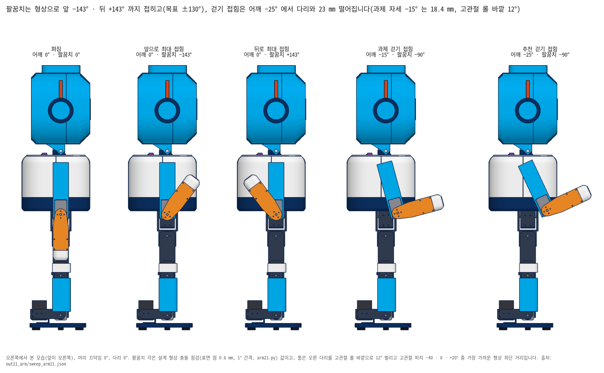
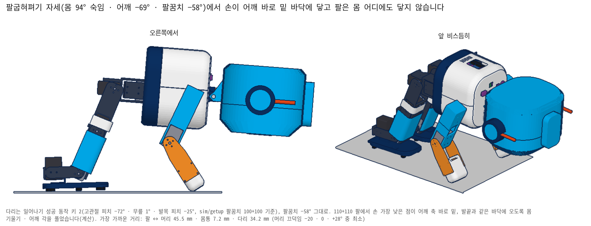

# 팔꿈치 팔 v21 — 팔 서보 4개판 (제안, 채택 전)

작성 2026-11-27 (KST). 형상 `code_v17/build21_arm.py`, 점검 · 부품 · 질량 `code_v17/arm21.py`, 그림 `code_v17/render21_arm.py`, STL `code_v17/arm21_stl.py`.
소유자 말 「설계해서 만들어 두면 고려해 보겠다」에 따라 만든 **제안**입니다. v20 키트(`out20/`)와 `build20.py` 는 바꾸지 않았습니다.
머리 끄덕임 −20 ~ +28° 를 넣은 `build21_head.py` 위에 팔만 바꿨습니다.

출처 표시
- **형상** = 설계 형상에서 잰 값입니다. 점 표본 충돌 점검(표면 점 간격 0.6 mm 또는 1 mm, 겹침 0.05 mm 이상이면 닿음)과 최단 거리(표면 점 0.5 mm, 가까운 점 찾기 나무 구조(KD tree))를 썼습니다.
- **계산** = 손 계산입니다.
- **시뮬** = `sim/getup/GETUP_STUDY.md` 의 MuJoCo 값입니다.
- **e-manual** = ROBOTIS 문서 값입니다.
- **추정** = 가정이 들어간 값입니다.

## 결론

1. **팔꿈치는 형상으로 앞뒤 ±143° 까지 접힙니다**(목표 ±130° 보다 13° 넓음, 좌우 같음). 어깨는 팔꿈치를 편 채 머리 −20 ~ +28° 전체에서 −120 / +118° 까지 닿지 않아, ±110° 에 8° 이상 남습니다. 다만 팔을 높이 든 채(어깨 −70° 부터 앞, +70° 부터 뒤) 팔꿈치를 크게 접으면 손이 머리에 닿습니다. 그래서 짝 규칙이 필요합니다(5절 표).
2. **걷기 접힘: 과제 자세(어깨 −15° · 팔꿈치 −90°)는 고관절 롤 바깥 12° 에서 다리와 18.4 mm 로, 일어나기 조사의 19 mm 보다 0.6 mm 작습니다.** 어깨를 −25° 로 들면 23.4 mm, 롤 형상 한계 33.6° 에서도 18.0 mm 가 남아 이것을 추천합니다. 팔을 곧게 늘어뜨리면 롤 7.5° 에서 다리에 닿습니다.
3. **일어나기 성공 동작 키 6 개는 몸통 · 다리와 닿지 않습니다**(다리와 가장 가까울 때 11 mm). 키 5(어깨 −110° · 팔꿈치 −49°)만 머리를 +28° 숙이면 머리 앞에 닿고, +27° 이하에서는 괜찮습니다. 손을 어깨 바로 밑에 둔 팔굽혀펴기 자세도 닿는 곳이 없습니다.
4. **팔 하나 246.6 g 으로 v20 보다 122 g 늘었고, 로봇은 3394 g(+244 g)입니다.** 조사가 가정한 220 g 보다 27 g 무겁습니다. 강도는 층 사이로 걸리는 곳이 손 하나뿐(0.1 MPa)입니다. 아래팔 판은 3.5 N·m 에서 층 안 7.8 MPa 입니다. 혼 나사 자리는 3.5 N·m 에서 빠듯합니다(7절).
5. **출력 부품은 팔 하나 5 개, 양팔 10 개, 207 cm³, 서포트 0** 입니다(사방이 막힌 30 mm 이하 다리 놓기 두 곳은 0 으로 셈). STL 10 개 모두 열린 모서리 0, STEP 과 부피 차 0.25 % 이하입니다. 손가락 날개는 팔꿈치를 지나갈 수 없어 단순한 벙어리장갑 손으로 바꿨습니다. 위팔은 지금 팔의 둥근 껍데기 느낌을 살리지 못했습니다(9절 10).



그림 1 제목: **팔꿈치는 형상으로 앞 −143° · 뒤 +143° 까지 접히고(목표 ±130°), 걷기 접힘은 어깨 −25° 에서 다리와 23 mm 떨어집니다(과제 자세 −15° 는 18.4 mm, 고관절 롤 바깥 12°).** 오른쪽에서 본 모습(앞이 오른쪽), 머리 0°, 다리 0°. 각은 형상 충돌 점검, 틈은 형상 최단 거리입니다.



그림 2 제목: **팔굽혀펴기 자세(몸 94° 숙임 · 어깨 −69° · 팔꿈치 −58°)에서 손이 어깨 바로 밑 바닥에 닿고 팔은 몸 어디에도 닿지 않습니다.** 다리는 일어나기 성공 동작 키 2 그대로이고, 몸 기울기와 어깨 각은 계산으로 풀었습니다(6절).

## 1. 무엇이 바뀌나

**로봇이 하는 일.** 팔이 어깨에서 앞뒤로 돌고(지금과 같음), 새로 팔꿈치에서 아래팔이 앞뒤로 접힙니다. 예를 들어 엎드린 채 아래팔을 앞으로 접어 손을 가슴 밑에 두고(어깨 −33° · 팔꿈치 −130°, 일어나기 성공 동작 키 1), 팔꿈치를 펴며 바닥을 밀어 가슴을 듭니다.

**무엇이 아닌가.**
- 채택된 키트가 아닙니다. 다리 · 몸통 · 머리 부품은 v20 과 같습니다. 회귀 점검에서 팔이 아닌 출력 부품 43 개의 부피가 `out20/print_parts/parts.json` 과 모두 같았습니다(`regression_gate.json`).
- 서보 등급은 바꾸지 않았습니다. 네 팔 서보 모두 XL430-W250-T 입니다.
- 시뮬 모델(`sim/export_mjcf.py`)에는 아직 넣지 않았습니다. 넣을 값은 `arm21_joints_mass.json` 에 있습니다(11절).

**바뀌는 것** (각도 부호는 시뮬과 같습니다: 어깨 · 팔꿈치 음수 = 앞으로)

| 항목 | v20 | v21 팔꿈치 팔 |
|---|---|---|
| 팔 관절 | 어깨 하나(`arm_swing`) | 어깨 + **팔꿈치(`elbow`, 어깨와 평행한 축)** |
| 길이 | 어깨 축 → 손 끝 130 mm(손 날개 끝) | **위팔 110 mm(어깨 축 → 팔꿈치 축) + 아래팔 110 mm(팔꿈치 축 → 손 바깥면) = 220 mm** |
| 팔꿈치 축 | — | 어깨 축 바로 아래 110 mm (x 0, \|y\| 102, z 196) |
| 서보 | 위팔 안 XL430 하나(혼은 몸통 쪽 어댑터에, 서보 몸통이 팔과 함께 돎) | 그대로 + **위팔 아래쪽에 XL430 하나 더.** 혼 끝이 아래, 혼은 바깥쪽 |
| 케이블 | 몸통 → 어깨 서보 | 그대로 + **어깨 서보 → 팔꿈치 서보 데이지 체인.** 두 서보의 케이블 끝이 위팔 속 상자(39 mm)를 사이에 두고 마주 봅니다. 케이블이 움직이는 관절을 지나지 않습니다 |
| 위팔 | 얇은 하늘색 껍데기 두 쪽(서보 케이스에 나사) | **구조 틀 한 덩어리**(하늘색). 앞뒤 벽이 두 서보의 옆 케이스 나사 16 개를 받습니다. 두 서보 사이 상자, 어깨 서보 바깥 덮개, 윗뚜껑이 붙어 있습니다 |
| 아래팔 | — | **판 두 장**(구조색, 평평하게 출력) + **흰 손**. 판은 다리 U 브래킷과 같은 자리(서보 가운데 면에서 21.2 – 24.7 mm)에 있습니다. 바깥 판은 혼에, 안쪽 판은 아이들러에 붙습니다 |
| 손 | 흰 벙어리장갑 + 어깨 캠으로 열리는 손가락 날개 | **흰 벙어리장갑 + 고무 손바닥.** 캠 막대는 팔꿈치를 지나갈 수 없어 날개를 뺐습니다 |
| 어깨 혼 어댑터 | 캠 돌기, 혼 나사 구멍 없음 | **캠 돌기 없음, 혼 나사 M2 4 개(0 · 90°)** |

**어떻게 ±130° 를 넘게 접히나.** 위팔 아래쪽은 팔꿈치 서보 가운데 면에서 ±20.6 mm 안에만 있습니다. 아래팔 판 두 장은 그 바깥(±21.2 – 24.7 mm)에 있어서 가위처럼 위팔 옆을 지나갑니다. 가운데 띠를 가로지르는 아래팔 부품은 손뿐인데, 손 윗모서리가 팔꿈치 축에서 50 mm 아래에서 시작합니다. 그래서 아래팔을 140° 넘게 접어야 손 윗모서리가 위팔에 닿습니다.

## 2. 출력표

- **설정:** PLA, 노즐 0.4 mm, 층 0.2 mm.
  - 구조 부품(위팔 틀, 아래팔 판, 손, 어댑터): 벽 1.2 mm(3줄), 채움 20 % 자이로이드
- 「위」는 출력할 때 위로 가는 방향이고, STL 에 이미 들어 있습니다.
- 왼팔은 이름의 `R` 을 `L` 로 바꾼 대칭 부품입니다(「위」의 y 부호가 반대).

| # | 부품 | STL 파일 | 위 | 색 | 크기 (mm) | 부피 (cm³) | 서포트 (mm²) |
|---|---|---|---|---|---|---|---|
| 1 | 위팔 틀 (서보 둘을 잡는 앞뒤 벽 + 상자 + 바깥 덮개 + 윗뚜껑) | `out21_arm/print_parts_stl/arm_R_upper_frame.stl` | −y (몸통 쪽 면이 바닥) | 하늘색 | 135×37×43 | 52.9 | 0 ※ |
| 2 | 아래팔 바깥 판 (팔꿈치 혼 쪽) | `out21_arm/print_parts_stl/arm_R_elbow_bracket_out.stl` | −y (평평하게) | 구조색 | 100×37×4 | 11.5 | 0 |
| 3 | 아래팔 안쪽 판 (아이들러 쪽, 받침 · 카운터보어) | `out21_arm/print_parts_stl/arm_R_elbow_bracket_in.stl` | −y (카운터보어 면이 바닥) | 구조색 | 100×37×5 | 11.5 | 0 |
| 4 | 손 (벙어리장갑 + 판을 받는 고리 틀 둘) | `out21_arm/print_parts_stl/arm_R_hand_frame.stl` | +z (손바닥이 바닥) | 흰색 | 37×49×60 | 26.6 | 0 ※ |
| 5 | 어깨 혼 어댑터 (캠 없음, 혼 나사 4) | `out21_arm/print_parts_stl/arm_R_horn_adapter.stl` | +y | 구조색 | 22×22×4 | 1.1 | 0 |

- **팔 하나 5 개, 양팔 10 개, 총 부피 207.2 cm³**(팔 하나 103.6 cm³). 출처: `out21_arm/print_parts/parts.json` [형상].
- STL 10 개 모두 열린 모서리 0, STEP 과 부피 차 0.25 % 이하입니다(`print_parts_stl/STL_CHECK.md`). STEP 원본은 `print_parts/<이름>.stp`, 두 팔 조립 STEP(공식 서보 모양 포함)은 `arms_v21_assembly.stp` 입니다.
- ※ `printcheck` 는 사방이 막힌 지붕을 서포트로 셉니다. 위팔 틀은 어깨 서보 칸 위 덮개(폭 29.2 mm) 1242 mm², 손은 뚜껑 두 칸(폭 15.5 mm, 가운데 갈비로 나눔) 1230 mm² 입니다. 둘 다 네 변이 받쳐진 30 mm 이하 다리 놓기라 0 으로 적었습니다(9절 8).

**출력 방향 고르기** [형상, 같은 0.6 / 1 mm 격자, 「서포트 (printcheck 값)」]

| 부품 | 고른 방향 | 다른 방향 | 고른 이유 |
|---|---|---|---|
| 위팔 틀 | −y: 0 (1242) | −z: 51, +z: 0 (1080), +y: 1409, ±x: 4073 | 층이 y 에 수직이라 팔이 앞뒤로 굽을 때 응력이 층 안입니다. −z 는 서포트가 적지만 층이 팔 길이 방향에 수직이라 굽힘이 층 사이로 갑니다 |
| 바깥 · 안쪽 판 | −y: 0 | ±x: 72 – 96, 안쪽 판 +y: 2922 | 평평하게 → 굽힘이 모두 층 안 |
| 손 | +z: 0 (1230) | −z: 0 (1591), ±x: 0 – 795 (1257 – 1988) | 손바닥 면이 평평하고, 둥근 바닥이 45° 규칙 안 |

## 3. 조립 순서

**미리 할 일:** 데이지 체인 케이블을 서보를 칸에 넣기 **전에** 꽂습니다.

1. **팔꿈치 서보에 케이블:** 짧은 X3P 케이블을 팔꿈치 서보 케이블 끝(위쪽이 될 끝)에 꽂습니다.
2. **팔꿈치 서보 → 위팔 틀 아래 칸:**
   - 혼이 바깥(오른팔 −y)을 보게 하고, 옆에서 앞뒤 벽 사이로 밀어 넣습니다. 케이블은 위쪽 상자로 올립니다.
   - 앞뒤 벽 바깥에서 M2.5 × 8 태핑 나사 8 개.
3. **어깨 서보 → 위팔 틀 위 칸:**
   - 상자 안 데이지 체인 케이블과 몸통에서 오는 케이블을 어깨 서보 케이블 끝(아래쪽)에 꽂습니다.
   - 혼이 몸통 쪽을 보게 하고, 몸통 쪽(안쪽)에서 밀어 넣습니다. 아이들러가 바깥 덮개 쪽으로 갑니다(틈 0.3 mm).
   - 몸통 케이블은 상자 안쪽 벽 위 홈(10 × 7 mm)으로 빼서 어깨 서보 안쪽 면을 따라 축 둘레까지 올립니다.
   - 앞뒤 벽 바깥에서 M2.5 × 8 태핑 나사 8 개.
4. **어깨 혼 어댑터 → 어깨 혼:** M2 × 6 나사 4 개(0 · 90° 자리).
5. **아래팔 판 → 팔꿈치 서보:**
   - 바깥 판을 팔꿈치 혼에 M2 × 6 4 개.
   - 안쪽 판을 아이들러에 M2 × 6 4 개. 몸통 쪽 면의 카운터보어(Ø5.2, 깊이 2)에 머리가 묻힙니다.
6. **손 → 판 사이:**
   - 손의 고리 틀 두 개를 아래에서 두 판 사이로 밀어 올립니다. 판 아래 끝이 손 윗면 턱에 얹힙니다.
   - 바깥 판 밖에서 M2.5 × 8 태핑 나사 4 개, 안쪽 판 밖에서(카운터보어) M2.5 × 6 4 개.
7. **고무 손바닥:** 손 바닥면에 붙입니다.
8. **어깨에 달기:** v20 과 같이 어댑터를 D컷 축에 압입합니다.

- 팔꿈치 서보 몸체 나사는 손을 단 뒤에도 앞뒤 벽 바깥에서 닿습니다. 판이 앞뒤 벽을 가리지 않습니다.
- 서보 영점: 팔을 곧게 늘어뜨린 자세(어깨 0° · 팔꿈치 0°)가 관절 0° 입니다.

## 4. 사야 할 것 (양팔)

| 품목 | 수량 | 쓰는 곳 | 출처 |
|---|---|---|---|
| XL430-W250-T | 2 (재고 W250 에서) | 팔꿈치 좌우 | 과제 조건 |
| 혼 · 아이들러 | 서보에 들어 있는 것 | 팔꿈치 | [추정] 서보 상자 구성, 실물 확인 |
| M2.5 × 8 mm 태핑 나사 | 32 | 서보 몸체 → 위팔 틀 앞뒤 벽(3.85 mm): 팔마다 어깨 8 + 팔꿈치 8 | 구멍 수 [형상], 길이는 v20 다리와 같은 규칙(벽 3.85 + 틈 0.35 + 물림 3.8) [추정] |
| M2.5 × 8 mm 태핑 나사 | 8 | 바깥 판(3.5 mm) → 손 고리 틀(6 mm) | [추정] 물림 4.4 mm |
| M2.5 × 6 mm 태핑 나사 | 8 | 안쪽 판(카운터보어 뒤 1.5 mm) → 손 고리 틀 | [추정] 물림 4.4 mm |
| M2 × 6 mm 나사 | 24 | 팔마다 팔꿈치 혼 4 · 팔꿈치 아이들러 4 · 어깨 혼 ↔ 어댑터 4 | 구멍 수 [형상]. **XL 아이들러 0 · 90° 구멍(Ø2.0)의 나사산 여부는 실물 확인** |
| X3P 케이블, 짧은 것(100 mm 이하) | 2 | 어깨 서보 → 팔꿈치 서보 | [추정] 위팔 속 상자 안 거리 약 40 mm. 서보에 든 180 mm 도 들어가지만 많이 남습니다 |
| 고무판 1 mm | 손바닥 2 장(약 25 × 37 mm) | 손바닥 | [형상] |

- v20 에서 없어지는 것: 손 날개 강철 핀 Ø2 (2), 손가락 막대. 어깨 강철 축 Ø8 은 그대로 씁니다.
- 몸통 쪽 케이블(몸통 → 어깨 서보)은 v20 과 같은 길입니다.

## 5. 범위 (형상)

**한 관절씩** [형상, 1° 간격, 표면 점 0.6 mm, `sweep_arm21.json` 의 `elbow_self` · `shoulder_head`]

| 관절 | 목표 | 형상 한계 | 처음 닿는 곳 | 관절 표(`arm21_joints_mass.json`) |
|---|---|---|---|---|
| 팔꿈치 앞 / 뒤 (어깨 0°) | ±130° | **−143° / +143°** (좌우 같음) | 손 고리 틀 윗모서리 ↔ 위팔 틀 | −130 ~ +130° |
| 어깨 앞 / 뒤 (팔꿈치 0°, 머리 −20 ~ +28° 전체) | ±110° | **−120° / +118°** | 위팔 틀 윗부분 ↔ 머리 앞(머리 +28°) / 머리 뒤(머리 −20°) | −110 ~ +110° |

- 어깨 한계는 머리 각에 따라 바뀝니다(4° 간격). 팔꿈치 0° 에서 머리 −20° 일 때 뒤로 +118°, 0° 일 때 +133°, +28° 일 때 앞으로 −120°, 0° 일 때 −135° 너머입니다. ±110° 는 머리 범위 전체에서 8° 이상 남습니다. v21 머리 문서의 지금 팔(+117 / −119°)과 거의 같습니다. 이번에 먼저 닿는 것은 손이 아니라 위팔 윗부분입니다.
- 팔꿈치 한계 143° 는 손 윗모서리가 팔꿈치 축에서 50 mm 아래에 있어서 생깁니다. 모서리를 둥글리지 않은 띠로 손 계산하면 137° 였고, 손 윗모서리를 반지름 8 mm 로 둥글려 6° 더 됩니다.

**어깨 × 팔꿈치 함께** [형상, 5° 간격, 표면 점 1 mm, 머리 −20 · 0 · +28° 모두와 다리 0° 자세에 대해, 오른팔. 왼팔은 3233 칸 중 1 칸만 다름]

| 어깨 | 팔꿈치가 닿지 않는 범위 | 막는 것 |
|---|---|---|
| −120° | −15 ~ +140° | 아래팔 ↔ 머리 앞 |
| −110° | −45 ~ +140° | 아래팔 ↔ 머리 앞 · 귀 |
| −100° | −65 ~ +140° | 같음 |
| −90° | −80 ~ +140° | 아래팔 ↔ 머리 앞(머리 0 · +28°) |
| −80° | −95 ~ +140° | 같음 |
| −70° | −115 ~ +140° | 같음 |
| −65 ~ +60° | −140 ~ +140° (팔꿈치 자체 한계 ±143° 까지) | — |
| +70° | −140 ~ +110° | 손 ↔ 머리 뒤 |
| +90° | −140 ~ +85° | 손 · 안쪽 판 ↔ 머리 뒤 |
| +110° | −140 ~ +55° | 같음 · 귀 |

- 팔을 높이 들고(어깨 −70° 부터 앞) 아래팔을 앞으로 접으면 손이 얼굴 쪽으로 와서 머리에 닿습니다. 뒤로 높이 들고 뒤로 접을 때도 같습니다. 몸통 · 다리와는 이 표 범위에서 닿지 않았습니다.
- 팔꿈치를 ±90° 접은 채 어깨를 돌리면: 팔꿈치 −90° 에서 어깨 앞 한계는 −99 ~ −116°(머리 +28 ~ −20°), 팔꿈치 +90° 에서 어깨 뒤 한계는 +99 ~ +119°(머리 −20 ~ +28°)입니다.
- 관절 표는 목표 그대로(어깨 ±110°, 팔꿈치 ±130°) 적었습니다. 위 짝 표는 동작을 짤 때 소프트웨어로 지켜야 합니다.

## 6. 틈 (형상)

**걷기 접힘과 다리** [형상, 표면 점 0.5 mm 최단 거리, 오른 다리를 고관절 롤 바깥으로 벌리고 고관절 피치 −40 · 0 · +20° 중 가장 가까운 값, 무릎 0°. 왼쪽은 0.2 mm 안에서 같음. `sweep_arm21.json` 의 `fold`]

| 팔 자세 (어깨 / 팔꿈치) | 롤 0° | 8° | 12° (걷기 실측 최대) | 20° | 25° | 33.6° (형상 한계) | 가장 가까운 곳 (롤 12°) |
|---|---|---|---|---|---|---|---|
| 곧게 늘어뜨림 0 / 0 | 13.0 mm | **닿음** | 닿음 | 닿음 | 닿음 | 닿음 | 안쪽 판 ↔ 허벅지 프레임 |
| 0 / −60 | 15.3 | 9.2 | 6.2 | 닿음 | 닿음 | 닿음 | 안쪽 판 ↔ 허벅지 프레임 |
| 0 / −90 | 19.3 | 18.0 | 15.2 | 9.4 | 6.1 | 0.8 | 안쪽 판 ↔ 허벅지 프레임 |
| **과제 걷기 접힘 −15 / −90** | 19.3 | 19.3 | **18.4** | 15.4 | 13.1 | 7.5 | 안쪽 판 ↔ 고관절 롤 U 브래킷 |
| −15 / −110 | 19.3 | 19.3 | 18.5 | 15.4 | 13.2 | 7.5 | 같음 |
| **추천 걷기 접힘 −25 / −90** | 23.5 | 23.6 | **23.4** | 22.2 | 21.1 | **18.0** | 안쪽 판 ↔ 고관절 롤 U 브래킷 |
| −25 / −110 | 23.5 | 23.6 | 23.4 | 22.2 | 21.1 | 18.0 | 같음 |

- **과제 자세(어깨 −15° · 팔꿈치 −90°)는 롤 12° 에서 18.4 mm 로, 일어나기 조사의 정적 계산값 19 mm 보다 0.6 mm 작습니다.** 조사의 캡슐 팔(같은 자세 30 mm)보다 실제 안쪽 판이 고관절 롤 브래킷에 가깝기 때문입니다.
- **어깨를 −25° 로 10° 더 앞으로 들면 롤 12° 에서 23.4 mm, 형상 한계 33.6° 에서도 18.0 mm 가 남습니다.** 걷기 접힘은 어깨 −25° · 팔꿈치 −90° 를 추천합니다. 팔꿈치를 −110° 로 더 접어도 틈은 거의 같습니다(가장 가까운 곳이 팔꿈치 근처라서).
- **고관절 롤 바깥 처음 닿는 각** [형상, 0.5° 간격]: 팔을 곧게 늘어뜨리면 **7.5°**, 과제 걷기 접힘 · 추천 걷기 접힘은 40° 까지 닿지 않습니다. 지금 관절 표의 롤 −25° 는 팔을 접었을 때만 맞는 값입니다.

**일어나기 성공 동작 키** [형상, 표면 점 0.6 mm 충돌 + 0.7 / 1 mm 최단 거리. 키는 `sim/getup/GETUP_STUDY.md` 의 팔꿈치 100+100 XL 성공 동작이고, 다리 · 팔 각을 그대로 110+110 형상에 넣었습니다]

| 키 | 어깨 / 팔꿈치 | 고관절 피치 / 무릎 / 발목 | 팔 ↔ 머리 (머리 −20 / 0 / +28°) | 팔 ↔ 몸통 | 팔 ↔ 다리 | 파고듦 |
|---|---|---|---|---|---|---|
| 1 | −33 / −130 | −61 / 0 / +22 | 51 / 50 / 39 mm | 7 mm | 30 mm | 없음 |
| 2 | −85 / −58 | −72 / 1 / −25 | 47 / 52 / 35 | 7 | 35 | 없음 |
| 3 | −110 / +46 | −115 / 4 / +22 | 51 / 35 / 13 | 7 | **11** | 없음 |
| 4 | −110 / −14 | −29 / 65 / +19 | 51 / 35 / 13 | 7 | 35 | 없음 |
| 5 | −110 / −49 | −115 / 0 / +22 | 51 / 35 / **닿음** | 7 | 35 | **머리 +28° 에서만** 안쪽 판 · 손 ↔ 머리 앞 |
| 6 | −90 / −28 | +22 / 115 / +9 | 48 / 53 / 31 | 7 | 35 | 없음 |

- **키 5 는 머리 끄덕임 +27° 이하에서 닿지 않습니다**(1° 간격 점검, `key_nod_free`). 키 3 · 4 는 머리 −20 ~ +28° 전체에서 괜찮습니다. 시뮬의 머리는 수동 관절이라 이 조건이 들어 있지 않습니다.
- 팔 ↔ 몸통 7 mm 는 자세와 상관없는 옆 틈(위팔 안쪽 면 |y| 81.4 ↔ 몸통 덮개 |y| 75)을 표면 점으로 잰 값입니다. 아래팔 안쪽 판(|y| 77.3)이 반바지(|y| 75) 옆을 지날 때는 2.3 mm 입니다(v20 팔 안쪽 면과 같은 자리). 안쪽 판 나사 머리는 카운터보어에 묻힙니다.
- 팔꿈치 형상 한계 −143° 는 키 1 의 −130° 에 13° 를 남깁니다.

**팔굽혀펴기 자세(그림 2)** [계산 + 형상]
- 다리는 키 2 그대로(고관절 피치 −72° · 무릎 1° · 발목 피치 −25°), 팔꿈치 −58° 그대로 두고, 손 가장 낮은 점이 어깨 축 바로 밑, 발끝과 같은 바닥에 오도록 몸 기울기와 어깨 각을 풀었습니다.
- 답: 몸 94.5° 숙임(몸통이 거의 수평), 어깨 −68.8°. 어깨 축은 바닥에서 199 mm 높이입니다.
- 이 자세에서 팔 ↔ 머리 45.5 mm(머리 −20 · 0 · +28° 중 최소), 몸통 7 mm, 다리 34 mm, 파고듦 없음.

## 7. 강도 (계산)

- **부하:** 팔꿈치 3.5 N·m(나쁜 경우)과 1.4 N·m(XL430 정지토크, e-manual) 두 값으로 계산했습니다.
  - 3.5 N·m 은 일어나기 조사의 XM 성공 동작 팔꿈치 부하 2.9 – 4.4 N·m [시뮬] 에서 잡은 위쪽 값입니다.
  - XL430 은 1.4 N·m 를 넘으면 밀려 돕니다. 성공한 XL 동작의 팔꿈치는 정지토크의 0.73(99번째 백분위) · 0.88(최대)배였습니다 [시뮬].
  - 손 힘은 몸무게 절반 16 N, 옆 힘은 그 0.3 배 4.8 N 으로 봤습니다 [추정].
- **기준:** v20 다리는 층 사이 반복 한계 약 7 MPa, 목표 5 MPa [추정] 입니다(`out20/LEG_PRINT_KIT_R.md` 6절). 층 안 방향은 이보다 훨씬 셉니다.

| 자리 | 출력 방향과 층 | 3.5 N·m | 1.4 N·m | 판정 |
|---|---|---|---|---|
| 바깥 판, 아래 혼 구멍 줄(폭 27.7, 두께 3.5, 단면계수 447 mm³) | 평평하게 → **층 안** | 7.8 MPa (두 판이 나누면 3.9) | 3.1 MPa (1.6) | 층 안이라 여유 있음 |
| 위팔 틀, 팔꿈치 칸(앞뒤 벽 3.85 × 41.2, 서보 케이스가 가운데를 이음, 4717 mm³) | 몸통 쪽 면 바닥 → **층 안** | 0.74 MPa | 0.30 MPa | 여유 큼 |
| 혼 나사 M2 4 개가 판 구멍을 누름(반지름 8 mm, 마찰 없이 다 받는다고 봄) | 층 안 | 나사 하나 109 N, 15.6 MPa | 44 N, 6.2 MPa | 3.5 N·m 에서는 빠듯. 실제로는 나사 조임 마찰이 대부분 받습니다 [추정] |
| 두 판 옆 굽힘(손에 옆 힘 4.8 N, 110 mm) | 층 안 | 4.7 MPa | — | 여유 있음 |
| 손 단면 z 110(속 빈 36.9 × 49.4, 벽 2, 모멘트 16 N × 24 mm) | 손바닥 바닥 → **층 사이** | 0.1 MPa | — | 층 사이에 걸리는 유일한 곳, 여유 큼 |

- 위팔 틀은 층이 y 에 수직입니다. 앞뒤로 미는 힘(팔이 x-z 면에서 굽힘)은 앞뒤 벽 안에서 z 방향 응력이 되어 층 안입니다. 옆(y) 힘만 층 사이로 가는데, 손 옆 힘 4.8 N 수준입니다.
- 서보 몸체 나사: 팔꿈치 토크 3.5 N·m 를 나사 8 개(축에서 14.8 · 31.4 mm)가 거리에 비례해 나누면 가장 먼 나사가 23 N 입니다 [계산].

## 8. 질량 (형상, `mass_props` light 와 같은 규칙)

| | v20 | v21 팔꿈치 팔 | 차 |
|---|---|---|---|
| 오른팔 | 124.7 g (팔 119.4 + 손 날개 5.3) | **246.6 g** (위팔 184.2 + 아래팔 62.4) | **+121.9 g** |
| 왼팔 | 123.5 g | 247.6 g | +124.1 g |
| 몸통 | 1087.9 g | 1085.6 g (어댑터 캠 돌기 없앰) | −2.3 g |
| **로봇 전체** | 3150 g | **3394 g** | **+244 g** |
| 무게중심 높이(바닥에서) | 286.6 mm | 284.4 mm | −2.2 mm |

- 오른팔 내역: 어깨 서보 65.2 · 팔꿈치 서보 65.2(XL430 57.2 g [e-manual] + 혼 · 나사 · 케이블 몫 8 g, `mass_props` 규칙), 위팔 틀 53.8, 바깥 판 12.4, 안쪽 판 12.4, 손 30.0, 팔꿈치 혼 4.0, 아이들러 3.0, 고무 0.6 g.
- 일어나기 조사가 가정한 팔꿈치 110+110 팔은 하나 220 g, 몸무게 3.28 kg 이었습니다 [시뮬 가정]. 이 형상은 팔 하나 27 g, 몸 0.11 kg 더 무겁습니다. 그 질량으로 일어나기를 다시 돌리지는 않았습니다.
- 가볍게 한 것: 위팔 틀 두 서보 사이 앞뒤 벽에 30 × 30 창(−7 g), 손 윗부분을 판 안쪽 고리 틀 두 개로(−16 g 쯤).
- 링크 질량 · 무게중심 · 관성(무게중심 둘레, 세계 축, 0 자세): `arm21_joints_mass.json` 의 `links`. 전체 질량 파일은 v20 형식 그대로 `mass_build21_arm_light.json` 입니다(바꾸지 않은 링크는 v20 값).

## 9. 한계

1. **서보 힘은 그대로 모자랄 수 있습니다.** 일어나기 조사에서 XL430 으로 선 것은 팔꿈치 100+100 한 번뿐이고 매우 예민했습니다 [시뮬]. 이 설계는 구조를 3.5 N·m 까지 버티게 했을 뿐, 서보가 1.4 N·m 를 넘게 내지는 못합니다.
2. **어깨 서보 출력축이 팔 전체를 외팔보로 받습니다.** v16 부터 같은 구조(혼 → 어댑터 → 강철 축, 바깥쪽 받침 없음)인데, 팔이 길어지고(130 → 220 mm) 무거워졌으며(125 → 247 g) 팔굽혀펴기 때 손 힘이 이 축으로 갑니다. XL430 출력축의 옆 하중 한계는 e-manual 에서 찾지 못했습니다 [추정 위험].
3. **고관절 롤 짝 규칙.** 팔을 곧게 늘어뜨리면 고관절 롤 바깥 7.5° 에서 다리와 닿습니다. 걸을 때는 팔을 접어야 합니다(6절).
4. **키 5 와 머리.** 어깨 −110° · 팔꿈치 −49° 에서 머리를 앞으로 많이 숙이면 아래팔이 머리에 닿습니다(6절의 조건).
5. **점검 방법.** 점 표본 충돌 점검(0.6 mm, 지도는 1 mm · 5° 간격)이라 그보다 얇은 틈은 놓칠 수 있습니다. 거리는 표면 점 사이 거리라 실제 틈보다 최대 1 mm 쯤 클 수 있습니다.
6. **질량.** 팔 하나가 조사 가정보다 27 g 무겁습니다. 일어나기 · 걷기 시뮬을 이 질량으로 다시 돌리지 않았습니다.
7. **추천 걷기 접힘(어깨 −25° · 팔꿈치 −90°)은 이 문서의 제안입니다.** 조사의 걷기 확인은 팔꿈치 −90° 접은 팔을 점 질량으로 넣은 것이고, 어깨 −25° 자세가 균형에 주는 영향은 시뮬로 확인하지 않았습니다.
8. **출력 판정.** `printcheck` 는 사방이 막힌 지붕을 서포트로 셉니다(위팔 덮개 1242 mm², 손 뚜껑 두 칸 1230 mm²). 둘 다 폭 29.2 · 15.5 mm 다리 놓기라 서포트 0 으로 적었습니다. 원래 판정값도 `parts.json` 의 `support_printcheck_mm2` 에 남겼습니다.
9. **공차.** v20 상수(칸 0.35, 한쪽 자리 0.3, 압입 +0.1, 몸체 나사 구멍 2.7, 혼 나사 구멍 2.4)를 그대로 썼고 시험 출력은 하지 않았습니다. v20 다리 칸에 넣은 0.5 mm 입구 모따기는 팔 칸에는 넣지 않았습니다.
10. **외형: 지금 팔의 둥근 껍데기 느낌을 살리지 못했습니다.**
   - 위팔은 앞뒤가 평평한 하늘색 틀이고 세로 모서리가 각져 있습니다. 몸체 나사 머리와 가벼움 창이 앞뒤에서 보입니다.
   - 범위 때문에 꼭 필요한 것은 z 262 아래를 팔꿈치 서보 가운데 면 ±20.6 mm 안에 두는 것뿐이었습니다. 앞뒤가 평평한 것은 나사 구멍을 내려고 앞뒤 벽을 x 방향 판으로 만든 이 형상 도구의 방식 때문이지, 범위 때문이 아닙니다.
   - 둥근 덮개를 따로 씌우거나 세로 모서리를 둥근 판으로 감싸는 손질은 하지 않았습니다(점검을 다시 돌려야 해서 이번 범위 밖).
   - 아래팔 옆은 구조색 판이고, 손만 지금 손처럼 둥근 흰 벙어리장갑입니다.

## 10. 다시 만드는 명령

```bash
cd code_v17
../sim/.venv/bin/python arm21.py              # 부품 STEP · parts.json · 조립 STEP · 질량 · 관절 표 · 충돌 점검 (부하 큰 DGX_1 에서 약 40 분)
../sim/.venv/bin/python render21_arm.py       # 그림 두 장 (arm21.py 다음에)
cd .. && python3 code_v17/arm21_stl.py         # STL + STL_CHECK.md
```
- `ARM21_CACHE=<파일>` 을 주면 모델(빌드 약 2 분)을 피클로 한 번만 만듭니다. `PROCS` 는 점검 병렬 수(기본 16)입니다.
- 단계만 따로: `arm21.py parts` · `mass` · `sweep` · `post`.

## 11. 남은 것

- **시뮬 모델에 넣기**(`sim/export_mjcf.py`, 이번에 안 함):
  - `MERGE` · `BODIES` · `assert` 가 `R/L_hand_flap` 을 기대합니다. 날개를 빼고 `R/L_forearm` 몸체와 `R/L_elbow` 관절(축 y, 점 (0, ±102, 196) mm)을 넣어야 합니다.
  - 질량은 `KITORU_MASS=out21_arm/mass_build21_arm_light.json` 으로 줄 수 있습니다. 렌더 모듈은 `render21_arm.py` 의 사슬(`R_forearm: [R_arm_swing, R_elbow]`)을 쓰면 됩니다.
  - 머리 끄덕임 범위(−20 ~ +28°) 다항식 맞춤은 `out_head21/HEAD_CRANK_v21.md` 의 남은 일 그대로입니다.
- **일어나기 다시 돌리기:** 실제 팔 질량(하나 247 g, 가정 220 g), 팔꿈치 형상 한계, 키 5 의 머리 끄덕임 조건(6절)을 넣고 `sim/getup` 을 다시 돌려야 이 팔이 일어나기에 맞는지 알 수 있습니다.
- **실물 확인:** XL 아이들러 0 · 90° 구멍 나사산, 서보 상자에 혼 · 아이들러가 들어 있는지, 짧은 X3P 케이블.
- **고관절 롤 관절 표:** 팔을 늘어뜨리면 롤 바깥 7.5° 에서 다리가 팔에 닿습니다(6절). 지금 표의 −25° 는 팔을 접었을 때만 맞습니다. 짝 규칙으로 적을지 소유자 결정이 필요합니다.
