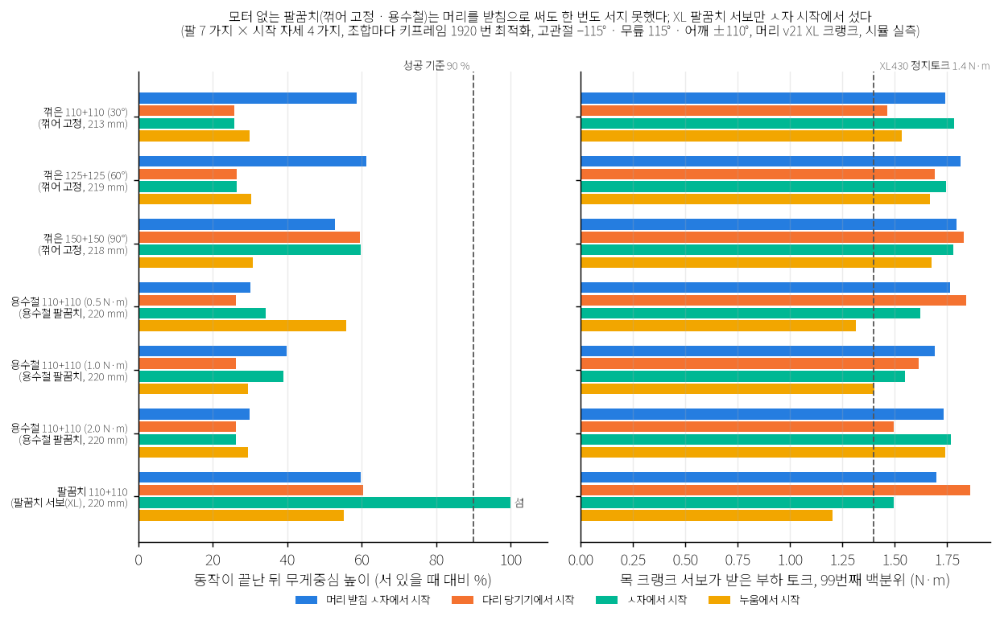
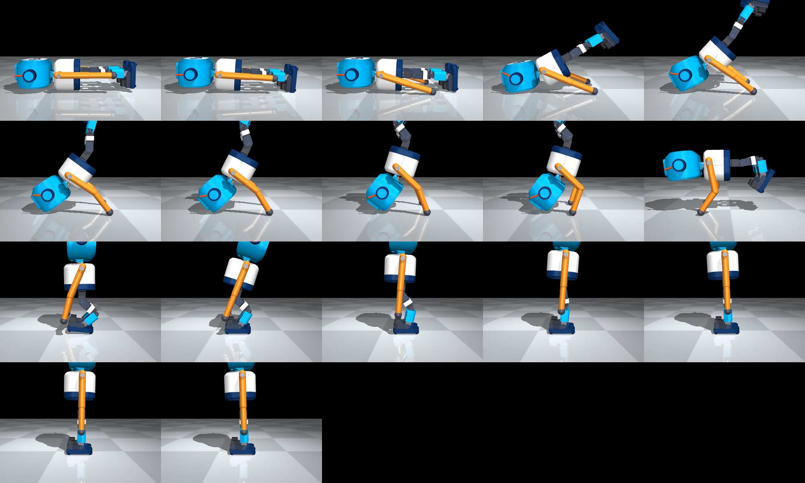

# 키토루 일어나기 — 팔 모양 조사 (2026-11-26)

## 결론 5줄 (처음 범위: 고관절 −80° · 무릎 100° — 최종 형상 범위로 다시 한 결과는 바로 아래 「갱신」 절)

1. **XL430 팔(정지토크 1.4 N·m)로는 어떤 길이 · 모양도 시뮬에서 한 번도 일어서지 못했습니다.** 곧은 팔 131–290 mm, 팔꿈치 팔 160–280 mm, 꺾은 팔 2 가지를 엎드림 · 누움에서 후보 · 시작 자세마다 키프레임 648–6568 번 최적화했습니다. 어깨 서보가 동작 시간의 12–93 % 동안 힘 한계에 걸렸습니다 [시뮬 실측].
2. **무게가 손에서 발로 넘어가는 순간에 손이 바닥에 닿으려면 팔이 280–290 mm 필요합니다.** 무릎 100° · 고관절 −80° 설계 범위, 다리 +20 mm 기준입니다. 고관절 굽힘을 −100° 까지 넓히면 245 mm 로 줄어듭니다 [정적 계산].
3. **처음으로 일어선 조합: 팔꿈치 팔(위팔 140 + 아래팔 140 mm)에 어깨 · 팔꿈치 서보를 2.7 N·m 이상(XM430-W210 · W350)으로 바꾼 경우입니다.** 누움에서 뒤로 구르며 일어섰고, 엎드림에서는 아직 못 섰습니다 [시뮬 실측]. 과제의 「XL430 한계 안」 조건 밖이라 따로 표시합니다.
4. **추천 팔 모양: 팔꿈치 하나를 더한 팔, 위팔 140 · 아래팔 140 mm(닿는 길이 280 mm).** 곧은 팔은 엎드림에서 처음 바닥을 밀 때 지렛대가 길어 어깨가 더 빨리 포화되므로 길게 늘려도 소용이 없었습니다. **서보 등급은 결정이 필요합니다:** XL430 으로는 서지 못했고, 성공은 어깨 · 팔꿈치 2.7 N·m 이상(XM430-W210 · W350)에서만 나왔습니다.
5. **팔 질량이 늘어도 걷기 균형은 나빠지지 않았습니다**(팔 하나 125 → 290 g, 추천 팔 XM 포함, 최대 보폭 · 밀기 버팀 같거나 나음) [시뮬 실측]. **그러나 걷는 동안 고관절 롤이 바깥으로 10–12° 벌어지는데, 팔꿈치 140+140 을 늘어뜨리면 롤 5° 에서 이미 다리에 닿습니다** [시뮬 실측 · 정적 계산]. 걸을 때는 팔꿈치를 앞으로 접어 두어야 하고, 접은 자세의 걷기는 아직 돌리지 않았습니다.

## 갱신 (같은 날): 안 A 최종 형상 범위로 다시

형상 에이전트가 잰 안 A 최종 형상 범위(`sim/walk/ranges/results/v20A/single.json`)로 다시 돌렸습니다.
- 형상 한계: 고관절 피치 −117.8 / +114°(굽힘을 막는 것은 몸통 반바지 ↔ 허벅지), 무릎 최대 117.8–120.1°, 고관절 롤 바깥 −33.6°.
- 이 조사에서 쓴 값: 고관절 피치 −115°(3° 여유) · 무릎 115° · 어깨 ±110°. 팔꿈치 ±130° 는 가정 그대로입니다.
- 이번 묶음은 다리 ↔ 몸통 · 머리 충돌을 시뮬에서 켜고 돌렸습니다(`SELFCOL=1`, 원래 모델은 계산하지 않음).

### 이번 결론 4줄

1. **필요한 팔 길이가 213 mm 로 줄었습니다**(엎드림 길, 다리를 편 ㅅ자에 몸통 거의 수평) [정적 계산]. 누움 길은 271 mm 그대로 깁니다. 팔꿈치 110+110(220 mm)이 엎드림 길을 7 mm 여유로 덮는 가장 짧은 후보입니다.
2. **XL430 어깨 · 팔꿈치로 처음 섰습니다. 팔꿈치 100+100, 엎드림에서 한 번입니다** [시뮬 실측]. 동작은 팔굽혀펴기 → 다리를 편 ㅅ자(고관절 −115°) → 반동으로 쪼그림 → 섬입니다. 그러나 매우 예민합니다.
   - 바꾼 조건 15 가지 중 1 가지(기준)에서만 섰습니다.
   - 그 근처를 다시 뽑은 3600 번, 조건 5 가지를 함께 넣은 최적화 640 후보에서는 한 번도 서지 않았습니다.
   - 누움(XL), 110+110 · 120+120, 비교용 XM 110+110 은 이 범위에서 모두 실패했습니다.
3. **다리 ↔ 몸통은 닿지 않았습니다.** 성공 동작에서 가장 가까울 때 7 mm 였습니다 [시뮬 실측, v18 메시 + 안 A 근사]. 고관절 −115° 를 쓸 때 무릎은 4° 이하였고, 무릎 115° 는 고관절 +22° 일 때만 썼습니다. 그래서 「고관절 −100° 이하 + 무릎 큰 굽힘」 영역은 쓰지 않았습니다.
4. **걷기용으로 팔꿈치를 −60 ~ −90°(아래팔을 앞으로) 접으면 고관절 롤 12° 에서 다리와 19 mm 이상 떨어집니다** [정적 계산]. 접은 팔 질량으로 걸어도 최대 보폭 · 밀기 버팀은 지금 팔과 같았습니다 [시뮬 실측].

**판정:** 고관절 −115° 덕에 XL430 으로도 「될 수 있음」까지는 왔습니다. 하지만 열린 고리 키프레임으로 믿을 만한 XL 동작은 찾지 못했습니다. 팔 모양 추천은 **팔꿈치 110+110(220 mm)** 으로 바꿉니다. 정적 여유가 있는 가장 짧은 팔이고, 140+140 보다 20 g 가볍고 다리와 틈도 넓습니다. 서보 등급(XL430 유지 / XM 급)과 동작 생성 방식(키프레임 / 되먹임 · 강화학습)은 여전히 결정이 필요합니다.

### 정적 필요 팔 길이 (`gu_static2.py`, 정적 계산)

방법은 2절과 같습니다. 여기에 다리 ↔ 몸통 · 머리 메시 거리가 0 이상인 자세만 받고, 뒤집힌 자세는 뺐습니다.

| 범위 | 엎드림 길(몸통 앞으로) | 그 자세의 다리 ↔ 몸통 틈 | 누움 길(몸통 뒤로) |
|---|---|---|---|
| 고관절 −80° · 무릎 100° (앞 결과) | 292 mm (무릎 0°, 몸통 62° 숙임) | 42 mm | 279 mm |
| 고관절 −115° · 무릎 100° | **213 mm** (무릎 5°, 발목 +22°, 몸통 88° 숙임) | 8 mm | 284 mm |
| 고관절 −115° · 무릎 115° | **213 mm** (같은 자세) | 8 mm | 271 mm (무릎 115°, 고관절 −100°) |

- 엎드림 길의 최저 자세는 무릎을 거의 편 ㅅ자라서, 무릎을 115° 로 넓혀도 그 길은 그대로입니다. 누움 길만 279 → 271 mm 로 조금 줄었습니다.
- 다리 ↔ 몸통 틈 8 mm 는 시뮬 모델(v18 메시 + 고관절 롤 안 A 근사) 기준입니다. 실제 v20A 형상에서는 −117.8° 에서 닿으므로, −115° 의 실제 틈은 이보다 작을 수 있습니다.

### XL430 키프레임 최적화 (`gu_search.py`, 시뮬 실측)

| 팔 (팔 하나 g) | 엎드림(다리 당기기 시작) | 엎드림(ㅅ자 시작) | 누움 | 비고 |
|---|---|---|---|---|
| 팔꿈치 100+100 (213) | 실패 0/1440, 끝 높이 55 % | **성공 10/1440** (같은 동작 근처), 이후 재탐색 0/3600 · 조건 5 가지 0/640 | 실패 0/2880, 끝 높이 50 % | 정적으로는 13 mm 모자람 |
| 팔꿈치 110+110 (220) | 실패 0/1440, 60 % | 실패 0/1440 + 성공 동작에서 출발 0/1200 · 조건 5 가지 0/640 | 실패 0/2880, 57 % | |
| 팔꿈치 120+120 (227) | 실패 0/1440, 26 % (지나는 동안 65 %) | 실패 0/1440 + 0/1200 · 0/640, 66 % (지나는 동안 98 %) | 실패 0/2880, 62 % | |
| 비교: 팔꿈치 110+110 · XM (270) | 실패 0/1440 | 실패 0/1440 + 0/1200 (지나는 동안 101 %, 끝 30 %) | 실패 0/1440 | 앞 범위의 140+140 XM 누움 성공과 대조 |

- 키 6개 + 섬, 교차 엔트로피 방법(30회 × 48). 「성공한 후보 수 / 돌린 수」에서 10/1440 은 한 최적화 안에서 같은 동작 둘레의 거의 같은 후보들입니다.
- 「성공 동작에서 출발」은 100+100 성공 키프레임을 처음 평균으로 다시 찾은 것(`h115seed` · `h115s21–23`)이고, 「조건 5 가지」는 기준 · 마찰 0.6 · 1.0 · 시간 ×0.95 · 1.05 에서 모두 서야 성공으로 친 최적화(`h115rob`)입니다.
- 비교용 XM 이 이 범위에서 실패한 것은 탐색이 운에 크게 좌우된다는 뜻으로 읽습니다. XM 이 XL 보다 못하다는 뜻이 아닙니다 [추정].

**성공한 XL 동작(팔꿈치 100+100, 엎드림, `results/getup_elbow100_XL_prone.mp4`, 0.5 s 간격 프레임 `results/getup_elbow100_XL_prone_frames.png`)**

| 키 | 시간 s | 어깨 ° | 팔꿈치 ° | 고관절 피치 ° | 무릎 ° | 발목 피치 ° | 하는 일 |
|---|---|---|---|---|---|---|---|
| 1 | 0.94 | −33 | −130 | −61 | 0 | +22 | 아래팔을 접어 손을 가슴 밑에 |
| 2 | 0.97 | −85 | −58 | −72 | 1 | −25 | 팔굽혀펴기로 가슴을 듦 |
| 3 | 1.44 | −110 | +46 | −115 | 4 | +22 | 다리를 편 채 엉덩이를 올려 ㅅ자 |
| 4 | 0.46 | −110 | −14 | −29 | 65 | +19 | 무릎을 굽히며 몸을 뒤로 |
| 5 | 0.43 | −110 | −49 | −115 | 0 | +22 | 다시 ㅅ자로 반동 |
| 6 | 0.63 | −90 | −28 | +22 | 115 | +9 | 팔로 밀며 쪼그림으로 넘어감 |
| 섬 | 1.5 | 0 | 0 | 0 | 0 | 0 | 다리를 폄 |

- 부하 토크(99번째 백분위 · 최대, 정지토크 대비): 어깨 XL 1.17 · 1.29(16 % 시간 포화), 팔꿈치 XL 0.73 · 0.88, 고관절 피치 XM 1.13 · 1.64(20 % 포화), 무릎 XM 0.91 · 1.16.
- 쓴 범위: 어깨 −110°(끝), 팔꿈치 −130°(가정한 끝), 고관절 −115°(끝), 무릎 115°(끝), 발목 +22°(끝). **모든 관절을 범위 끝까지 씁니다.** 실기에서 범위가 조금만 줄어도 이 동작은 그대로 쓸 수 없습니다.
- 몸 뚫음 검사(`gu_pen.py`): 팔 ↔ 머리 43 mm, 팔 ↔ 몸통 10 mm, 팔 ↔ 다리 18 mm, 다리 ↔ 몸통 7 mm, 다리 ↔ 머리 139 mm. 파고듦 없음.

### 걷기용 접은 팔 (`gu_clear2.py` 정적 계산, `gu_walk.py` 시뮬 실측)

- 오른 다리를 고관절 롤 바깥으로 벌리고, 고관절 피치 −40 · 0 · +20° 중 가장 가까운 값을 적었습니다(팔 ↔ 요 링크 · 허벅지 · 정강이 · 발목 · 발).

| 팔 / 접은 자세 | 롤 0° | 8° | 12°(걷기 실측 최대) | 20° | 33.6°(형상 한계) |
|---|---|---|---|---|---|
| 100+100 / 펴 늘어뜨림 | 18 mm | 7 | 1 | −11 | −33 |
| 100+100 / 팔꿈치 −60° | 29 | 29 | 27 | 21 | 9 |
| 100+100 / 팔꿈치 −90° | 29 | 29 | 29 | 27 | 16 |
| 110+110 / 펴 늘어뜨림 | 16 | 2 | **−6 (닿음)** | −21 | −37 |
| 110+110 / 팔꿈치 −60° | 28 | 24 | 21 | 15 | 2 |
| 110+110 / 팔꿈치 −90° | 28 | 28 | 26 | 19 | 9 |
| 110+110 / 어깨 −15° · 팔꿈치 −90° | 30 | 30 | 30 | 26 | 16 |
| 120+120 / 펴 늘어뜨림 | 16 | −1 | −9 | −21 | −34 |
| 120+120 / 팔꿈치 −90° | 28 | 22 | 19 | 13 | 3 |

- **팔꿈치를 −60 ~ −90° 접으면 세 길이 모두 롤 12° 에서 19 mm 이상 남습니다.** 형상 한계 33.6° 까지 남기려면 110+110 은 어깨 −15° · 팔꿈치 −90° 가 가장 넉넉합니다(16 mm).
- 걷기(팔꿈치 −90° 로 접은 팔의 질량 · 무게중심을 점 질량으로): 최대 보폭과 밀기 버팀이 지금 팔과 같았습니다. 걷는 동안 고관절 롤 바깥 최대는 오른쪽 10° · 왼쪽 12° 로 같았습니다.

| 팔 (접음 −90°) | 팔 하나 g | 몸무게 kg | 최대 보폭 (0.45+0.20 / 0.38+0.15) | 버틴 밀기 (앞 / 옆) |
|---|---|---|---|---|
| 곧은 131 (지금) | 125 | 3.09 | 70 / 60 mm | 6 / 8 N |
| 팔꿈치 110+110 | 220 | 3.28 | 70 / 60 mm | 6 / 8 N |
| 팔꿈치 120+120 | 227 | 3.30 | 70 / 60 mm | 6 / 8 N |

### 이번 묶음 다시 돌리는 법

```bash
cd sim/getup
../.venv/bin/python gu_static2.py                                                   # → results/static2.json
E="NK=6 HIP_MIN_DEG=-115 KNEE_MAX_DEG=115 ARM_MAX_DEG=110 SELFCOL=1"
env $E TAG=h115 STARTS=tuck,pike,supine6 PROCS=30 SEED=11 ../.venv/bin/python gu_search.py 30 48 "팔꿈치 100+100" "팔꿈치 110+110" "팔꿈치 120+120" "팔꿈치 110+110 · XM"
env $E TAG=h115sup STARTS=supine6 PROCS=18 SEED=12 INIT_FROM="r4rob:팔꿈치 140+140 · XM:supine6" SIG_SCALE=0.5 ../.venv/bin/python gu_search.py 30 48 "팔꿈치 100+100" "팔꿈치 110+110" "팔꿈치 120+120"
env $E ROBUST=1 TAG=h115rob STARTS=pike PROCS=44 SEED=13 INIT_FROM="h115:팔꿈치 100+100:pike" SIG_SCALE=0.25 ../.venv/bin/python gu_search.py 20 32 "팔꿈치 100+100" "팔꿈치 110+110" "팔꿈치 120+120"
env $E TAG=h115seed STARTS=pike PROCS=30 SEED=14 INIT_FROM="h115:팔꿈치 100+100:pike" SIG_SCALE=0.35 ../.venv/bin/python gu_search.py 25 48 "팔꿈치 110+110" "팔꿈치 120+120" "팔꿈치 110+110 · XM"
for sd in 21 22 23; do env $E TAG=h115s$sd STARTS=pike PROCS=16 SEED=$sd INIT_FROM="h115:팔꿈치 100+100:pike" SIG_SCALE=0.3 ../.venv/bin/python gu_search.py 25 48 "팔꿈치 100+100"; done
SELFCOL=1 ../.venv/bin/python gu_robust.py h115 "팔꿈치 100+100" pike
../.venv/bin/python gu_pen.py h115 "팔꿈치 100+100" pike
../.venv/bin/python gu_clear2.py
FOLD_DEG=-90 TAG=walk_fold ../.venv/bin/python gu_walk.py "곧은 131 (지금)" "팔꿈치 110+110" "팔꿈치 120+120"
CUDA_DEVICE_ORDER=PCI_BUS_ID MUJOCO_GL=egl MUJOCO_EGL_DEVICE_ID=4 ../.venv/bin/python gu_show.py h115 "팔꿈치 100+100" pike mp4 results/getup_elbow100_XL_prone.mp4
```
- 이번 묶음 결과 파일에는 `selfcol: true` 가 들어 있어 `gu_search.replay` 가 충돌 설정을 맞춰 다시 돌립니다.

## 머리 받침 + 모터 없는 팔꿈치 (2026-11-27)

물음: 팔꿈치 서보 없이(꺾어 고정한 팔 · 용수철 팔꿈치) 머리를 받침점으로 써서 일어설 수 있는가. 범위는 위 「갱신」 절과 같습니다(고관절 −115° · 무릎 115° · 어깨 ±110° · 다리 ↔ 몸통 충돌 켬). 모든 서보는 XL430(1.4 N·m)입니다.

### 결론 5줄

1. **모터 없는 팔꿈치는 머리를 써도 한 번도 서지 못했습니다** [시뮬 실측]. 꺾어 고정한 팔 3 가지와 용수철 팔꿈치 3 가지를 돌렸습니다. 시작 자세 4 가지 × 1920 번에, 따로 2 × 1440 번을 더 찾았습니다. 팔마다 10560 번 중 0 번 섰습니다. 가장 좋은 시도의 끝 높이는 53–62 % 였습니다(서 있는 높이 대비).
2. **비교용 XL 팔꿈치 서보 110+110 은 ㅅ자 시작에서 섰습니다(56/1920)** [시뮬 실측]. 그러나 매우 예민합니다. 조건 15 가지 중 3 가지에서만 섰는데, 그 셋은 기준과 「처음 가라앉는 시간」 둘뿐입니다. 마찰 · 동작 시간 · 이득 · 팔 질량을 조금만 바꿔도 모두 넘어졌습니다. 이 동작은 머리를 짧게만 씁니다(바닥에 닿은 시간 9 %).
3. **목 크랭크 XL 은 머리를 받침으로 쓰는 동작에서 버티지 못합니다** [시뮬 실측 · 계산].
   - 머리 받침 ㅅ자 시도에서 head_nod 관절이 받은 토크는 99번째 백분위 2.4–2.8 N·m 였습니다.
   - 크랭크 비로 바꾸면 서보 쪽 2.2–2.5 N·m 로, XL 정지토크 1.4 N·m 의 1.6–1.8 배입니다.
   - 시뮬 서보 부하도 99번째 백분위 1.7–1.8 N·m 이고, 동작 시간의 16–40 % 동안 힘 한계에 걸렸습니다.
   - 선 동작(서보 팔꿈치)도 환산 2.0 N·m · 시뮬 부하 1.5 N·m 로, 8 % 시간 포화됐습니다.
4. **바닥은 머리를 뒤로 젖히는 쪽으로 밉니다** [시뮬 실측]. 거의 모든 엎드림 시도에서 머리가 −25 ~ −27° 까지 밀렸습니다(뒤 멈춤턱 −25.5°). 그래서 「끝까지 숙여 앞 멈춤턱(+32.5°)에 기대기」는 하중을 받지 못합니다. 머리 받침을 하려면 뒤 멈춤턱(머리 껍데기 뒤 ↔ 몸통 덮개)이 하중을 받게 하거나, 목 서보를 키워야 합니다.
5. **추천: 팔꿈치 서보를 빼지 말고, 머리를 받침으로 쓰는 동작은 목에 맡기지 마세요** [추정]. 모터 없는 팔꿈치는 이 조사 범위에서 가능성을 보이지 못했습니다. XL 팔꿈치 110+110 이 여전히 유일하게 선 팔입니다. 열린 고리 키프레임으로는 믿을 만한 동작이 아직 없다는 「갱신」 절 판정도 그대로입니다.

### 무엇을 바꿔 돌렸나

**팔 [추정 질량]**

| 방식 | 팔 | 닿는 길이 mm | 팔 하나 g | 팔꿈치 |
|---|---|---|---|---|
| 꺾어 고정 | 꺾은 110+110 (30°) | 213 | 155 | 아래 토막을 앞으로 30° 꺾어 고정 |
| 꺾어 고정 | 꺾은 125+125 (60°) | 219 | 165 | 60° |
| 꺾어 고정 | 꺾은 150+150 (90°) | 218 | 182 | 90° |
| 용수철 팔꿈치 | 용수철 110+110 (0.5 · 1.0 · 2.0 N·m) | 220 | 165 | 서보 없는 경첩 + 비틀림 용수철, 경첩 · 용수철 10 g |
| 비교: 팔꿈치 서보 | 팔꿈치 110+110 | 220 | 220 | XL430 위치 제어 ±130° |

- 꺾은 팔 예시(110+110 을 30 · 60 · 90°)는 60° 에서 193 mm, 90° 에서 161 mm 라 213 mm 에 못 미칩니다. 그래서 각마다 위팔 · 아래팔을 늘렸습니다(`gu_model.reach`) [계산].
- 용수철 팔꿈치:
  - 범위는 −130 ~ 0° 입니다. − 쪽이 아래팔을 앞으로 접는 쪽이고, 0°(곧은 자리)에 멈춤턱이 있습니다.
  - 용수철은 펴는 쪽으로 밉니다. 미리 감김은 90° 입니다. 그래서 곧을 때 토크는 90° 굽혔을 때의 반입니다. 예를 들어 1.0 N·m 용수철은 곧을 때 0.5 N·m, 90° 에서 1.0, 130° 에서 1.22 N·m 입니다.
  - 멈춤턱은 0.1° 안에서 섰습니다(스모크 시험).
- **머리: (나) XL 위치 제어(크랭크 비 반영)로 했습니다.**
  - 이유: v21 소프트 한계 −20 / +28° 가 껍데기 닿는 각 −25.5 / +32.5° 보다 안쪽입니다. 그래서 (가)는 서보를 한계 밖으로 명령해야 합니다. 실물 운용은 (나) 입니다.
  - 모델은 원래부터 head_nod 를 크랭크 XL 에 고리(등식 제약)로 묶어 두었습니다. 위 7절의 「수동 관절 + 범위 끝」은 정확한 말이 아닙니다(아래 「한계」).
  - 이번에 바꾼 것(`HEAD21=1`, `gu_model.head21`):
    - 고리 다항식을 v21 링크 표(`code_v17/out_head21/head21.json`)로 다시 맞췄습니다. 잔차는 머리 0.02°, 귀 0.77° 입니다.
    - head_nod 범위를 껍데기 멈춤턱 −25.5 / +32.5° 로 했습니다.
    - 크랭크 명령을 머리 −20 ~ +28° 에 해당하는 크랭크 각으로 제한했습니다.
  - 머리 각도 키마다 찾았습니다.
- **새 시작 `headpike`:** 엎드림에서 머리를 +28° 숙여 이마를 바닥에 대고, 고관절을 접어 머리 · 발로 버티는 ㅅ자를 만든 뒤 팔로 무게를 옮기는 처음 평균입니다. 기존 tuck · pike · supine6 도 같은 모델(머리 v21 · 머리 각 키)로 함께 돌렸습니다. **그래서 「갱신」 절 h115 표와 같은 조건이 아닙니다.**
- 목 측정(`Sim.neck`, 5 ms 간격):
  - 머리 · 귀 ↔ 바닥 접촉력(`mj_contactForce`)
  - head_nod 가 받은 토크 = 고리(등식 제약) 힘 + 멈춤턱 힘
  - 크랭크 쪽 환산 = 고리 토크 × dβ/dα(가상일, `head21.py` 와 같은 식)
  - 시뮬 크랭크 서보 부하 = 서보 힘 − 감쇠 × 속도(다른 관절 토크 몫과 같은 정의, 귀 연동 · 크랭크 관성 포함)

### 결과 표 (`gu_head.py`, 시뮬 실측, 묶음 `headarm` 40회 × 48)

토크 몫은 정지토크 1.4 N·m 대비 99번째 백분위입니다. 「크랭크 서보」 칸은 환산 · 시뮬 부하(XL 대비 배수) · 포화 시간 % 입니다.

| 방식 | 팔 | 머리 받침 ㅅ자 | 다리 당기기 | ㅅ자 | 누움 |
|---|---|---|---|---|---|
| 꺾어 고정 | 110+110 (30°) | 실패 0/1920, 끝 59 % | 0/1920, 26 % | 0/1920, 26 % | 0/1920, 30 % |
| 꺾어 고정 | 125+125 (60°) | 0/1920, 61 % | 0/1920, 26 % | 0/1920, 26 % | 0/1920, 30 % |
| 꺾어 고정 | 150+150 (90°) | 0/1920, 53 % | 0/1920, 60 % | 0/1920, 60 % | 0/1920, 31 % |
| 용수철 | 0.5 N·m | 0/1920, 30 % | 0/1920, 26 % | 0/1920, 34 % | 0/1920, 56 % |
| 용수철 | 1.0 N·m | 0/1920, 40 % | 0/1920, 26 % | 0/1920, 39 % | 0/1920, 30 % |
| 용수철 | 2.0 N·m | 0/1920, 30 % | 0/1920, 26 % | 0/1920, 26 % | 0/1920, 30 % |
| 팔꿈치 서보 XL | 110+110 | 0/1920, 60 % | 0/1920, 60 % | **성공 56/1920, 100 %** | 0/1920, 55 % |

- 따로 더 찾은 것(각 30회 × 48 = 1440):
  - `headseedA`: 모터 없는 6 팔을 선 서보 동작에서 출발시켜 ㅅ자로 찾았습니다. 모두 0/1440, 끝 26–27 % 였습니다.
  - `headseedB`: 머리 받침 최고 시도(용수철 2.0)에서 출발시켜 머리 받침 ㅅ자로 찾았습니다. 모두 0/1440, 끝 30–62 % 였습니다(용수철 2.0 이 62 %).
- 많은 머리 받침 시도가 지나는 동안 무게중심을 서 있는 높이 이상(97–110 %)까지 올렸습니다. 그러나 끝에는 넘어졌습니다.
- 칸마다 어깨 · 목 · 팔꿈치 값을 모두 담은 전체 표는 `results/head_headarm.md`(13 칸)와 `results/head_headseedA_headseedB.md` 입니다. 요약은 아래와 같습니다.
  - 어깨: 99번째 백분위 1.02–1.35, 포화 20–100 % 입니다. 모든 팔에서 어깨가 먼저 막힙니다.
  - 머리 ↔ 바닥 접촉: 머리 받침 ㅅ자 시도에서 동작 시간의 22–46 % 동안 닿았습니다. 힘은 99번째 백분위 15–25 N, 가장 큰 순간 17–66 N 이었습니다. 받은 geom 은 주로 `col_head_front`(얼굴 앞)이고, 정수리(`col_crest`) · 눈(`col_eye_L`)도 있었습니다.
  - 목: head_nod 토크는 99번째 백분위 2.4–2.8 N·m 입니다. 크랭크 환산은 2.2–2.5 N·m(XL 의 1.6–1.8 배), 시뮬 부하는 1.7–1.8 N·m 입니다.
  - 용수철 팔꿈치 각: 2.0 N·m 는 거의 곧은 채(0 ~ −5°)였습니다. 0.5 · 1.0 N·m 는 ㅅ자 · 머리 받침에서 −113 ~ −130° 까지 접혔습니다. 엎드림에서 바닥은 대개 팔을 펴는 쪽(멈춤턱 쪽)으로 밀었습니다.



그림 제목: **모터 없는 팔꿈치(꺾어 고정 · 용수철)는 머리를 받침으로 써도 한 번도 서지 못했고, XL 팔꿈치 서보만 ㅅ자 시작에서 섰습니다.**
- 왼쪽: 동작이 끝난 뒤 무게중심 높이(서 있을 때 대비 %)
- 오른쪽: 목 크랭크 서보가 받은 부하 토크(99번째 백분위, 점선은 XL 정지토크 1.4 N·m)
- 팔 7 가지 × 시작 자세 4 가지, 조합마다 1920 번 최적화, 시뮬 실측

### 선 동작 (팔꿈치 서보 110+110 XL, ㅅ자 시작, `results/getup_elbow110_XL_head_pike.mp4`, 0.5 s 간격 프레임 `results/getup_elbow110_XL_head_pike_frames.png`)

| 키 | 시간 s | 어깨 ° | 팔꿈치 ° | 고관절 피치 ° | 무릎 ° | 발목 피치 ° | 머리 ° (+ 숙임) |
|---|---|---|---|---|---|---|---|
| 1 | 0.72 | −32 | −130 | −40 | 6 | −31 | −1 |
| 2 | 1.18 | −85 | −53 | −37 | 67 | −12 | −20 |
| 3 | 1.50 | −110 | −33 | −90 | 17 | +22 | +28 |
| 4 | 0.66 | −109 | +11 | −115 | 0 | +22 | −15 |
| 5 | 0.25 | +94 | −15 | −56 | 41 | +22 | +20 |
| 6 | 0.64 | −103 | +40 | −35 | 71 | −42 | +3 |
| 섬 | 1.5 | 0 | 0 | 0 | 0 | 0 | 0 |

- 동작: 팔굽혀펴기로 가슴을 듭니다 → 다리를 편 ㅅ자(고관절 −115°)를 만듭니다 → 0.25 s 동안 팔을 −109° 에서 +94° 로 크게 휘둘러 반동을 줍니다 → 팔로 밀며 쪼그림으로 넘어가 섭니다.
- 부하 토크(99번째 백분위 · 최대, 정지토크 대비) [시뮬 실측]:
  - 어깨 1.19 · 1.72, 44 % 시간 포화
  - 팔꿈치 0.92 · 1.30, 18 % 포화
  - 고관절 피치(XM) 0.82, 무릎(XM) 0.56
- 목 [시뮬 실측]:
  - 얼굴(`col_mouth`)이 동작 시간의 9 % 동안 바닥에 닿았습니다. 힘은 99번째 백분위 18 N, 가장 큰 순간 21 N 입니다.
  - head_nod 토크는 2.15 / 2.46 N·m(99번째 백분위 / 최대)입니다.
  - 크랭크 환산은 1.98 N·m, 시뮬 부하는 1.50 N·m(XL 의 1.07 배)이고, 8 % 시간 포화됐습니다.
  - 멈춤턱에는 닿지 않았습니다.
- 조건 바꿔 재생(`gu_robust.py`): 3/15 였습니다. 선 것은 기준과 처음 가라앉는 시간 +0.05 · +0.2 s 뿐입니다. 마찰 0.5–1.2, 동작 시간 ×0.9–1.1, 위치 이득 ×0.75 · 1.25, 팔 질량 ×0.8 · 1.2 에서는 모두 넘어졌습니다(끝 높이 73–77 mm).
- 몸 뚫음(`gu_pen.py`): 가장 가까울 때 팔 ↔ 머리 5.8 mm, 팔 ↔ 몸통 10 mm, 팔 ↔ 허벅지 15.5 mm, 팔 ↔ 정강이 15 mm, 다리 ↔ 몸통 9.6 mm 였습니다. 파고듦은 없었습니다.
- 참고(같은 측정으로 다시 돌림): 「갱신」 절의 100+100 성공(v18 머리 범위)도 정수리(`col_crest`)를 바닥에 찧었습니다. 그때 가장 큰 순간 89 N, head_nod 토크 최대 3.6 N·m 였고, 크랭크 서보가 17 % 시간 포화됐습니다. **XL 로 선 두 동작 모두 목 서보를 한계 너머로 씁니다.**

### 용수철을 만들 수 있나 (`gu_head.spring_calc`, 계산)

조건: 피아노선, 코일 지름 16 mm, 허용 굽힘 응력 1.2 GPa [추정], 미리 감김 90° 에서 −130° 까지 접힘(비틀림 220°).

| 90° 에서 토크 | 가장 많이 접혔을 때 토크 | 선 지름 | 감김 수 | 몸통 길이 | 용수철 질량 |
|---|---|---|---|---|---|
| 0.5 N·m | 0.61 N·m | 1.8 mm | 13 | 24 mm | 13 g |
| 1.0 N·m | 1.22 N·m | 2.3 mm | 18 | 41 mm | 29 g |
| 2.0 N·m | 2.44 N·m | 2.9 mm | 22 | 65 mm | 58 g |

- 0.5 N·m 는 시중 비틀림 용수철 크기로 만들 수 있습니다. 1.0 N·m 부터는 팔꿈치에 넣기 어렵습니다. 2.0 N·m 는 용수철만 58 g 으로 XL430(57 g)만큼 무겁고, 시뮬에서 가정한 10 g 보다 훨씬 무겁습니다.
- 접힘을 −60° 로 막으면 1.0 N·m 가 13 g, 2.0 N·m 가 24 g 으로 줄어듭니다.

### 다시 돌리는 법

```bash
cd sim/getup
E="NK=6 HIP_MIN_DEG=-115 KNEE_MAX_DEG=115 ARM_MAX_DEG=110 SELFCOL=1 HEAD21=1"
A6=("꺾은 110+110 (30°)" "꺾은 125+125 (60°)" "꺾은 150+150 (90°)" "용수철 110+110 (0.5 N·m)" "용수철 110+110 (1.0 N·m)" "용수철 110+110 (2.0 N·m)")
env $E TAG=headarm STARTS=headpike,tuck,pike,supine6 PROCS=38 SEED=31 ../.venv/bin/python gu_search.py 40 48 "${A6[@]}" "팔꿈치 110+110"   # 약 57 분
env $E TAG=headseedA STARTS=pike PROCS=19 SEED=32 INIT_FROM="headarm:팔꿈치 110+110:pike" SIG_SCALE=0.35 ../.venv/bin/python gu_search.py 30 48 "${A6[@]}"
env $E TAG=headseedB STARTS=headpike PROCS=19 SEED=33 INIT_FROM="headarm:용수철 110+110 (2.0 N·m):headpike" SIG_SCALE=0.4 ../.venv/bin/python gu_search.py 30 48 "${A6[@]}"
../.venv/bin/python gu_head.py headarm                  # 표 · 그림 · 용수철 계산 → results/head_headarm.md · fig_head_headarm.png
../.venv/bin/python gu_head.py headseedA headseedB
../.venv/bin/python gu_robust.py headarm "팔꿈치 110+110" pike
../.venv/bin/python gu_pen.py headarm "팔꿈치 110+110" pike
CUDA_DEVICE_ORDER=PCI_BUS_ID MUJOCO_GL=egl MUJOCO_EGL_DEVICE_ID=3 ../.venv/bin/python gu_show.py headarm "팔꿈치 110+110" pike mp4 results/getup_elbow110_XL_head_pike.mp4
```

- 결과 파일에 `head21: true` · `nk` 가 들어 있어 `gu_search.replay` 가 머리 모델과 키 수를 맞춰 다시 돌립니다. 다시 돌린 값이 저장값과 같은지 `gu_head.py` 가 확인합니다.
- 앞 묶음 회귀 확인: `h115` 100+100 성공을 바뀐 코드로 다시 돌려도 끝 높이가 저장값과 소수점 끝까지 같았습니다(`HEAD21` 없이는 머리 명령 0, 모델 그대로).

### 한계

- 열린 고리 키프레임 + 교차 엔트로피 방법입니다. 「못 찾음」이지 「불가능」의 증명이 아닙니다. 다만 모터 없는 팔 6 가지 × 10560 번에서 0 이었습니다.
- 머리는 XL 위치 제어(나)로만 돌렸습니다. (가)(앞 멈춤턱에 기대기)는 따로 돌리지 않았습니다. 바닥이 머리를 뒤로 미는 것을 보면 (가)로도 하중을 받지 못할 것으로 봅니다 [추정].
- 위 7절 「수동 head_nod 관절과 그 범위 끝」은 부정확합니다. 그때도 head_nod 는 크랭크 XL(위치 0 명령)에 고리로 묶여 있었고, 범위만 v18(−10 ~ +20°)이었습니다.
- 머리 껍데기 · 덮개가 멈춤턱 하중(이번 엎드림 시도의 순간 최대 1.4–6.0 N·m)을 견디는지는 확인하지 않았습니다. 얼굴 앞(입 · 눈 · 카메라 근처)이 바닥에 닿는 것도 실물 보호 문제로 남습니다.
- 시뮬은 용수철 팔꿈치 질량을 10 g 으로 두었습니다. 계산으로는 1.0 · 2.0 N·m 가 29 · 58 g 이라, 2.0 N·m 는 실제로 더 무겁습니다.
- 귀 고리 다항식 잔차 0.77° 는 귀 각에만 영향을 줍니다. 귀 질량 64 g 이 크랭크 부하에 들어갑니다.
- 접촉력 최대값은 5 ms 간격 표본의 순간값이라 충돌 순간 크기에 민감합니다. 그래서 99번째 백분위를 함께 적었습니다.

아래 1–8절은 처음 범위(고관절 −80°, 무릎 100°, 어깨 ±120°)로 한 조사입니다.

## 무엇을 했나 (로봇이 하는 일과 예시)

- **이 조사가 다룬 것:** 넘어진 키토루가 팔과 다리 관절을 미리 정한 순서(키프레임)대로 움직여 다시 서는 동작입니다. 관절마다 위치 목표를 주고 서보가 따라갑니다. 센서 되먹임은 없습니다(열린 고리).
- **무엇이 아닌가:** 실기 동작이 아닙니다. 강화학습도 아닙니다. 키프레임은 사람이 짠 처음 값에서 시작해 교차 엔트로피 방법(cross-entropy method, 무작위로 뽑아 좋은 것만 남기는 최적화)으로 고쳤습니다.
- **예시 — 성공한 동작(팔꿈치 140+140 · XM, 묶음 `r4rob`, 누움에서 움직이기 시작해 다 서기까지 약 6.3 s, 영상 `results/getup_elbow140_XM_supine.mp4`, 0.5 s 간격 프레임 `results/getup_elbow140_XM_supine_frames.png`):**
  1. 등을 대고 누운 채 두 팔을 머리 뒤쪽 바닥으로 뻗어 짚습니다(어깨 +89 ~ +120°).
  2. 다리를 접어 올리며 팔로 바닥을 밀어, 머리와 두 손으로 물구나무를 서듯 뒤로 구릅니다.
  3. 다리가 머리 위로 넘어가 무릎 · 발이 바닥에 닿으면, 팔로 바닥을 밀어 쪼그림(무릎 100°, 고관절 −80°)으로 옮깁니다.
  4. 다리를 펴서 섭니다. 끝 1 s 동안 몸통 기울기 2° 이하, 무게중심 높이는 서 있을 때의 99.9 % 입니다.

## 수치 출처 표기

- **[시뮬 실측]** MuJoCo 4.0.1 에서 돌려 잰 값입니다.
- **[정적 계산]** 관절 각만으로 무게중심 · 어깨 높이를 계산한 값입니다(동역학 없음).
- **[e-manual]** ROBOTIS e-manual 값입니다. XL430-W250: 11.1 V 에서 정지토크 1.4 N·m, 무부하 57 rpm, 57.2 g, 기어비 258.5 (2026-11-26 페이지 확인).
- **[추정]** 근사 · 가정입니다.

## 1. 모델과 팔 후보

- **몸:** `sim/walk` 걷기 모델(v18 형상) + 고관절 롤 안 A 근사(`hr_cfg` 와 같은 `hrA(40.5 mm)`) + 허벅지 · 정강이 각 +20 mm(질량 포함, `sp_common.SEG`)입니다. 서보는 지금 배치(롤 · 피치 · 무릎 · 발목 롤 XM430-W350, 발목 피치 XC430-W240, 요 · 팔 XL430)입니다. 몸무게 3.09 kg 입니다(팔 바꾸기 전).
- **관절 범위(설계):** 무릎 0–100°, 고관절 피치 −80 – +30°, 발목 피치 −50 – +22°, 어깨 ±120°입니다. 팔꿈치는 ±130° 로 가정했습니다 [추정]. 서보 힘은 정지토크에서 잘립니다. 위치 이득은 앞 조사와 같이 2배입니다.
- **팔 모델 [추정]:** 원래 팔 메시를 지우고 캡슐 · 공으로 다시 만들었습니다.
  - 질량 = 어깨 서보 65.2 g(혼 · 케이블 포함) + 막대 0.34 g/mm × 길이 + 손 15 g.
  - 막대 선밀도는 지금 팔 132.5 g 에서 서보(73 g)와 손을 빼고 131 mm 로 나눈 값입니다.
  - 팔꿈치 팔은 팔꿈치 축에 XL430 하나(65.2 g)를 더 답니다.
  - 팔은 바닥과만 닿고 몸과는 닿지 않습니다(원래 모델 규칙과 같음).

| 팔 | 닿는 길이 mm | 팔 하나 g | 비고 |
|---|---|---|---|
| 곧은 131 (지금) | 131 | 125 | 원래 팔과 같은 질량 |
| 곧은 160 · 190 · 220 · 260 · 290 | 160–290 | 135–179 | |
| 팔꿈치 80+80 · 100+100 · 110+110 · 90+130 · 140+140 | 160–280 | 200–240 | 위팔 + 아래팔(팔꿈치 축에서 손 바깥면) |
| 꺾은 120+80 (40°) · 130+100 (60°) | 190 · 203 | 148 · 158 | 아래 토막을 앞으로 꺾어 고정 |
| 민감도: 팔꿈치 140+140 · W210 / · XM | 280 | 290 | 어깨 · 팔꿈치를 XM430-W210(2.7 N·m) / W350(3.8 N·m, 각 90 g)으로 |

## 2. 정적 계산: 손에서 발로 무게가 넘어가는 순간 (`gu_static.py`)

- 두 발을 평평하게 두고, 무게중심이 발바닥 패드 앞뒤 끝 안쪽 5 mm 안에 오는 자세를 모두 훑었습니다(무릎 5° · 발목 4° · 고관절 3° 간격).
- 그중 어깨 축이 가장 낮은 자세의 어깨 높이가 「손을 바닥에 짚은 채 발로 무게를 옮기는」 준정적 일어나기에 필요한 팔 길이입니다.

| 관절 범위 | 몸통이 앞으로 기운 길(엎드림에서) | 몸통이 뒤로 기운 길(누움에서) |
|---|---|---|
| 설계(무릎 100°, 고관절 −80°) | **292 mm** (무릎 0°, 고관절 −80°, 몸통 62° 숙임 — 다리를 편 ㅅ자) | **279 mm** (무릎 75°, 몸통 53° 뒤로) |
| 무릎 120° | 287 mm | 274 mm |
| 무릎 130° | 281 mm | 259 mm |
| 고관절 −100° (무릎 100°) | **245 mm** | 279–284 mm |
| 고관절 −120° (무릎 100°) | 199 mm | 282 mm |

- **지금 팔 131 mm 는 150–160 mm 모자랍니다.** 곧은 220 mm 도 60–70 mm 모자랍니다. 그래서 팔 길이만으로는 준정적으로 안 되고, 반동이 이 틈을 메워야 합니다.
- **무릎을 넓히는 것보다 고관절 굽힘을 넓히는 것이 훨씬 잘 듣습니다.** 고관절 −80 → −100° 에서 필요한 길이가 292 → 245 mm 로 줄었습니다. 고관절 −100° 가 형상에서 되는지는 형상 쪽 확인이 필요합니다(허벅지가 몸통 앞 아래에 닿는지).
- 그림: `results/fig_reach.png`


## 3. 키프레임 최적화 결과 (`gu_search.py`, 시뮬 실측)

- **동작:** 키프레임 4개(1 · 2묶음) 또는 6개(3 · 4묶음) + 마지막 「섬」(모든 관절 0°, 1.5 s)입니다. 키마다 시간과 어깨 · 팔꿈치 · 고관절 피치 · 무릎 · 발목 피치 목표(좌우 같음)를 찾습니다.
- **성공 판정(앞 조사 `getup.py` 와 같음):** 끝 1 s 동안 몸통 기울기 15° 미만이고 무게중심 높이가 서 있을 때의 90 % 이상.
- **최적화 비용:** 순간 비용 = 몸통 기울기 + 높이 부족 + 두 발 가운데와 무게중심 사이 수평 거리(3묶음부터). 끝 1 s 평균과 가장 좋았던 순간을 반씩 더했습니다.
- **묶음:**
  1. `search` — 13 후보 × 엎드림 · 누움, 키 4개, 18회 × 36.
  2. `pike` · `hip100` — 엎드림을 「팔굽혀펴기 → ㅅ자」로 시작, 고관절 −80° · −100°.
  3. `r3` · `r3hip100` — 키 6개, 엎드림은 「팔굽혀펴기 → 다리 당기기」로 시작, 서보 민감도(· XM) 포함.
  4. `r4xl` · `r4rob` · `r5arm110` · `r6prone` — 성공한 동작을 처음 값으로 다른 서보 · 어깨 범위로 옮기기, 조건을 바꿔도 되게 고치기.

### 3.1 후보별 가장 좋은 시도

(표의 토크 몫 = |서보 힘 − 감쇠 × 속도| / 정지토크의 99번째 백분위, 포화 시간 = 힘이 한계에 닿은 시간 비율)

| 팔 | 닿는 길이 mm | 팔 하나 g | 시작 | 성공 (성공한 후보 수 / 돌린 수, 모든 묶음) | 가장 좋은 시도: 끝 높이 % | 지나는 동안 최고 높이 % | 어깨 토크 몫 · 포화 % | 팔꿈치 토크 몫 · 포화 % | 묶음 · 고관절 한계 |
|---|---|---|---|---|---|---|---|---|---|
| 곧은 131 (지금) | 131 | 125 | 엎드림 | 실패 (0/648) | 26 | 41 | 1.12 · 33 | — | search · -80° |
| 곧은 131 (지금) | 131 | 125 | 누움 | 실패 (0/648) | 29 | 44 | 0.86 · 12 | — | search · -80° |
| 곧은 160 | 160 | 135 | 엎드림 | 실패 (0/648) | 45 | 53 | 1.00 · 60 | — | search · -80° |
| 곧은 160 | 160 | 135 | 누움 | 실패 (0/648) | 42 | 45 | 1.02 · 51 | — | search · -80° |
| 곧은 190 | 190 | 145 | 엎드림 | 실패 (0/648) | 26 | 40 | 1.13 · 57 | — | search · -80° |
| 곧은 190 | 190 | 145 | 누움 | 실패 (0/648) | 29 | 43 | 1.10 · 51 | — | search · -80° |
| 곧은 220 | 220 | 155 | 엎드림 | 실패 (0/2568) | 26 | 39 | 1.07 · 52 | — | hip100 · -100° |
| 곧은 220 | 220 | 155 | 누움 | 실패 (0/1608) | 30 | 46 | 1.09 · 34 | — | search · -80° |
| 곧은 260 | 260 | 169 | 엎드림 | 실패 (0/2568) | 26 | 40 | 1.16 · 66 | — | search · -80° |
| 곧은 260 | 260 | 169 | 누움 | 실패 (0/1608) | 30 | 47 | 1.14 · 48 | — | hip100 · -100° |
| 곧은 290 | 290 | 179 | 엎드림 | 실패 (0/648) | 26 | 46 | 1.08 · 61 | — | search · -80° |
| 곧은 290 | 290 | 179 | 누움 | 실패 (0/648) | 30 | 45 | 1.01 · 49 | — | search · -80° |
| 팔꿈치 80+80 | 160 | 200 | 엎드림 | 실패 (0/648) | 46 | 47 | 1.17 · 66 | 0.71 · 0 | search · -80° |
| 팔꿈치 80+80 | 160 | 200 | 누움 | 실패 (0/648) | 29 | 46 | 1.18 · 33 | 0.77 · 1 | search · -80° |
| 팔꿈치 100+100 | 200 | 213 | 엎드림 | 실패 (0/648) | 56 | 56 | 1.28 · 73 | 0.93 · 20 | search · -80° |
| 팔꿈치 100+100 | 200 | 213 | 누움 | 실패 (0/648) | 53 | 53 | 1.19 · 77 | 0.66 · 16 | search · -80° |
| 팔꿈치 110+110 | 220 | 220 | 엎드림 | 실패 (0/5448) | 61 | 71 | 1.27 · 46 | 0.89 · 24 | r3 · -80° |
| 팔꿈치 110+110 | 220 | 220 | 누움 | 실패 (0/4488) | 58 | 59 | 1.14 · 64 | 0.87 · 14 | r3hip100 · -100° |
| 팔꿈치 90+130 | 220 | 220 | 엎드림 | 실패 (0/648) | 26 | 41 | 1.24 · 53 | 1.07 · 28 | search · -80° |
| 팔꿈치 90+130 | 220 | 220 | 누움 | 실패 (0/648) | 30 | 46 | 1.28 · 52 | 0.88 · 1 | search · -80° |
| 팔꿈치 140+140 | 280 | 240 | 엎드림 | 실패 (0/5448) | 76 | 76 | 1.17 · 91 | 1.04 · 36 | hip100 · -100° |
| 팔꿈치 140+140 | 280 | 240 | 누움 | 실패 (0/6568) | 73 | 73 | 1.18 · 80 | 1.04 · 37 | r3 · -80° |
| 꺾은 120+80 (40°) | 190 | 148 | 엎드림 | 실패 (0/648) | 26 | 39 | 1.14 · 65 | — | search · -80° |
| 꺾은 120+80 (40°) | 190 | 148 | 누움 | 실패 (0/648) | 30 | 44 | 1.02 · 42 | — | search · -80° |
| 꺾은 130+100 (60°) | 203 | 158 | 엎드림 | 실패 (0/2568) | 26 | 56 | 1.24 · 87 | — | hip100 · -100° |
| 꺾은 130+100 (60°) | 203 | 158 | 누움 | 실패 (0/1608) | 30 | 56 | 1.57 · 38 | — | search · -80° |
| 팔꿈치 140+140 · XM | 280 | 290 | 엎드림 | 실패 (0/4800) | 30 | 115 | 0.87 · 22 | 0.89 · 19 | r6prone · -80° |
| 팔꿈치 140+140 · XM | 280 | 290 | 누움 | **성공** (478/4960) | 100 | 106 | 0.83 · 18 | 0.89 · 8 | r3 · -80° |
| 팔꿈치 110+110 · XM | 220 | 270 | 엎드림 | 실패 (0/1440) | 26 | 90 | 0.90 · 20 | 1.03 · 16 | r3 · -80° |
| 팔꿈치 110+110 · XM | 220 | 270 | 누움 | 실패 (0/2880) | 30 | 86 | 0.70 · 16 | 0.73 · 7 | r4xl · -80° |
| 곧은 220 · XM | 220 | 180 | 엎드림 | 실패 (0/1440) | 26 | 88 | 0.82 · 18 | — | r3 · -80° |
| 곧은 220 · XM | 220 | 180 | 누움 | 실패 (0/1440) | 30 | 97 | 1.01 · 18 | — | r3 · -80° |
| 팔꿈치 140+140 · W210 | 280 | 290 | 누움 | **성공** (1081/2880) | 100 | 100 | 1.06 · 47 | 0.76 · 4 | r4xl · -80° |
| 팔꿈치 140+140 · W210 | 280 | 290 | 엎드림 | 실패 (0/1920) | 30 | 121 | 1.05 · 17 | 0.85 · 7 | r6prone · -80° |

- 토크 몫은 그 팔의 서보 정지토크 대비입니다(XL 1.4, W210 2.7, XM 3.8 N·m). 1 을 넘는 것은 감쇠 몫을 뺀 부하가 정지토크보다 컸던 순간입니다(서보 힘 자체는 한계에서 잘림).
- `r4rob` 의 성공 수는 조건 5 가지(기준 · 마찰 0.6 · 1.0 · 시간 ×0.95 · 1.05)에서 모두 선 후보만 셉니다.




- 엎드림에서는 XM · W210 팔이 지나는 동안 무게중심을 서 있는 높이 이상(115–121 %)까지 올렸지만, 그대로 넘어가 끝에는 누운 높이(30 %)였습니다. 몸을 던지듯 뛰어오르다 균형을 잃은 것입니다.

### 3.2 왜 XL430 팔은 안 되나

- **곧은 팔은 엎드림에서 처음 바닥을 밀 때 막힙니다.** 엎드리면 어깨 축이 바닥에서 70 mm 위입니다. 팔이 길수록 손이 거의 누운 각도(220 mm 면 18°)에서 바닥에 닿습니다. 그래서 어깨에서 손까지 수평 지렛대가 팔 길이만큼 길어집니다. 가슴을 들려면 팔 하나가 약 7 N 을 내야 하는데, 지렛대 0.21 m 면 1.5 N·m 로 XL430 정지토크(1.4)를 넘습니다 [정적 계산, 힘은 추정]. 지금 팔(131 mm)이 오히려 가슴을 가장 높이 들었습니다.
- **팔꿈치 팔은 손을 어깨 밑에 둘 수 있어 팔굽혀펴기가 됩니다.** 그래서 가장 멀리 갔습니다(140+140: 팔로 버틴 판자 자세까지, 끝 높이 73–76 %). 그러나 거기서 발을 몸 밑으로 당겨 무게를 발로 옮기는 단계에서 어깨가 포화됐습니다(포화 시간 58–93 %).
- **같은 동작을 서보만 XL430 으로 바꾸면 실패합니다.** XM 으로 성공한 키프레임을 처음 값으로 XL430 팔꿈치 140+140 을 1440 번 다시 최적화했지만 성공 0 이었습니다(`r4xl`).
- 성공한 동작에서 어깨 부하는 99번째 백분위 2.9–3.0 N·m, 팔꿈치는 2.0–3.5 N·m 였습니다(4절 표). 둘 다 XL430 정지토크 1.4 N·m 의 2배 안팎입니다. W210(2.7 N·m)으로도 섰지만 어깨가 47 % 시간 동안 포화됐습니다. **어깨 · 팔꿈치 모두 2.7 N·m 이상, 여유를 두려면 3.8 N·m 급이 필요합니다** [시뮬 실측].

### 3.3 성공한 동작이 조건 변화에 얼마나 버티나 (`gu_robust.py`)

| 동작(묶음, 팔) | 성공 / 15 조건 | 실패한 조건 |
|---|---|---|
| r3, 팔꿈치 140+140 · XM, 누움 | 4 | 마찰 0.5, 마찰 0.65, 마찰 1.0, 마찰 1.2, 동작 시간 ×0.9, 동작 시간 ×0.95, 동작 시간 ×1.1, 위치 이득 ×1.25, 팔 질량 ×0.8, 팔 질량 ×1.2, 처음 가라앉는 시간 +0.05 s |
| r4rob, 팔꿈치 140+140 · XM, 누움 | 12 | 마찰 0.5, 동작 시간 ×1.1, 팔 질량 ×1.2 |
| r4xl, 팔꿈치 140+140 · W210, 누움 | 3 | 마찰 0.5, 마찰 0.65, 마찰 1.0, 마찰 1.2, 동작 시간 ×0.9, 동작 시간 ×1.05, 동작 시간 ×1.1, 위치 이득 ×0.75, 위치 이득 ×1.25, 팔 질량 ×0.8, 팔 질량 ×1.2, 처음 가라앉는 시간 +0.2 s |
| r5arm110, 팔꿈치 140+140 · XM, 누움 | 6 | 마찰 0.5, 마찰 0.65, 마찰 1.2, 동작 시간 ×0.9, 동작 시간 ×0.95, 위치 이득 ×1.25, 팔 질량 ×0.8, 팔 질량 ×1.2, 처음 가라앉는 시간 +0.05 s |
| r5arm110, 팔꿈치 140+140 · W210, 누움 | 10 | 마찰 0.5, 마찰 0.65, 마찰 1.0, 마찰 1.2, 팔 질량 ×1.2 |
| r3hip100, 팔꿈치 140+140 · XM, 누움 | 1 | 마찰 0.5, 마찰 0.65, 마찰 1.0, 마찰 1.2, 동작 시간 ×0.9, 동작 시간 ×0.95, 동작 시간 ×1.05, 동작 시간 ×1.1, 위치 이득 ×0.75, 위치 이득 ×1.25, 팔 질량 ×0.8, 팔 질량 ×1.2, 처음 가라앉는 시간 +0.05 s, 처음 가라앉는 시간 +0.2 s |

- 15 조건: 기준, 바닥 마찰 0.5 · 0.65 · 1.0 · 1.2(기준 0.8), 동작 시간 ×0.9 · 0.95 · 1.05 · 1.1, 위치 이득 ×0.75 · 1.25, 팔 질량 ×0.8 · 1.2, 처음 가라앉는 시간 +0.05 · +0.2 s.
- `r4rob` 은 조건 5 가지의 평균 비용으로 다시 최적화한 것이라 버티는 조건이 가장 많습니다.

- 궤적이 매우 예민합니다. 고관절 범위를 0.0003 rad 만 바꿔도 같은 키프레임의 결과가 갈라졌습니다. 한 번 성공은 실기 성공을 뜻하지 않습니다.

### 3.4 팔이 몸을 뚫고 지나가지 않았나 (`gu_pen.py`, 시뮬 실측)

- 시뮬은 팔과 몸 · 다리, 다리와 몸 사이 충돌을 계산하지 않습니다. 그래서 성공한 동작을 다시 돌리며 50 Hz 로 가장 짧은 거리를 쟀습니다(몸통 쪽 어깨 혼 · 아이들러 · 축은 팔이 붙는 자리라 뺌).

| 동작 | 팔↔머리 | 팔↔몸통 | 팔↔허벅지 · 정강이 · 요 링크 | 다리↔몸통 | 다리↔머리 |
|---|---|---|---|---|---|
| r4rob, 팔꿈치 140+140 · XM | 32 mm | 10 mm | 13 mm | 41 mm | 176 mm |
| r5arm110, 팔꿈치 140+140 · XM | 38 mm | 10 mm | 12 mm | 26 mm | 176 mm |
| r4xl, 팔꿈치 140+140 · W210 | 7 mm | 10 mm | 12 mm | 17 mm | 171 mm |

- **모든 쌍이 끝까지 떨어져 있었습니다(파고듦 없음).** 성공이 몸을 뚫고 지나간 덕은 아닙니다. 다만 W210 동작은 팔이 머리에 7 mm 까지 다가갑니다.

## 4. 필요한 관절 범위 · 토크 몫 (성공한 동작 기준)

| 동작 | 어깨 범위 ° | 팔꿈치 ° | 고관절 피치 ° | 무릎 ° | 발목 피치 ° | 어깨 최대 N·m (99번째 백분위) | 팔꿈치 최대 N·m | 고관절 최대 N·m | 무릎 최대 N·m |
|---|---|---|---|---|---|---|---|---|---|
| r4rob, 팔꿈치 140+140 · XM | 0 ~ 120 | -30 ~ 83 | -80 ~ 13 | 0 ~ 100 | -50 ~ 0 | 3.0 (3.0) | 4.4 (3.5) | 5.2 (2.7) | 2.4 (1.9) |
| r4xl, 팔꿈치 140+140 · W210 | -13 ~ 120 | -26 ~ 104 | -80 ~ 30 | 0 ~ 100 | -50 ~ 0 | 3.5 (2.9) | 2.8 (2.0) | 4.1 (2.5) | 1.6 (1.0) |
| r5arm110, 팔꿈치 140+140 · XM | -8 ~ 110 | -17 ~ 89 | -80 ~ 22 | 0 ~ 100 | -50 ~ 0 | 3.2 (3.0) | 4.4 (2.9) | 5.3 (3.5) | 2.4 (2.0) |

- 범위는 키프레임 목표의 최소 ~ 최대입니다(실제 관절은 목표를 따라가며 조금 덜 갑니다). 무릎 100° · 고관절 −80° · 발목 −50° 설계 끝까지 다 씁니다.
- 어깨는 +120° 끝까지 썼지만 ±110° 로 줄여 다시 찾아도 섰습니다(`r5arm110`).
- 토크 [시뮬 실측]: 부하 토크 = 서보 힘 − 감쇠 × 속도. 최대값이 정지토크를 넘는 것은 관절이 밖에서 밀려 거꾸로 돌 때 감쇠 몫이 더해진 순간입니다. 어깨 · 팔꿈치 모두 XL430 정지토크 1.4 N·m 의 2배 안팎을 요구합니다.

## 5. 걷기 영향 (`gu_walk.py`, 시뮬 실측) · 팔과 다리 틈 (`gu_clear.py`, 정적 계산)

- **방법:** 팔 질량 · 무게중심 차이를 팔 body 에 점 질량 하나로 더했습니다(팔꿈치는 0° 로 편 채라고 봄). 제어기는 `sim/walk` 그대로(이득 2배 · 200 Hz · 지연 10 ms, 웅크림 25 mm)입니다.
- 걷기: 한 걸음 (0.45 + 0.20) s · (0.38 + 0.15) s × 보폭 50–110 mm, 18 걸음.
- 밀기: 6번째 걸음 한 발 지지 중 0.2 s, 앞 · 옆 4–14 N.

| 팔 | 팔 하나 g | 몸무게 kg | 안 넘어진 최대 보폭 (0.45+0.20 / 0.38+0.15) | 버틴 밀기 (앞 / 옆) |
|---|---|---|---|---|
| 곧은 131 (지금) | 125 | 3.09 | 70 / 60 mm | 6 / 8 N |
| 곧은 220 | 155 | 3.15 | 70 / 60 mm | 6 / 8 N |
| 팔꿈치 110+110 | 220 | 3.28 | 70 / 70 mm | 6 / 8 N |
| 팔꿈치 140+140 | 240 | 3.32 | 70 / 70 mm | 8 / 8 N |
| 팔꿈치 140+140 · XM (추천 모양) | 290 | 3.42 | 70 / 60 mm | 8 / 8 N |

- **팔 질량이 늘어도 걷기 균형은 나빠지지 않았습니다.** 오히려 조금 나았습니다. 팔이 무거워져 몸의 흔들림 관성이 커진 것으로 봅니다 [추정].
- **걷는 동안 고관절 롤:** 한 걸음 0.45 + 0.20 s · 보폭 70 mm 에서 측정 관절각이 바깥으로 최대 오른쪽 10°, 왼쪽 12° 였습니다(지금 팔 · XM 팔 같음) [시뮬 실측].
- **팔과 다리 틈:** 시뮬은 팔과 다리의 충돌을 계산하지 않으므로 따로 쟀습니다. 팔을 늘어뜨리고 고관절 롤을 바깥으로 벌릴 때 팔과 다리 사이 가장 짧은 거리입니다.

| 팔 | 롤 0° | 5° | 10° | 15° | 20° |
|---|---|---|---|---|---|
| 곧은 131 (지금, 캡슐 근사) | 34 mm | 30 | 26 | 21 | 17 |
| 곧은 220 · 팔꿈치 110+110 | 16 | 7 | **−2 (닿음)** | −11 | −21 |
| 팔꿈치 140+140 | 13 | **−1** | −15 | −28 | −34 |
| 꺾은 130+100 (60°) | 22 | 18 | 14 | 9 | 5 |

- 걷는 동안 롤이 10–12° 까지 가므로, 곧은 220 · 팔꿈치 110+110 · 140+140 은 늘어뜨린 채로는 걸을 때 다리에 닿습니다. 지금 팔(131 mm)은 26 mm, 꺾은 팔은 13–14 mm 남습니다. **걸을 때는 팔꿈치를 앞으로 접어(아래팔을 앞으로) 손을 다리 앞에 두어야 합니다.** 접은 자세의 걷기는 돌리지 않았습니다.

## 6. 추천 팔 모양

- **팔꿈치 하나를 더한 팔, 위팔 140 mm · 아래팔 140 mm(닿는 길이 280 mm).**
- **서보 등급(결정 필요, 과제 조건 「XL430 한계 안」과 부딪힘):** XL430 으로는 이 조사에서 일어서지 못했습니다. 일어선 것은 어깨 · 팔꿈치 XM430-W210(2.7 N·m, 어깨 47 % 시간 포화)과 XM430-W350(3.8 N·m) 두 경우뿐입니다. XL430 을 지키려면 되먹임 제어 · 강화학습 같은 다른 동작 생성이 필요하고, 이번 조사로는 될지 알 수 없습니다.
- 이유:
  1. 정적 계산의 필요 길이(279–292 mm)에 가장 가깝습니다.
  2. 엎드림에서 손을 어깨 밑에 둘 수 있어 팔굽혀펴기가 됩니다. 곧은 팔은 이것이 안 됩니다.
  3. 누움에서 성공한 유일한 모양입니다.
  4. 걷기 균형을 해치지 않았습니다.
- **함께 볼 것:**
  - 고관절 피치 굽힘을 −100° 까지 넓히면 필요한 팔 길이가 245 mm 로 줄어 더 짧은 팔도 될 수 있습니다(형상 확인 필요).
  - 어깨 범위는 ±110° 로 줄여도 누움 성공이 유지됐습니다(`r5arm110`).
  - 엎드림 일어나기는 아직 성공하지 못했습니다. 엎드림 → 누움으로 뒤집는 동작은 이 몸(팔이 앞뒤로만 돎)에서 따로 조사가 필요합니다.

## 7. 한계

- 열린 고리 키프레임만 해 봤습니다. 자세 되먹임이나 강화학습을 쓰면 XL430 으로도 될 수 있습니다. 이번 결과는 「손으로 짠 처음 값 + 교차 엔트로피 최적화로 찾지 못함」입니다.
- 성공한 동작은 머리와 두 손으로 물구나무를 서듯 뒤로 구릅니다. 머리 껍데기 · 카메라가 바닥에 몸무게를 받습니다. 머리 강도와 카메라 보호는 따로 봐야 합니다.
- 물구나무 동안 머리를 받치는 것은 시뮬에서 수동 `head_nod` 관절과 그 범위 끝입니다. 실기에서는 머리 크랭크 XL430 과 링크가 이 하중을 받는데, 확인하지 않았습니다.
- 어깨 범위는 ±120°(모델 값)로 돌렸습니다. v21 머리 끄덕임 조사는 실제 팔 메시가 머리에 처음 닿는 각(+117 / −119°) 때문에 ±110° 를 추천합니다. ±110° 로 다시 찾아도 섰습니다(`r5arm110`). 캡슐 팔은 성공 동작 내내 머리에서 7 mm 이상 떨어져 있었습니다(3.4절).
- 팔은 캡슐 근사이고, 질량 · 손 무게 · 팔꿈치 범위 ±130° 는 추정입니다. 팔과 몸 · 다리의 충돌은 시뮬에서 계산하지 않았습니다(5절의 틈은 따로 계산).
- 무릎 100° 이상 · 고관절 −80° 밖(−100°)은 민감도 줄이며, 형상이 되는지는 형상 에이전트 확인이 필요합니다.
- 바닥 마찰 0.8, 서보 모델(감쇠 = 정지토크/무부하속도)은 기존 걷기 모델 그대로입니다. 전압 강하 · 서보 발열은 넣지 않았습니다.
- 걷기 확인은 팔을 편 채(점 질량)이고, 팔꿈치를 접은 걷기는 돌리지 않았습니다.

## 8. 다시 돌리는 법

```bash
cd sim/getup
../.venv/bin/python gu_static.py                                  # 정적 계산 → results/static.json
TAG=search ../.venv/bin/python gu_search.py 18 36                  # 1묶음: 13 후보 × 엎드림 · 누움
TAG=pike STARTS=pike PROCS=24 ../.venv/bin/python gu_search.py 24 40 "곧은 220" "곧은 260" "팔꿈치 110+110" "팔꿈치 140+140" "꺾은 130+100 (60°)"
TAG=hip100 HIP_MIN_DEG=-100 STARTS=pike,supine PROCS=24 SEED=1 ../.venv/bin/python gu_search.py 24 40 (같은 5 후보)
NK=6 TAG=r3 STARTS=tuck,supine6 PROCS=28 SEED=2 ../.venv/bin/python gu_search.py 30 48 "팔꿈치 110+110" "팔꿈치 140+140" "팔꿈치 140+140 · XM" "팔꿈치 110+110 · XM" "곧은 220 · XM"
NK=6 TAG=r3hip100 HIP_MIN_DEG=-100 STARTS=tuck,supine6 PROCS=28 SEED=3 ../.venv/bin/python gu_search.py 30 48 "팔꿈치 110+110" "팔꿈치 140+140" "팔꿈치 140+140 · XM"
NK=6 TAG=r4xl STARTS=supine6 PROCS=26 SEED=4 INIT_FROM="r3:팔꿈치 140+140 · XM:supine6" SIG_SCALE=0.4 ../.venv/bin/python gu_search.py 30 48 "팔꿈치 140+140" "팔꿈치 140+140 · W210" "팔꿈치 110+110 · XM"
NK=6 TAG=r4rob ROBUST=1 STARTS=supine6 PROCS=26 SEED=5 INIT_FROM="r3:팔꿈치 140+140 · XM:supine6" SIG_SCALE=0.25 ../.venv/bin/python gu_search.py 20 32 "팔꿈치 140+140 · XM" "팔꿈치 140+140"
NK=6 TAG=r5arm110 ARM_MAX_DEG=110 STARTS=supine6 PROCS=26 SEED=6 INIT_FROM="r3:팔꿈치 140+140 · XM:supine6" SIG_SCALE=0.4 ../.venv/bin/python gu_search.py 30 48 "팔꿈치 140+140 · XM" "팔꿈치 140+140 · W210"
NK=6 TAG=r6prone STARTS=tuck PROCS=24 SEED=7 INIT_FROM="r3:팔꿈치 140+140 · XM:tuck" SIG_SCALE=0.5 ../.venv/bin/python gu_search.py 40 48 "팔꿈치 140+140 · XM" "팔꿈치 140+140 · W210"
../.venv/bin/python gu_robust.py r4rob "팔꿈치 140+140 · XM" supine6     # 조건 바꿔 다시 돌리기
../.venv/bin/python gu_summary.py <tag> ...                        # 표 → results/summary_<tag>.md
../.venv/bin/python gu_walk.py                                     # 걷기 · 밀기
../.venv/bin/python gu_clear.py                                    # 팔과 다리 틈
../.venv/bin/python gu_pen.py r4rob "팔꿈치 140+140 · XM" supine6     # 팔 · 다리가 몸을 뚫는지(3.4절)
../.venv/bin/python gu_figs.py search pike_hip100 r3_r3hip100 r4xl_r4rob_r5arm110_r6prone   # 그림 둘
CUDA_DEVICE_ORDER=PCI_BUS_ID MUJOCO_GL=egl MUJOCO_EGL_DEVICE_ID=3 NK=6 ../.venv/bin/python gu_show.py r4rob "팔꿈치 140+140 · XM" supine6 mp4 results/getup_elbow140_XM_supine.mp4
```

- 결과 재생은 `gu_search.replay` 가 저장된 관절 범위 · 키 수를 맞춰 줍니다. 범위가 조금만 달라도 궤적이 갈라지므로 꼭 이것으로 다시 돌립니다.
- 커밋 기준: 레포 `Najongs/Make_kirotoo`, 이 문서와 같은 커밋.
