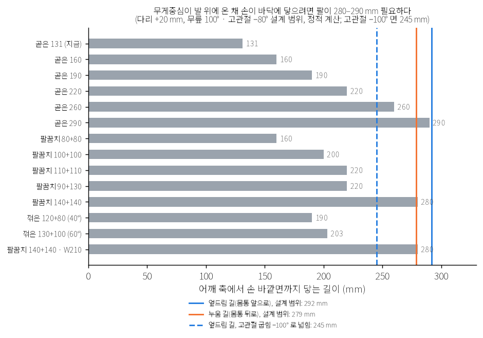
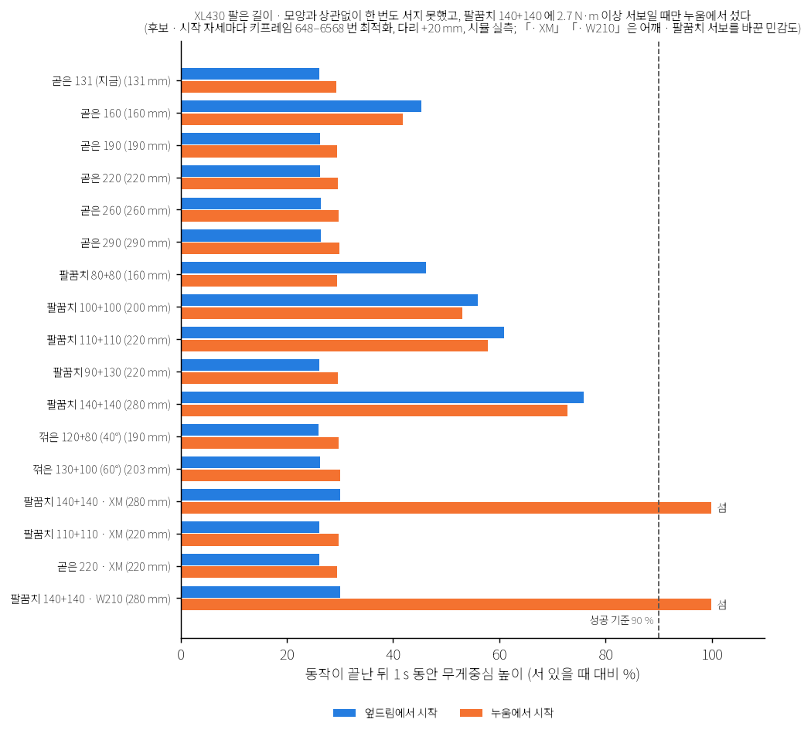

# 키토루 일어나기 — 팔 모양 조사 (2026-11-26)

## 결론 5줄

1. **XL430 팔(정지토크 1.4 N·m)로는 어떤 길이 · 모양도 시뮬에서 한 번도 일어서지 못했습니다.** 곧은 팔 131–290 mm, 팔꿈치 팔 160–280 mm, 꺾은 팔 2 가지를 엎드림 · 누움에서 후보마다 키프레임 640–1440 번 최적화했습니다. 어깨 서보가 동작 시간의 33–93 % 동안 힘 한계에 걸렸습니다 [시뮬 실측].
2. **무게가 손에서 발로 넘어가는 순간에 손이 바닥에 닿으려면 팔이 280–290 mm 필요합니다.** 무릎 100° · 고관절 −80° 설계 범위, 다리 +20 mm 기준입니다. 고관절 굽힘을 −100° 까지 넓히면 245 mm 로 줄어듭니다 [정적 계산].
3. **처음으로 일어선 조합: 팔꿈치 팔(위팔 140 + 아래팔 140 mm)에 어깨 · 팔꿈치 서보를 2.7 N·m 이상(XM430-W210 · W350)으로 바꾼 경우입니다.** 누움에서 뒤로 구르며 일어섰고, 엎드림에서는 아직 못 섰습니다 [시뮬 실측]. 과제의 「XL430 한계 안」 조건 밖이라 따로 표시합니다.
4. **추천 팔 모양: 팔꿈치 하나를 더한 팔, 위팔 140 · 아래팔 140 mm, 어깨 · 팔꿈치는 XM430-W210 이상.** 곧은 팔은 엎드림에서 처음 바닥을 밀 때 지렛대가 길어 어깨가 더 빨리 포화되므로 길게 늘려도 소용이 없었습니다.
5. **팔 질량이 늘어도 걷기는 나빠지지 않았습니다**(팔 하나 125 → 240 g, 최대 보폭 · 밀기 버팀 같음) [시뮬 실측]. 다만 늘어뜨린 긴 팔은 고관절 롤을 10° 넘게 벌리면 다리에 닿습니다 [정적 계산]. 걸을 때는 팔꿈치를 앞으로 접어 두어야 합니다.

## 무엇을 했나 (로봇이 하는 일과 예시)

- **이 조사가 다룬 것:** 넘어진 키토루가 팔과 다리 관절을 미리 정한 순서(키프레임)대로 움직여 다시 서는 동작입니다. 관절마다 위치 목표를 주고 서보가 따라갑니다. 센서 되먹임은 없습니다(열린 고리).
- **무엇이 아닌가:** 실기 동작이 아닙니다. 강화학습도 아닙니다. 키프레임은 사람이 짠 처음 값에서 시작해 교차 엔트로피 방법(cross-entropy method, 무작위로 뽑아 좋은 것만 남기는 최적화)으로 고쳤습니다.
- **예시 — 성공한 동작(팔꿈치 140+140 · XM, 묶음 `r4rob`, 누움에서 움직이기 시작해 다 서기까지 약 6.3 s, 영상 `results/getup_elbow140_XM_supine.mp4`, 0.5 s 간격 프레임 `results/getup_elbow140_XM_supine_frames.png`):**
  1. 등을 대고 누운 채 두 팔을 머리 뒤쪽 바닥으로 뻗어 짚습니다(어깨 +89 ~ +120°).
  2. 다리를 접어 올리며 팔로 바닥을 밀어, 머리와 두 손으로 물구나무를 서듯 뒤로 구릅니다.
  3. 다리가 머리 위로 넘어가 무릎 · 발이 바닥에 닿으면, 팔로 바닥을 밀어 쪼그림(무릎 100°, 고관절 −80°)으로 옮깁니다.
  4. 다리를 펴서 섭니다. 끝 1 s 동안 몸통 기울기 2° 이하, 무게중심 높이는 서 있을 때의 99.9 % 입니다.

## 수치 출처 표기

- **[시뮬 실측]** MuJoCo 4.0.1 에서 돌려 잰 값입니다.
- **[정적 계산]** 관절 각만으로 무게중심 · 어깨 높이를 계산한 값입니다(동역학 없음).
- **[e-manual]** ROBOTIS e-manual 값입니다. XL430-W250: 11.1 V 에서 정지토크 1.4 N·m, 무부하 57 rpm, 57.2 g, 기어비 258.5 (2026-11-26 페이지 확인).
- **[추정]** 근사 · 가정입니다.

## 1. 모델과 팔 후보

- **몸:** `sim/walk` 걷기 모델(v18 형상) + 고관절 롤 안 A 근사(`hr_cfg` 와 같은 `hrA(40.5 mm)`) + 허벅지 · 정강이 각 +20 mm(질량 포함, `sp_common.SEG`)입니다. 서보는 지금 배치(롤 · 피치 · 무릎 · 발목 롤 XM430-W350, 발목 피치 XC430-W240, 요 · 팔 XL430)입니다. 몸무게 3.09 kg 입니다(팔 바꾸기 전).
- **관절 범위(설계):** 무릎 0–100°, 고관절 피치 −80 – +30°, 발목 피치 −50 – +22°, 어깨 ±120°입니다. 팔꿈치는 ±130° 로 가정했습니다 [추정]. 서보 힘은 정지토크에서 잘립니다. 위치 이득은 앞 조사와 같이 2배입니다.
- **팔 모델 [추정]:** 원래 팔 메시를 지우고 캡슐 · 공으로 다시 만들었습니다.
  - 질량 = 어깨 서보 65.2 g(혼 · 케이블 포함) + 막대 0.34 g/mm × 길이 + 손 15 g.
  - 막대 선밀도는 지금 팔 132.5 g 에서 서보(73 g)와 손을 빼고 131 mm 로 나눈 값입니다.
  - 팔꿈치 팔은 팔꿈치 축에 XL430 하나(65.2 g)를 더 답니다.
  - 팔은 바닥과만 닿고 몸과는 닿지 않습니다(원래 모델 규칙과 같음).

| 팔 | 닿는 길이 mm | 팔 하나 g | 비고 |
|---|---|---|---|
| 곧은 131 (지금) | 131 | 125 | 원래 팔과 같은 질량 |
| 곧은 160 · 190 · 220 · 260 · 290 | 160–290 | 135–179 | |
| 팔꿈치 80+80 · 100+100 · 110+110 · 90+130 · 140+140 | 160–280 | 200–240 | 위팔 + 아래팔(팔꿈치 축에서 손 바깥면) |
| 꺾은 120+80 (40°) · 130+100 (60°) | 190 · 203 | 148 · 158 | 아래 토막을 앞으로 꺾어 고정 |
| 민감도: 팔꿈치 140+140 · W210 / · XM | 280 | 290 | 어깨 · 팔꿈치를 XM430-W210(2.7 N·m) / W350(3.8 N·m, 각 90 g)으로 |

## 2. 정적 계산: 손에서 발로 무게가 넘어가는 순간 (`gu_static.py`)

- 두 발을 평평하게 두고, 무게중심이 발바닥 패드 앞뒤 끝 안쪽 5 mm 안에 오는 자세를 모두 훑었습니다(무릎 5° · 발목 4° · 고관절 3° 간격).
- 그중 어깨 축이 가장 낮은 자세의 어깨 높이가 「손을 바닥에 짚은 채 발로 무게를 옮기는」 준정적 일어나기에 필요한 팔 길이입니다.

| 관절 범위 | 몸통이 앞으로 기운 길(엎드림에서) | 몸통이 뒤로 기운 길(누움에서) |
|---|---|---|
| 설계(무릎 100°, 고관절 −80°) | **292 mm** (무릎 0°, 고관절 −80°, 몸통 62° 숙임 — 다리를 편 ㅅ자) | **279 mm** (무릎 75°, 몸통 53° 뒤로) |
| 무릎 120° | 287 mm | 274 mm |
| 무릎 130° | 281 mm | 259 mm |
| 고관절 −100° (무릎 100°) | **245 mm** | 279–284 mm |
| 고관절 −120° (무릎 100°) | 199 mm | 282 mm |

- **지금 팔 131 mm 는 150–160 mm 모자랍니다.** 곧은 220 mm 도 60–70 mm 모자랍니다. 그래서 팔 길이만으로는 준정적으로 안 되고, 반동이 이 틈을 메워야 합니다.
- **무릎을 넓히는 것보다 고관절 굽힘을 넓히는 것이 훨씬 잘 듣습니다.** 고관절 −80 → −100° 에서 필요한 길이가 292 → 245 mm 로 줄었습니다. 고관절 −100° 가 형상에서 되는지는 형상 쪽 확인이 필요합니다(허벅지가 몸통 앞 아래에 닿는지).
- 그림: `results/fig_reach.png`



## 3. 키프레임 최적화 결과 (`gu_search.py`, 시뮬 실측)

- **동작:** 키프레임 4개(1 · 2묶음) 또는 6개(3 · 4묶음) + 마지막 「섬」(모든 관절 0°, 1.5 s)입니다. 키마다 시간과 어깨 · 팔꿈치 · 고관절 피치 · 무릎 · 발목 피치 목표(좌우 같음)를 찾습니다.
- **성공 판정(앞 조사 `getup.py` 와 같음):** 끝 1 s 동안 몸통 기울기 15° 미만이고 무게중심 높이가 서 있을 때의 90 % 이상.
- **최적화 비용:** 순간 비용 = 몸통 기울기 + 높이 부족 + 두 발 가운데와 무게중심 사이 수평 거리(3묶음부터). 끝 1 s 평균과 가장 좋았던 순간을 반씩 더했습니다.
- **묶음:**
  1. `search` — 13 후보 × 엎드림 · 누움, 키 4개, 18회 × 36.
  2. `pike` · `hip100` — 엎드림을 「팔굽혀펴기 → ㅅ자」로 시작, 고관절 −80° · −100°.
  3. `r3` · `r3hip100` — 키 6개, 엎드림은 「팔굽혀펴기 → 다리 당기기」로 시작, 서보 민감도(· XM) 포함.
  4. `r4xl` · `r4rob` · `r5arm110` · `r6prone` — 성공한 동작을 처음 값으로 다른 서보 · 어깨 범위로 옮기기, 조건을 바꿔도 되게 고치기.

### 3.1 후보별 가장 좋은 시도

(표의 토크 몫 = |서보 힘 − 감쇠 × 속도| / 정지토크의 99번째 백분위, 포화 시간 = 힘이 한계에 닿은 시간 비율)

| 팔 | 닿는 길이 mm | 팔 하나 g | 시작 | 성공 (성공한 후보 수 / 돌린 수, 모든 묶음) | 가장 좋은 시도: 끝 높이 % | 지나는 동안 최고 높이 % | 어깨 토크 몫 · 포화 % | 팔꿈치 토크 몫 · 포화 % | 묶음 · 고관절 한계 |
|---|---|---|---|---|---|---|---|---|---|
| 곧은 131 (지금) | 131 | 125 | 엎드림 | 실패 (0/648) | 26 | 41 | 1.12 · 33 | — | search · -80° |
| 곧은 131 (지금) | 131 | 125 | 누움 | 실패 (0/648) | 29 | 44 | 0.86 · 12 | — | search · -80° |
| 곧은 160 | 160 | 135 | 엎드림 | 실패 (0/648) | 45 | 53 | 1.00 · 60 | — | search · -80° |
| 곧은 160 | 160 | 135 | 누움 | 실패 (0/648) | 42 | 45 | 1.02 · 51 | — | search · -80° |
| 곧은 190 | 190 | 145 | 엎드림 | 실패 (0/648) | 26 | 40 | 1.13 · 57 | — | search · -80° |
| 곧은 190 | 190 | 145 | 누움 | 실패 (0/648) | 29 | 43 | 1.10 · 51 | — | search · -80° |
| 곧은 220 | 220 | 155 | 엎드림 | 실패 (0/2568) | 26 | 39 | 1.07 · 52 | — | hip100 · -100° |
| 곧은 220 | 220 | 155 | 누움 | 실패 (0/1608) | 30 | 46 | 1.09 · 34 | — | search · -80° |
| 곧은 260 | 260 | 169 | 엎드림 | 실패 (0/2568) | 26 | 40 | 1.16 · 66 | — | search · -80° |
| 곧은 260 | 260 | 169 | 누움 | 실패 (0/1608) | 30 | 47 | 1.14 · 48 | — | hip100 · -100° |
| 곧은 290 | 290 | 179 | 엎드림 | 실패 (0/648) | 26 | 46 | 1.08 · 61 | — | search · -80° |
| 곧은 290 | 290 | 179 | 누움 | 실패 (0/648) | 30 | 45 | 1.01 · 49 | — | search · -80° |
| 팔꿈치 80+80 | 160 | 200 | 엎드림 | 실패 (0/648) | 46 | 47 | 1.17 · 66 | 0.71 · 0 | search · -80° |
| 팔꿈치 80+80 | 160 | 200 | 누움 | 실패 (0/648) | 29 | 46 | 1.18 · 33 | 0.77 · 1 | search · -80° |
| 팔꿈치 100+100 | 200 | 213 | 엎드림 | 실패 (0/648) | 56 | 56 | 1.28 · 73 | 0.93 · 20 | search · -80° |
| 팔꿈치 100+100 | 200 | 213 | 누움 | 실패 (0/648) | 53 | 53 | 1.19 · 77 | 0.66 · 16 | search · -80° |
| 팔꿈치 110+110 | 220 | 220 | 엎드림 | 실패 (0/5448) | 61 | 71 | 1.27 · 46 | 0.89 · 24 | r3 · -80° |
| 팔꿈치 110+110 | 220 | 220 | 누움 | 실패 (0/4488) | 58 | 59 | 1.14 · 64 | 0.87 · 14 | r3hip100 · -100° |
| 팔꿈치 90+130 | 220 | 220 | 엎드림 | 실패 (0/648) | 26 | 41 | 1.24 · 53 | 1.07 · 28 | search · -80° |
| 팔꿈치 90+130 | 220 | 220 | 누움 | 실패 (0/648) | 30 | 46 | 1.28 · 52 | 0.88 · 1 | search · -80° |
| 팔꿈치 140+140 | 280 | 240 | 엎드림 | 실패 (0/5448) | 76 | 76 | 1.17 · 91 | 1.04 · 36 | hip100 · -100° |
| 팔꿈치 140+140 | 280 | 240 | 누움 | 실패 (0/6568) | 73 | 73 | 1.18 · 80 | 1.04 · 37 | r3 · -80° |
| 꺾은 120+80 (40°) | 190 | 148 | 엎드림 | 실패 (0/648) | 26 | 39 | 1.14 · 65 | — | search · -80° |
| 꺾은 120+80 (40°) | 190 | 148 | 누움 | 실패 (0/648) | 30 | 44 | 1.02 · 42 | — | search · -80° |
| 꺾은 130+100 (60°) | 203 | 158 | 엎드림 | 실패 (0/2568) | 26 | 56 | 1.24 · 87 | — | hip100 · -100° |
| 꺾은 130+100 (60°) | 203 | 158 | 누움 | 실패 (0/1608) | 30 | 56 | 1.57 · 38 | — | search · -80° |
| 팔꿈치 140+140 · XM | 280 | 290 | 엎드림 | 실패 (0/4800) | 30 | 115 | 0.87 · 22 | 0.89 · 19 | r6prone · -80° |
| 팔꿈치 140+140 · XM | 280 | 290 | 누움 | **성공** (478/4960) | 100 | 106 | 0.83 · 18 | 0.89 · 8 | r3 · -80° |
| 팔꿈치 110+110 · XM | 220 | 270 | 엎드림 | 실패 (0/1440) | 26 | 90 | 0.90 · 20 | 1.03 · 16 | r3 · -80° |
| 팔꿈치 110+110 · XM | 220 | 270 | 누움 | 실패 (0/2880) | 30 | 86 | 0.70 · 16 | 0.73 · 7 | r4xl · -80° |
| 곧은 220 · XM | 220 | 180 | 엎드림 | 실패 (0/1440) | 26 | 88 | 0.82 · 18 | — | r3 · -80° |
| 곧은 220 · XM | 220 | 180 | 누움 | 실패 (0/1440) | 30 | 97 | 1.01 · 18 | — | r3 · -80° |
| 팔꿈치 140+140 · W210 | 280 | 290 | 누움 | **성공** (1081/2880) | 100 | 100 | 1.06 · 47 | 0.76 · 4 | r4xl · -80° |
| 팔꿈치 140+140 · W210 | 280 | 290 | 엎드림 | 실패 (0/1920) | 30 | 121 | 1.05 · 17 | 0.85 · 7 | r6prone · -80° |

- 토크 몫은 그 팔의 서보 정지토크 대비입니다(XL 1.4, W210 2.7, XM 3.8 N·m). 1 을 넘는 것은 감쇠 몫을 뺀 부하가 정지토크보다 컸던 순간입니다(서보 힘 자체는 한계에서 잘림).
- `r4rob` 의 성공 수는 조건 5 가지(기준 · 마찰 0.6 · 1.0 · 시간 ×0.95 · 1.05)에서 모두 선 후보만 셉니다.




- 엎드림에서는 XM · W210 팔이 지나는 동안 무게중심을 서 있는 높이 이상(115–121 %)까지 올렸지만, 그대로 넘어가 끝에는 누운 높이(30 %)였습니다. 몸을 던지듯 뛰어오르다 균형을 잃은 것입니다.

### 3.2 왜 XL430 팔은 안 되나

- **곧은 팔은 엎드림에서 처음 바닥을 밀 때 막힙니다.** 엎드리면 어깨 축이 바닥에서 70 mm 위입니다. 팔이 길수록 손이 거의 누운 각도(220 mm 면 18°)에서 바닥에 닿습니다. 그래서 어깨에서 손까지 수평 지렛대가 팔 길이만큼 길어집니다. 가슴을 들려면 팔 하나가 약 7 N 을 내야 하는데, 지렛대 0.21 m 면 1.5 N·m 로 XL430 정지토크(1.4)를 넘습니다 [정적 계산, 힘은 추정]. 지금 팔(131 mm)이 오히려 가슴을 가장 높이 들었습니다.
- **팔꿈치 팔은 손을 어깨 밑에 둘 수 있어 팔굽혀펴기가 됩니다.** 그래서 가장 멀리 갔습니다(140+140: 팔로 버틴 판자 자세까지, 끝 높이 73–76 %). 그러나 거기서 발을 몸 밑으로 당겨 무게를 발로 옮기는 단계에서 어깨가 포화됐습니다(포화 시간 58–93 %).
- **같은 동작을 서보만 XL430 으로 바꾸면 실패합니다.** XM 으로 성공한 키프레임을 처음 값으로 XL430 팔꿈치 140+140 을 1440 번 다시 최적화했지만 성공 0 이었습니다(`r4xl`).
- 성공한 동작에서 어깨 부하는 99번째 백분위 2.9–3.0 N·m, 팔꿈치는 2.0–3.5 N·m 였습니다(4절 표). 둘 다 XL430 정지토크 1.4 N·m 의 2배 안팎입니다. W210(2.7 N·m)으로도 섰지만 어깨가 47 % 시간 동안 포화됐습니다. **어깨 · 팔꿈치 모두 2.7 N·m 이상, 여유를 두려면 3.8 N·m 급이 필요합니다** [시뮬 실측].

### 3.3 성공한 동작이 조건 변화에 얼마나 버티나 (`gu_robust.py`)

| 동작(묶음, 팔) | 성공 / 15 조건 | 실패한 조건 |
|---|---|---|
| r3, 팔꿈치 140+140 · XM, 누움 | 4 | 마찰 0.5, 마찰 0.65, 마찰 1.0, 마찰 1.2, 동작 시간 ×0.9, 동작 시간 ×0.95, 동작 시간 ×1.1, 위치 이득 ×1.25, 팔 질량 ×0.8, 팔 질량 ×1.2, 처음 가라앉는 시간 +0.05 s |
| r4rob, 팔꿈치 140+140 · XM, 누움 | 12 | 마찰 0.5, 동작 시간 ×1.1, 팔 질량 ×1.2 |
| r4xl, 팔꿈치 140+140 · W210, 누움 | 3 | 마찰 0.5, 마찰 0.65, 마찰 1.0, 마찰 1.2, 동작 시간 ×0.9, 동작 시간 ×1.05, 동작 시간 ×1.1, 위치 이득 ×0.75, 위치 이득 ×1.25, 팔 질량 ×0.8, 팔 질량 ×1.2, 처음 가라앉는 시간 +0.2 s |
| r5arm110, 팔꿈치 140+140 · XM, 누움 | 6 | 마찰 0.5, 마찰 0.65, 마찰 1.2, 동작 시간 ×0.9, 동작 시간 ×0.95, 위치 이득 ×1.25, 팔 질량 ×0.8, 팔 질량 ×1.2, 처음 가라앉는 시간 +0.05 s |
| r5arm110, 팔꿈치 140+140 · W210, 누움 | 10 | 마찰 0.5, 마찰 0.65, 마찰 1.0, 마찰 1.2, 팔 질량 ×1.2 |
| r3hip100, 팔꿈치 140+140 · XM, 누움 | 1 | 마찰 0.5, 마찰 0.65, 마찰 1.0, 마찰 1.2, 동작 시간 ×0.9, 동작 시간 ×0.95, 동작 시간 ×1.05, 동작 시간 ×1.1, 위치 이득 ×0.75, 위치 이득 ×1.25, 팔 질량 ×0.8, 팔 질량 ×1.2, 처음 가라앉는 시간 +0.05 s, 처음 가라앉는 시간 +0.2 s |

- 15 조건: 기준, 바닥 마찰 0.5 · 0.65 · 1.0 · 1.2(기준 0.8), 동작 시간 ×0.9 · 0.95 · 1.05 · 1.1, 위치 이득 ×0.75 · 1.25, 팔 질량 ×0.8 · 1.2, 처음 가라앉는 시간 +0.05 · +0.2 s.
- `r4rob` 은 조건 5 가지의 평균 비용으로 다시 최적화한 것이라 버티는 조건이 가장 많습니다.

- 궤적이 매우 예민합니다. 고관절 범위를 0.0003 rad 만 바꿔도 같은 키프레임의 결과가 갈라졌습니다. 한 번 성공은 실기 성공을 뜻하지 않습니다.

## 4. 필요한 관절 범위 · 토크 몫 (성공한 동작 기준)

| 동작 | 어깨 범위 ° | 팔꿈치 ° | 고관절 피치 ° | 무릎 ° | 발목 피치 ° | 어깨 최대 N·m (99번째 백분위) | 팔꿈치 최대 N·m | 고관절 최대 N·m | 무릎 최대 N·m |
|---|---|---|---|---|---|---|---|---|---|
| r4rob, 팔꿈치 140+140 · XM | 0 ~ 120 | -30 ~ 83 | -80 ~ 13 | 0 ~ 100 | -50 ~ 0 | 3.0 (3.0) | 4.4 (3.5) | 5.2 (2.7) | 2.4 (1.9) |
| r4xl, 팔꿈치 140+140 · W210 | -13 ~ 120 | -26 ~ 104 | -80 ~ 30 | 0 ~ 100 | -50 ~ 0 | 3.5 (2.9) | 2.8 (2.0) | 4.1 (2.5) | 1.6 (1.0) |
| r5arm110, 팔꿈치 140+140 · XM | -8 ~ 110 | -17 ~ 89 | -80 ~ 22 | 0 ~ 100 | -50 ~ 0 | 3.2 (3.0) | 4.4 (2.9) | 5.3 (3.5) | 2.4 (2.0) |

- 범위는 키프레임 목표의 최소 ~ 최대입니다(실제 관절은 목표를 따라가며 조금 덜 갑니다). 무릎 100° · 고관절 −80° · 발목 −50° 설계 끝까지 다 씁니다.
- 어깨는 +120° 끝까지 썼지만 ±110° 로 줄여 다시 찾아도 섰습니다(`r5arm110`).
- 토크 [시뮬 실측]: 부하 토크 = 서보 힘 − 감쇠 × 속도. 최대값이 정지토크를 넘는 것은 관절이 밖에서 밀려 거꾸로 돌 때 감쇠 몫이 더해진 순간입니다. 어깨 · 팔꿈치 모두 XL430 정지토크 1.4 N·m 의 2배 안팎을 요구합니다.

## 5. 걷기 영향 (`gu_walk.py`, 시뮬 실측) · 팔과 다리 틈 (`gu_clear.py`, 정적 계산)

- **방법:** 팔 질량 · 무게중심 차이를 팔 body 에 점 질량 하나로 더했습니다(팔꿈치는 0° 로 편 채라고 봄). 제어기는 `sim/walk` 그대로(이득 2배 · 200 Hz · 지연 10 ms, 웅크림 25 mm)입니다.
- 걷기: 한 걸음 (0.45 + 0.20) s · (0.38 + 0.15) s × 보폭 50–110 mm, 18 걸음.
- 밀기: 6번째 걸음 한 발 지지 중 0.2 s, 앞 · 옆 4–14 N.

| 팔 | 팔 하나 g | 몸무게 kg | 안 넘어진 최대 보폭 (0.45+0.20 / 0.38+0.15) | 버틴 밀기 (앞 / 옆) |
|---|---|---|---|---|
| 곧은 131 (지금) | 125 | 3.09 | 70 / 60 mm | 6 / 8 N |
| 곧은 220 | 155 | 3.15 | 70 / 60 mm | 6 / 8 N |
| 팔꿈치 110+110 | 220 | 3.28 | 70 / 70 mm | 6 / 8 N |
| 팔꿈치 140+140 | 240 | 3.32 | 70 / 70 mm | 8 / 8 N |

- **팔 질량이 늘어도 걷기 균형은 나빠지지 않았습니다.** 오히려 조금 나았습니다. 팔이 무거워져 몸의 흔들림 관성이 커진 것으로 봅니다 [추정].
- XM 팔(팔 하나 290 g)은 걷기로 돌리지 않았습니다. 140+140 XL(240 g)보다 50 g 무거운 정도라 비슷할 것으로 봅니다 [추정].
- **팔과 다리 틈:** 시뮬은 팔과 다리의 충돌을 계산하지 않으므로 따로 쟀습니다. 팔을 늘어뜨리고 고관절 롤을 바깥으로 벌릴 때 팔과 다리 사이 가장 짧은 거리입니다.

| 팔 | 롤 0° | 5° | 10° | 15° | 20° |
|---|---|---|---|---|---|
| 곧은 131 (지금, 캡슐 근사) | 34 mm | 30 | 26 | 21 | 17 |
| 곧은 220 · 팔꿈치 110+110 | 16 | 7 | **−2 (닿음)** | −11 | −21 |
| 팔꿈치 140+140 | 13 | **−1** | −15 | −28 | −34 |
| 꺾은 130+100 (60°) | 22 | 18 | 14 | 9 | 5 |

- 팔꿈치 140+140 은 늘어뜨리면 롤 5° 에서 이미 닿습니다. **걸을 때는 팔꿈치를 앞으로 접어(아래팔을 앞으로) 손을 다리 앞에 두어야 합니다.** 접은 자세의 걷기는 돌리지 않았습니다.

## 6. 추천 팔 모양

- **팔꿈치 하나를 더한 팔, 위팔 140 mm · 아래팔 140 mm(닿는 길이 280 mm).**
- **어깨 · 팔꿈치 서보는 XM430-W210(2.7 N·m) 이상, 여유를 두려면 XM430-W350(3.8 N·m).** XL430 으로는 이 조사에서 일어서지 못했습니다.
- 이유:
  1. 정적 계산의 필요 길이(279–292 mm)에 가장 가깝습니다.
  2. 엎드림에서 손을 어깨 밑에 둘 수 있어 팔굽혀펴기가 됩니다. 곧은 팔은 이것이 안 됩니다.
  3. 누움에서 성공한 유일한 모양입니다.
  4. 걷기 균형을 해치지 않았습니다.
- **함께 볼 것:**
  - 고관절 피치 굽힘을 −100° 까지 넓히면 필요한 팔 길이가 245 mm 로 줄어 더 짧은 팔도 될 수 있습니다(형상 확인 필요).
  - 어깨 범위는 ±110° 로 줄여도 누움 성공이 유지됐습니다(`r5arm110`).
  - 엎드림 일어나기는 아직 성공하지 못했습니다. 엎드림 → 누움으로 뒤집는 동작은 이 몸(팔이 앞뒤로만 돎)에서 따로 조사가 필요합니다.

## 7. 한계

- 열린 고리 키프레임만 해 봤습니다. 자세 되먹임이나 강화학습을 쓰면 XL430 으로도 될 수 있습니다. 이번 결과는 「손으로 짠 처음 값 + 교차 엔트로피 최적화로 찾지 못함」입니다.
- 성공한 동작은 머리와 두 손으로 물구나무를 서듯 뒤로 구릅니다. 머리 껍데기 · 카메라가 바닥에 몸무게를 받습니다. 머리 강도와 카메라 보호는 따로 봐야 합니다.
- 팔은 캡슐 근사이고, 질량 · 손 무게 · 팔꿈치 범위 ±130° 는 추정입니다. 팔과 몸 · 다리의 충돌은 시뮬에서 계산하지 않았습니다(5절의 틈은 따로 계산).
- 무릎 100° 이상 · 고관절 −80° 밖(−100°)은 민감도 줄이며, 형상이 되는지는 형상 에이전트 확인이 필요합니다.
- 바닥 마찰 0.8, 서보 모델(감쇠 = 정지토크/무부하속도)은 기존 걷기 모델 그대로입니다. 전압 강하 · 서보 발열은 넣지 않았습니다.
- 걷기 확인은 팔을 편 채(점 질량)이고, 팔꿈치를 접은 걷기는 돌리지 않았습니다.

## 8. 다시 돌리는 법

```bash
cd sim/getup
../.venv/bin/python gu_static.py                                  # 정적 계산 → results/static.json
TAG=search ../.venv/bin/python gu_search.py 18 36                  # 1묶음: 13 후보 × 엎드림 · 누움
TAG=pike STARTS=pike PROCS=24 ../.venv/bin/python gu_search.py 24 40 "곧은 220" "곧은 260" "팔꿈치 110+110" "팔꿈치 140+140" "꺾은 130+100 (60°)"
TAG=hip100 HIP_MIN_DEG=-100 STARTS=pike,supine PROCS=24 SEED=1 ../.venv/bin/python gu_search.py 24 40 (같은 5 후보)
NK=6 TAG=r3 STARTS=tuck,supine6 PROCS=28 SEED=2 ../.venv/bin/python gu_search.py 30 48 "팔꿈치 110+110" "팔꿈치 140+140" "팔꿈치 140+140 · XM" "팔꿈치 110+110 · XM" "곧은 220 · XM"
NK=6 TAG=r3hip100 HIP_MIN_DEG=-100 STARTS=tuck,supine6 PROCS=28 SEED=3 ../.venv/bin/python gu_search.py 30 48 "팔꿈치 110+110" "팔꿈치 140+140" "팔꿈치 140+140 · XM"
NK=6 TAG=r4xl STARTS=supine6 PROCS=26 SEED=4 INIT_FROM="r3:팔꿈치 140+140 · XM:supine6" SIG_SCALE=0.4 ../.venv/bin/python gu_search.py 30 48 "팔꿈치 140+140" "팔꿈치 140+140 · W210" "팔꿈치 110+110 · XM"
NK=6 TAG=r4rob ROBUST=1 STARTS=supine6 PROCS=26 SEED=5 INIT_FROM="r3:팔꿈치 140+140 · XM:supine6" SIG_SCALE=0.25 ../.venv/bin/python gu_search.py 20 32 "팔꿈치 140+140 · XM" "팔꿈치 140+140"
NK=6 TAG=r5arm110 ARM_MAX_DEG=110 STARTS=supine6 PROCS=26 SEED=6 INIT_FROM="r3:팔꿈치 140+140 · XM:supine6" SIG_SCALE=0.4 ../.venv/bin/python gu_search.py 30 48 "팔꿈치 140+140 · XM" "팔꿈치 140+140 · W210"
NK=6 TAG=r6prone STARTS=tuck PROCS=24 SEED=7 INIT_FROM="r3:팔꿈치 140+140 · XM:tuck" SIG_SCALE=0.5 ../.venv/bin/python gu_search.py 40 48 "팔꿈치 140+140 · XM" "팔꿈치 140+140 · W210"
../.venv/bin/python gu_robust.py r4rob "팔꿈치 140+140 · XM" supine6     # 조건 바꿔 다시 돌리기
../.venv/bin/python gu_summary.py <tag> ...                        # 표 → results/summary_<tag>.md
../.venv/bin/python gu_walk.py                                     # 걷기 · 밀기
../.venv/bin/python gu_clear.py                                    # 팔과 다리 틈
../.venv/bin/python gu_figs.py search pike_hip100 r3_r3hip100 r4xl_r4rob_r5arm110_r6prone   # 그림 둘
CUDA_DEVICE_ORDER=PCI_BUS_ID MUJOCO_GL=egl MUJOCO_EGL_DEVICE_ID=3 NK=6 ../.venv/bin/python gu_show.py r4rob "팔꿈치 140+140 · XM" supine6 mp4 results/getup_elbow140_XM_supine.mp4
```

- 결과 재생은 `gu_search.replay` 가 저장된 관절 범위 · 키 수를 맞춰 줍니다. 범위가 조금만 달라도 궤적이 갈라지므로 꼭 이것으로 다시 돌립니다.
- 커밋 기준: 레포 `Najongs/Make_kirotoo`, 이 문서와 같은 커밋.
