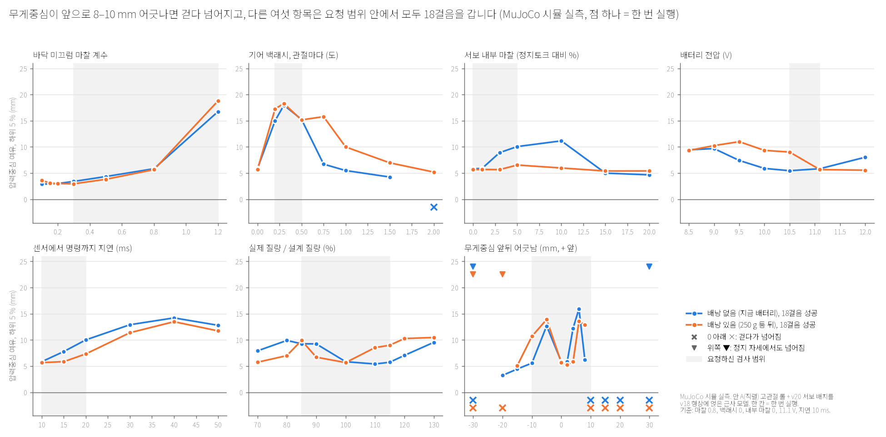
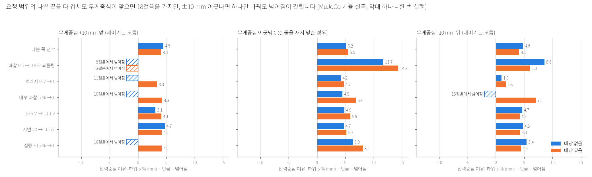

# 키토루 강건성 검사: 실물로 만들면 무엇이 먼저 안 될까 (2026-11-26)

소유자 질문은 「실제로 만들 때 동작이 안 될 수 있는지」였습니다. 실물은 설계와 조금씩 다릅니다. 바닥, 기어, 배터리 전압, 통신 지연, 무게, 무게중심이 그렇습니다. 그 차이를 MuJoCo 물리 모델에만 넣고, 제어기는 설계값만 아는 상태로 정지 자세와 걷기를 돌렸습니다. 출력물 강도와 서보 발열은 시뮬 밖에서 간단히 계산했습니다.

## 0. 결론 — 실물에서 먼저 깨질 것 순서

1. **무릎 서보 과열.** 0.077 m/s 로 계속 걸으면 무릎 XM430 부하 토크 RMS 가 1.33 N·m 입니다(정지토크의 35 %) [시뮬 실측]. 열 모델로 보면 정상 상태 온도가 68–96 °C 로, 한계 80 °C 근처이거나 넘습니다. 배낭을 달거나 질량이 +15 % 면 71–115 °C 입니다 [추정 열 모델].
2. **무게중심 앞뒤 어긋남.** 실물 무게중심이 설계보다 **앞으로 8–10 mm** 가 있는데 제어기가 모르면, 걷다가 넘어집니다(+10 mm 에서 배낭 없음 11걸음, 배낭 있음 18걸음 뒤 멈추다 넘어짐; +15 mm 는 둘 다 7–8걸음). 뒤로는 −15 mm 까지 버팁니다 [시뮬 실측]. 실물 무게중심을 재서 제어기 모델에 넣는 것이 가장 싼 대책입니다.
3. **출력물(PLA) 층 사이 굽힘.** 다리 부품은 모두 다리 방향으로 쌓아 출력해서, 굽힘이 층 사이를 벌립니다 [단면은 STL 실측, 강도는 추정].
   - 걷는 동안 걸음마다 되풀이되는 응력(걷기 99 % 모멘트)이 반복 하중 한계로 본 약 7 MPa 를 넘는 곳은 두 부품입니다.
     - 고관절 롤 U 브래킷(안 A 새 부품): 9.7 MPa
     - 정강이 틀: 7.2–7.7 MPa
   - 층간 강도 20 MPa 의 절반쯤이라 한 번에 부러지지는 않지만, 오래 걸으면 층 사이로 금이 갈 수 있습니다.
   - 발목 브래킷은 걷기 반복 응력이 4.3 MPa 로 한계 아래입니다. 다만 서보가 정지토크를 낼 때(넘어짐 · 과부하)는 9.3 MPa 입니다.
   - 넘어질 때의 충격은 넣지 않았습니다.
4. **기어 · 조립 놀이(백래시).** 서보 자체 백래시 0.25° [e-manual] 는 문제없습니다. 걷기는 관절마다 1.5° 까지 버티고, 2° 에서 넘어졌습니다(배낭 없음) [시뮬 실측]. 출력물 나사 구멍 여유로 혼이 미끄러지면 놀이가 늘 수 있습니다 [추정].
5. **바닥 마찰 · 전압 · 지연 · 질량은 시뮬에서 여유가 큽니다.**
   - 마찰은 0.1, 지연은 50 ms, 질량은 ±30 % 까지 18걸음을 갔습니다.
   - 전압은 8.5 V 까지 갔지만 무릎 포화가 4.3 → 11 % 로 늘었습니다.
   - 실제 전압 한계는 균형이 아니라 서보 동작 하한 10.0 V(XM430) · 최소 전압 기본값 9.5 V 입니다 [e-manual].

- **수치 출처 표기:** [시뮬 실측] MuJoCo 4.0.1 · [e-manual] ROBOTIS e-manual · [STL 실측] 출력 파일을 잘라 잰 값 · [추정] 근거가 약한 가정값
- **나쁜 쪽을 모두 겹친 조합**(마찰 0.5, 백래시 0.5°, 내부 마찰 5 %, 10.5 V, 지연 20 ms, 질량 +15 %): 무게중심만 맞으면 배낭 유무 둘 다 18걸음을 갔습니다. 무게중심을 ±10 mm 어긋나게 하면 그중 하나만 되돌려도 넘어지는 경우가 생겼습니다. ±10 mm 는 경계이고 보장이 아닙니다(3절).



## 1. 무엇을 어떻게 돌렸나

### 1.1 모델 (근사임)

- **로봇:** v18 MJCF 형상에 두 가지를 얹었습니다.
  - 고관절 롤 **안 A(직렬)**: `sim/walk/hiproll/hr_cfg.py` 의 `hr("A")`. 롤 축 z 198.8, 피치 축 z 144.5 mm, 다리 +40.5 mm, 롤 서보 82 g.
  - v20 서보 배치(`sim/walk/battery6000/sim_runs.py` 의 `V20`): XM430 은 롤 · 피치 · 무릎 · 발목 롤, XC430 은 발목 피치, XL430 은 고관절 요 · 팔.
- **안 A 형상의 새 모델은 아직 없습니다.** 몸통 · 다리 부품 형상과 질량은 v18 그대로이고, 롤 서보 질량과 다리 길이만 반영했습니다. 질량 합은 3.05 kg 입니다 [시뮬 실측, 설계 목표 약 3.1 kg].
- **서보 모델:** 위치 액추에이터입니다.
  - kp = Dynamixel P 이득 추정값 × 2. 이득 2배는 `WALK_REPORT.md` 기준 설정입니다.
  - 감쇠 = 정지토크/무부하속도.
  - 회전자 관성은 추정값입니다.
- **제어기:** `sim/walk` 그대로입니다. ZMP 미리보기 + DCM, 200 Hz, 이득 2배, 지연 10 ms, 웅크림 25 mm, 발 들기 12 mm, 한 발 0.45 s + 두 발 0.20 s, 보폭 0.05 m.
  - 걷기 속도 명령은 0.077 m/s 이고, 실제 걸은 속도는 0.076 m/s 입니다 [시뮬 실측].
  - 옆 디딤 보정 `k_lat` = 0 입니다. `hiproll/results/compare.json` 의 안 A 0.05 m 보폭에서 여유가 더 컸습니다.
- **두 기준:**
  - 「배낭 없음」: 지금 LB-012 + Jetson 2S.
  - 「배낭 있음」: `battery6000` 의 등 뒤 배낭형입니다. LB-012 · Jetson 배터리를 빼고, 강압 모듈 15 g 과 250 g 팩을 x −117, z 280 mm 에 둡니다.
  - 배낭은 설계 결정이라 제어기도 압니다. 몸 전체 무게중심 x 는 −6.9 → −17.1 mm 입니다 [시뮬 실측].
- **시험:**
  - 정지 자세: 12 초 서 있기.
  - 걷기: 18걸음. 몸통 기울기 35° 초과 또는 무게중심 높이 0.13 m 미만이면 넘어짐으로 봅니다.
- **판정 지표:**
  - **압력중심 여유 하위 5 %:** 바닥 힘의 압력중심에서 닿아 있는 패드 볼록 껍질 가장자리까지 거리입니다(걷는 동안). 요청하신 「발 여유 하위 5 %」를 이것으로 읽었습니다. `WALK_REPORT.md` 와 같은 정의입니다.
  - **흔드는 발 최고 높이:** 발이 0.3 s 이상 뜬 구간마다 패드 바닥의 최고 높이입니다. 바닥을 스칠 위험을 봅니다.
  - **무릎 사용률 99 %:** u = |부하 토크|/정지토크 + |속도|/무부하속도 의 99 % 값입니다.
  - **무릎 포화 %:** 서보 힘이 정지토크에 붙은 시간입니다.

### 1.2 흐트러짐을 넣은 방법 (물리 모델에만, 제어기는 모름)

| 항목 | 방법 | 근거 |
|---|---|---|
| 바닥 마찰 | 모든 충돌 geom 미끄럼 마찰(기준 0.8 = 모델 기본값) | 기준값은 [추정: 고무 패드 · 단단한 바닥] |
| 기어 백래시 | 다리 서보 관절 12개마다 같은 축 · 같은 자리에 「놀이 관절」(범위 ±b/2)을 하나 더 넣음. 서보 힘 · 회전자 관성 · 감쇠는 모터 쪽 관절에 남고, 바깥 짐은 놀이 범위 안에서는 모터에 닿지 않음. 서보 위치 제어는 **출력각**(모터 각 + 놀이 각)으로 닫음(물리 1 kHz 마다 명령 − 놀이 각), 제어기 센서도 출력각을 읽음. 놀이 끝 부딪힘은 MuJoCo 가 허용하는 가장 단단한 한계(solref 0.002 s) | X430 엔코더(AS5045 · AS5601, 12 bit 360°)가 출력축 절대각을 준다고 봄 [추정]. XM430-W350 백래시 15′ = 0.25° [e-manual]. 0.5° 를 넣으면 놀이 각 최대 0.33°(한계가 약간 무름) [시뮬 실측] |
| 내부 마찰 | 다리 서보 관절 frictionloss = 정지토크 × 비율 | e-manual 에 값 없음 → 1–20 % 를 훑음 [추정] |
| 전압 | 정지토크 · 무부하속도를 e-manual 표로 보간. kp 는 V/11.1 배, 감쇠 = 정지토크/무부하속도로 다시 계산 | 표: XM 3.8 N·m · 43 rpm (11.1 V), 4.1 · 46 (12 V) / XC 1.4 · 52 (9 V), 1.7 · 65 (11.1 V), 1.9 · 70 (12 V) / XL 1.0 · 47 (9 V), 1.4 · 57 (11.1 V), 1.5 · 61 (12 V) [e-manual]. kp ∝ 전압은 [추정: P 이득이 PWM 듀티를 정함] |
| 제어 지연 | 센서 → 명령 링 버퍼(5 ms 단위, 기준 10 ms) | `kw_sim` 과 같은 방법 |
| 질량 | 모든 body 질량 · 관성 배수(무게중심 위치 그대로) | — |
| 무게중심 앞뒤 | 몸 전체가 dx 옮겨지도록 몸통 무게중심을 dx × 3.05 kg / 1.09 kg(약 2.8 배) 옮김 | — |

- **같은 코드 확인:** 흐트러짐이 0 일 때 이 검사 코드(`rb_common.run_rb`)는 `sim/walk/kw_sim.run` 과 같은 결과를 냅니다. 넘어짐 · 걸음 수 · 압력중심 여유 · 사용률이 소수점까지 같았습니다(`smoke.py`) [시뮬 실측].
- **흩어짐:** 마찰을 0.78–0.82 로, 질량을 ±1 % 바꿔 보면 압력중심 여유 하위 5 % 는 5.5–7.3 mm 사이였습니다. 다만 백래시 0.2° 처럼 작은 변화에도 15 mm 대로 뛰는 경우가 있습니다. 이 지표는 5 mm 대와 15 mm 대 두 무리를 오갑니다. 그래서 **여유 수치의 몇 mm 차이보다 넘어짐 여부를 판정 기준으로** 봤습니다 [시뮬 실측].

## 2. 하나씩 바꾸기 — 무너지는 경계

전체 표는 `results/tables.md` 에 있습니다. 아래는 요약입니다.

| 항목 | 요청 범위에서 | 무너지는 경계 (배낭 없음 / 있음) | 함께 나빠지는 것 |
|---|---|---|---|
| 바닥 마찰 0.3 · 0.5 · 0.8 · 1.2 | 정지 · 걷기 모두 성공 | 0.1 까지 안 무너짐 / 안 무너짐 | 압력중심 여유 하위 5 % 가 0.8 에서 5.8 mm → 0.3 에서 3.4 mm → 0.1 에서 2.9 mm |
| 기어 백래시 0.2–0.5° | 모두 성공 | **2.0° 에서 9걸음에 넘어짐** / 2.0° 까지 성공 | 무릎 포화 4.3 → 7.0 %, 흔드는 발 최소 높이 10.9 → 9.4 mm(1.5°) |
| 내부 마찰 1–20 % | 모두 성공 | 20 % 까지 안 무너짐 | 무릎 포화 4.3 → 7.7 % |
| 전압 10.5 V | 성공(무릎 포화 4.3 → 6.3 %) | 8.5 V 까지 안 무너짐 | 무릎 포화 8.5 V 에서 11.2 %, 사용률 99 % 1.35. **실물 한계는 서보 전압 하한**(XM 10.0 V, 기본 최소 전압 9.5 V) [e-manual] |
| 제어 지연 10 · 20 ms | 성공 | 50 ms 까지 안 무너짐 | 느린 걸음(0.077 m/s)이라 거의 영향 없음 |
| 질량 ±15 % | 성공 | ±30 % 까지 안 무너짐 | 배낭 있음 기준 무릎 포화 6.0 % |
| 무게중심 앞뒤 ±10 mm | **+10 mm 에서 넘어짐**, −10 mm 는 성공 | 앞: **+8 mm 성공, +10 mm 11걸음 넘어짐**, +15 mm 8걸음 / 앞: +8 mm 성공, +10 mm 18걸음 뒤 멈추다 넘어짐, +15 mm 7걸음. 뒤: −20 mm 성공, −30 mm 정지도 못 함 / −15 mm 성공, **−20 mm 정지도 못 함**. 정지: 배낭 없음 **+30 mm 에서도 정지 못 함** | 넘어지기 전 무릎 포화 12–14 %, 사용률 99 % 1.4 |

- **정지 자세는 단단합니다.** 무게중심 ±30 mm(배낭 없음), −20 · −30 mm(배낭 있음) 말고는 모든 조건에서 12 초를 버텼습니다 [시뮬 실측].
- **무게중심은 앞쪽에 약합니다.** 제어기의 목표 압력중심이 발 기준점보다 7 mm 뒤(`zmp_off`)라서, 앞으로 어긋나면 발끝 쪽 여유가 먼저 바닥나는 것으로 봅니다 [추정].
- **실물 무게중심을 재서 제어기에 넣으면** 경계가 넓어집니다. 배낭 없음은 +10 · −20 mm 가 성공이고, +20 · −30 mm 는 넘어졌습니다. 배낭 있음은 +10 · +20 mm 가 성공이고, −20 mm 는 넘어졌습니다 [시뮬 실측]. 배낭 있음은 설계 무게중심이 이미 10 mm 뒤라서 뒤쪽 여유가 작습니다.
- **디딤발이 잠깐 뜨는 일:** 걷는 동안 발이 0.03–0.3 s 동안 바닥에서 떨어지는 일이 기준에서 16번 있었습니다(흔드는 발 18번과 별도). 최고 높이는 약 2 mm 입니다. 걸음을 넘기는 순간 뒤꿈치 쪽이 들썩이는 것으로 보입니다 [시뮬 실측, 원인은 추정]. 넘어짐과는 관계가 없었습니다.

## 3. 나쁜 쪽 조합

나쁜 쪽 값은 마찰 0.5, 백래시 0.5°, 내부 마찰 5 %, 10.5 V, 지연 20 ms, 질량 +15 % 입니다. 무게중심은 세 갈래로 나눴습니다: +10 mm, −10 mm(둘 다 제어기는 모름), 0(실물을 재서 맞춘 경우). 갈래마다 「전부」와 「하나씩 뺀 것」을 돌렸습니다.



| 무게중심 | 전부 겹침 | 하나씩 뺀 6가지 중 넘어진 것 (배낭 없음 / 있음) |
|---|---|---|
| 0 (맞춤) | 둘 다 18걸음 성공, 압력중심 여유 5.2 / 5.5 mm | 0 / 0 |
| +10 mm (앞) | 둘 다 18걸음 성공, 4.5 / 4.1 mm | **4 / 1** (마찰 되돌림 · 백래시 0 · 내부 마찰 0 · 질량 되돌림 / 마찰 되돌림) |
| −10 mm (뒤) | 둘 다 18걸음 성공, 4.8 / 4.1 mm | **1 / 0** (내부 마찰 0) |

- 나쁜 쪽을 **모두** 겹친 경우는 성공했습니다. 그런데 그중 좋은 쪽으로 하나를 되돌리면 넘어지기도 했습니다. 무게중심이 ±10 mm 어긋난 상태는 결과가 들쭉날쭉한 **경계**라는 뜻입니다. 내부 마찰 · 백래시가 흔들림을 눌러 주는 쪽으로 작용한 것으로 봅니다 [추정].
- **정지 자세는 모든 조합에서 버텼습니다.**
- 「전부 겹침」 여섯 경우의 무릎 포화는 최대 14 %, 사용률 99 % 는 최대 1.26 이었습니다.

## 4. 시뮬 밖 계산

### 4.1 서보 발열 (`heat.py`, 전부 [추정] 열 모델)

- **계산 방법:**
  - 부하 토크 → 전류(I = τ/Kt, Kt 는 e-manual) → 권선 구리 손실 P = I_rms² × (11.1 V / 정지전류).
  - 열저항은 15–25 K/W 로 잡았습니다(케이스 겉넓이 약 7000 mm², 자연 대류).
  - 실내 25 °C 에서 시작합니다. 대기 전력 · 기어 마찰 열은 뺐으므로 실제보다 작게 나오는 쪽입니다.
- **연속 토크:** e-manual 에 값이 없고, 「정지토크는 연속 출력과 다르다」는 주의만 있습니다. 그래서 정상 상태 온도로 판정했습니다. 한계는 XM · XC 80 °C, XL 72 °C 입니다 [e-manual].

| 시험 | 관절 (서보) | 부하 평균 / RMS (N·m) | RMS / 정지토크 | 구리 손실 (W) | 정상 상태 온도 (°C) |
|---|---|---|---|---|---|
| 걷기, 배낭 없음 | **무릎 (XM430)** | 1.13 / 1.33 | 35 % | 2.85 | **68–96** |
| | 고관절 롤 (XM430) | 0.63 / 0.87 | 23 % | 1.22 | 43–56 |
| | 고관절 피치 (XM430) | 0.44 / 0.72 | 19 % | 0.84 | 38–46 |
| | 발목 피치 (XC430) | 0.29 / 0.41 | 24 % | 0.85 | 38–46 |
| | 발목 롤 (XM430) · 고관절 요 (XL430) | 0.22 / 0.34 · 0.04 / 0.06 | 9 % · 4 % | 0.19 · 0.02 | 28–30 · 25–26 |
| 걷기, 배낭 있음 | 무릎 | 1.24 / 1.42 | 37 % | 3.26 | **74–107** |
| 걷기, 질량 +15 %, 배낭 있음 | 무릎 | 1.34 / 1.49 | 39 % | 3.59 | **79–115** |
| 나쁜 조합 (무게중심 −10 mm), 배낭 있음 | 무릎 | 1.63 / 1.79 | 50 % | 5.19 | **103–155** |
| 서 있기, 배낭 없음 · 있음 | 무릎 | RMS 0.53 · 0.63 | 14 · 17 % | 0.46 · 0.64 | 32–36 · 35–41 |

- **무릎만 위험합니다.** 무릎 부하의 대부분은 웅크림 25 mm 로 몸무게를 받치는 몫입니다(서 있기만 해도 0.5 N·m).
- 열이 오르는 데는 몇 분이 걸립니다(열 시정수, 값은 모름). 그래서 짧은 시험 걷기는 괜찮고, **몇 분 이상 계속 걸을 때** 과열 정지(Overheating Shutdown, 기본 켜짐 [e-manual])가 걸릴 수 있습니다.

### 4.2 출력물 굽힘 (`strength.py`)

- **단면:** `out20/print_parts_stl` 의 오른 다리 STL 을 1 mm 간격으로 잘랐습니다.
  - 이 파일들은 다른 작업이 만드는 중인 안 A 판이고, 아직 커밋 전입니다(2026-11-26 20:43–20:44 KST). sha1 은 `results/strength.json` 에 남겼습니다.
  - 혼 · 나사 자리인 양끝 8 mm 는 뺐습니다.
- **출력 설정 반영:** 벽 1.2 mm 는 꽉 찬 것으로, 안쪽 채움 20 % 는 0.2 배로 셌습니다 [추정].
  - 단면 넓이 계산은 STL 부피와 0.4 % 안에서 맞았습니다(허벅지 틀 23.42 / 23.51 cm³) [STL 실측].
- **모멘트:** 이웃 관절 토크 중 큰 것입니다.
  - 걷기에서 무릎 · 고관절 피치 · 발목 피치가 1 % 넘는 시간 동안 정지토크에 붙어서, 걷기 최대 = 정지토크 3.8 N·m 입니다 [시뮬 실측].
  - 12 V 에서는 4.1 N·m [e-manual] 이고, 응력이 8 % 더 큽니다.
- **보수적으로 잡은 것:** 모멘트 축이 STL x · y 중 어느 쪽인지 따로 맞추지 않고, 약한 쪽 단면계수를 썼습니다. 서보 케이스가 함께 받는 몫은 뺐습니다.
- **허용 응력:** 다섯 부품 모두 다리 방향(STL z)이 쌓는 방향이라, 굽힘이 층 사이를 벌립니다. PLA 층간 인장 강도는 15–30 MPa, 대표 20 MPa 로 잡았습니다. 반복 하중은 그 1/3(약 7 MPa)을 오래 버틴다고 봤습니다 [추정: 문헌 일반값].

| 부품 | 가장 약한 단면 STL z (끝 3 mm 뺀 안쪽) | 꽉 찬 단면 넓이 (mm²) | 단면계수 (mm³) | 정지토크 3.8 N·m 응력 (MPa) | 20 MPa 대비 안전율 | 걷기 99 % 모멘트 (N·m) → 응력 (MPa) | 반복 7 MPa |
|---|---|---|---|---|---|---|---|
| **고관절 롤 U 브래킷 (안 A 새 부품)** | 70 mm | 125 | 391 | **9.7** | **2.1** | 3.8 → **9.7** | **넘음** |
| **정강이 틀** | 84 mm (안쪽 59 mm) | 181 (168) | 492 (525) | **7.7** (7.2) | 2.6 (2.8) | 3.8 → **7.7** (7.2) | **넘음** |
| 발목 브래킷 | 8 mm (안쪽 11 mm) | 286 (311) | 408 (518) | 9.3 (7.3) | 2.1 (2.7) | 1.75 → 4.3 (3.4) | 아래 |
| 허벅지 틀 | 79 mm | 227 | 713 | 5.3 | 3.8 | 3.8 → 5.3 | 아래 |
| 고관절 요 브래킷 | 64 mm | 444 | 794 | 4.8 | 4.2 | 3.8 → 4.8 | 아래 |

- **걷기 99 % 모멘트:** 기준 걷기에서 이웃 관절 힘의 99 % 값입니다 [시뮬 실측]. 무릎 · 고관절 피치는 걷는 시간의 1 % 넘게 정지토크에 붙어서, 99 % 값도 3.8 N·m 입니다. 발목 브래킷 쪽은 발목 피치가 XC430(정지토크 1.75 N·m)이고, 발목 롤은 99 % 값이 정지토크의 0.35 배라 1.75 N·m 입니다.
- 정강이 틀 84 mm · 발목 브래킷 8 mm 는 자른 범위의 끝입니다. 끝 모양(모따기 · 혼 자리) 때문에 작게 나왔을 수 있어, 괄호에 안쪽 최솟값을 함께 적었습니다. 순위는 바뀌지 않습니다.
- 고관절 롤 U 브래킷은 출력 방향 표(`out20/print_parts/parts.json`)가 다시 만들어지는 중이라 확인하지 못했습니다. 다른 부품처럼 STL z 가 쌓는 방향이라고 봤습니다 [추정].

- 한 번에 부러질 정도는 아닙니다. 다만 **오래 걸으면 층 사이로 금이 갈 수 있는** 곳은 고관절 롤 U 브래킷과 정강이 틀입니다. 넘어지거나 과부하일 때는 발목 브래킷도 같은 수준(안전율 2.1–2.7)입니다.
- 넘어질 때는 바닥 충격이 서보를 거꾸로 돌리므로 정지토크보다 큰 모멘트가 걸릴 수 있습니다. 이번 계산에는 넣지 않았습니다.
- 나사 구멍 주변 응력 집중도 넣지 않았습니다. 이 둘을 넣으면 안전율이 더 작아집니다.

## 5. 대책 제안 (실물 순서)

1. **첫 실물 걷기 때 무릎 서보 온도를 기록합니다.** Present Temperature 레지스터를 씁니다. 몇 분 걸리고 쉬는 식으로 시작합니다.
   - 시뮬로 줄일 수 있는 것: 웅크림 25 mm → 15 mm 처럼 무릎을 덜 굽히는 걸음. 이번에는 시험하지 않았습니다.
2. **조립 직후 실물 무게중심을 잽니다.** 발 앞뒤에 저울 두 개를 두면 됩니다. 잰 값을 제어기 모델(`build_model` 의 질량 · 무게중심)에 넣습니다.
   - 배낭을 달 거라면 뒤쪽 여유가 작으니(−15 mm 까지) 특히 필요합니다.
3. **출력 방향 · 두께를 바꿉니다.** 고관절 롤 U 브래킷 · 정강이 틀이 먼저이고, 넘어짐에 대비하면 발목 브래킷도 대상입니다.
   - 굽힘이 층을 따라가도록 눕혀 출력하거나, 벽을 4–5줄로 늘립니다.
   - 가장 약한 단면을 두껍게 합니다(단면계수를 2배로 하면 응력이 절반).
4. **혼 나사를 단단히 고정합니다.** 나사 고정제나 와셔를 쓰고, 혼과 브래킷 사이 미끄러짐을 막습니다. 놀이가 관절마다 1.5° 를 넘지 않게 합니다.
5. **배터리 저전압 경고를 겁니다.** 셀당 3.5 V(10.5 V)에서 경고, 10.0 V 아래에서 걷기 중지. 시뮬 균형보다 서보 전압 하한이 먼저입니다.

## 6. 한계

- **모델:** 안 A 형상 새 모델이 없어 v18 형상 + 롤 서보 질량 + 다리 길이로 근사했습니다. 서보 이득 · 회전자 관성 · 바닥 접촉 · 백래시 놀이 관절은 모두 추정입니다.
- **설계가 검사 도중 바뀜:** 이 검사는 맡기신 대로 안 A 설정(`hr("A")`)으로 돌렸습니다. 그 설정은 롤-피치 사이가 +40.5 mm, 웅크림 25 mm, 무릎 XM430-W350 입니다.
  - 검사하는 동안 현황판에 「다리 길이 확정: 허벅지 · 정강이 각 +20 mm, 웅크림 35 mm, 롤-피치 늘림 최소」와 「무릎 W210 여부 결정 대기」가 올라왔습니다(`sim/walk/speed/SPEED_STUDY.md`).
  - `sim/model/kitoru_v20.xml` 도 만드는 중이었습니다.
  - 웅크림이 깊어지면 무릎 부하가 커지므로 **발열 결론(1번)은 더 나빠지는 쪽**일 가능성이 큽니다 [추정]. 확정 형상으로 다시 돌려야 합니다. 그때는 `rb_common.ROB0` 와 모델 경로만 바꾸면 됩니다.
- **판정:** 시험마다 한 번씩 돌렸고, 시뮬은 같은 조건이면 같은 결과가 나옵니다(무작위 없음). 경계 근처(무게중심 ±10 mm)는 조금만 바뀌어도 결과가 갈립니다. 「경계 값」은 대략 그 근처라는 뜻입니다.
- **조건:** 평평한 바닥에서 앞으로 0.077 m/s 로만 걸었습니다. 밀기 · 돌기 · 경사 · 턱 · 빠른 걸음 · 넘어졌다 일어나기는 이번에 넣지 않았습니다.
- **흐트러짐 방식:** 백래시는 같은 크기로 다리 12관절 모두에 넣었고, 실물처럼 관절마다 다른 값은 아닙니다. 내부 마찰은 쿨롱 마찰 하나로만 흉내 냈습니다.
- **발열:** 열저항 · 권선 저항이 추정이라 온도 폭이 넓습니다(±15 °C 이상). 실물 측정으로만 확정됩니다.
- **강도:** 단순 보 계산입니다. 서보 케이스가 함께 받는 몫, 응력 집중, 충격, 크리프는 넣지 않았습니다. PLA 강도는 문헌 일반값이고 이 프린터 실측이 아닙니다.
- **STL:** 강도 계산에 쓴 STL 은 다른 작업이 만드는 중인 커밋 전 파일입니다. 확정판이 나오면 `strength.py` 를 다시 돌려야 합니다.

## 7. 실행 명령 (레포 `sim/` 에서, 2026-11-26)

실행 때 레포는 `f528cc0` 였습니다. 그 뒤 `1fb1186` 까지 `sim/walk` 의 공용 파일(`kw_*.py`, `run_tests.py`, `hiproll/`, `battery6000/`)은 바뀌지 않았습니다. 결과 json 의 `cfg` 에 시험마다 쓴 설정이 모두 들어 있습니다.

```bash
cd sim
.venv/bin/python robust/smoke.py                         # 예행: kw_sim.run 과 같은지 + 흐트러짐 하나씩 (약 1–2분)
RB_PROCS=24 .venv/bin/python robust/rb_sweep.py oat extra combo   # 하나씩 188 · 추가 48 · 조합 84 번 (24 프로세스, 약 8분)
.venv/bin/python robust/tables.py                        # results/tables.md
.venv/bin/python robust/strength.py                      # results/strength.json (출력 STL 단면)
.venv/bin/python robust/heat.py                          # results/heat.json
.venv/bin/python robust/figs.py                          # results/robust_oat.png, robust_combo.png (제목은 TITLE1 · TITLE2 환경 변수)
```

| 파일 | 내용 |
|---|---|
| `rb_common.py` | 실행기(물리 모델에만 흐트러짐), 지표 |
| `rb_sweep.py` | 묶음 정의(`oat` · `extra` · `combo`) |
| `rerun_errors.py` | 오류 난 줄만 다시 돌리기 |
| `results/*.json` | 시험마다 설정 + 결과, 기준 설정(`base`) 포함 |
