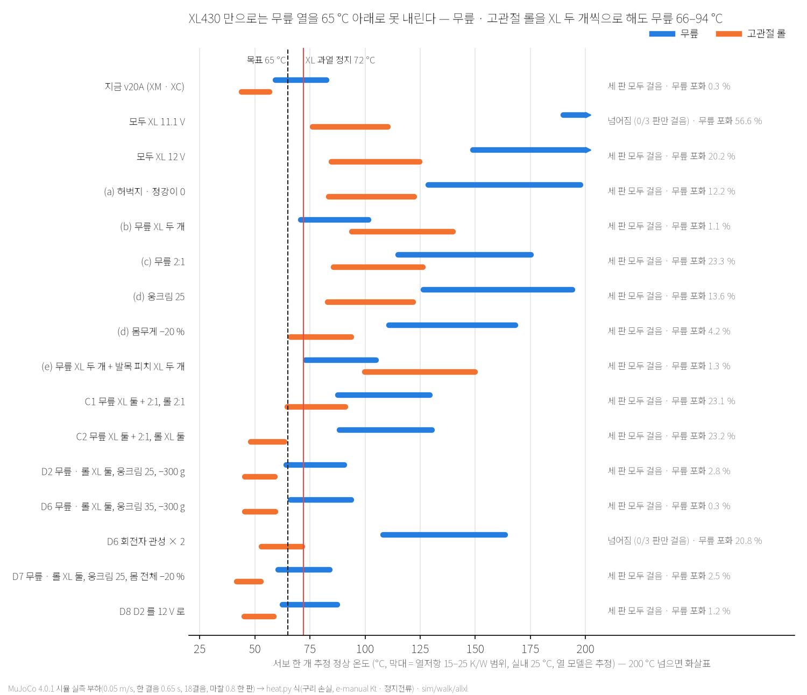

# v20 안 A 키트를 모든 관절 XL430-W250-T 로 만들면 (2026-11-26)

소유자 결정(2026-11-26): 「W250 만 있다, 그걸로 한다」. 새 서보는 사지 않고, 터틀봇3 버거에서 뗀 XL430-W250-T 만 씁니다. 그래서 지금 v20 안 A 키트(롤-피치 40.13 mm, 허벅지 · 정강이 각 +20 mm, 웅크림 35 mm)를 그대로 두고 서보만 XL430 으로 바꿨을 때 되는지, 안 되면 무엇을 바꿔야 하는지 MuJoCo 로 봤습니다.

## 결론 5줄

1. **그대로는 안 됩니다.** 모든 관절을 XL430 으로 바꾸면 11.1 V 에서 서기만 되고, 0.05 m/s 걷기도 세 판 모두 넘어집니다. 넘어지기 전 무릎은 시간의 55–57 % 동안 힘을 다 쓰고 있었습니다(포화) [시뮬 실측]. 한 발로 설 때 무릎에 드는 토크가 1.63 N·m 로, XL 정지토크 1.4 N·m 보다 큽니다 [정적 계산].
2. **무릎만의 문제가 아닙니다.** 걸을 때 고관절 롤도 열 목표를 넘습니다. 롤 부하 RMS 가 0.72 N·m 이고 추정 온도는 83–121 °C 입니다(XL 과열 정지 72 °C). 한 발로 설 때마다 몸의 옆 모멘트를 롤 서보가 받기 때문입니다. 발목 피치와 고관절 피치는 서보 하나로 됩니다 [시뮬 실측 부하 + 추정 열 모델].
3. **꼭 필요한 조합(추천 D6): 무릎과 고관절 롤을 XL 두 개씩(같은 축 양쪽) + 몸통 · 머리 출력물 −300 g.** 허벅지 · 정강이 +20 mm 와 웅크림 35 mm 는 그대로 둡니다.
   - 0.05 · 0.077 m/s 를 세 판 모두 걷습니다. 무릎 포화는 0.3 · 4.7 %, 압력중심 여유는 10.9 · 9.3 mm 입니다.
   - 쓸 만한 최고 속도는 0.085 m/s, 넘어지지 않은 최고는 0.115 m/s(보폭 75 mm)입니다 [시뮬 실측].
   - XL430 은 21개가 듭니다(다리 16 · 어깨 2 · 팔꿈치 2 · 머리 1). 버거 11대(XL 22개 중 21개 사용)입니다.
4. **이 조합도 「계속 걷기」 열 기준은 못 맞춥니다.** 0.05 m/s 에서 무릎 서보 하나의 추정 온도가 66–94 °C 로, 목표 65 °C 를 넘습니다. 시험한 어떤 조합도 위쪽 끝(25 K/W)이 65 °C 아래로 내려가지 않았습니다.
   - 그래서 걷기와 쉬기를 섞어야 합니다. 걷는 시간이 전체의 약 40 % 이하(서서 쉬기)이거나 58 % 이하(토크를 끄고 쉬기)여야 합니다 [추정].
   - 감속(2:1 · 1.5:1 · 3:1)은 오히려 나빴습니다. 출력에서 본 회전자 관성이 감속비² 배로 커져, 무릎 부하가 1.5–2.9 N·m 로 늘었습니다 [시뮬 실측, 관성은 추정].
   - 허벅지 · 정강이를 0 · +10 으로 되돌리는 것도 나빴습니다. 무릎 포화가 12–22 % 로 남고, 최고 속도가 0.085–0.092 m/s 로 줄었습니다.
5. **나사 자리는 맞습니다.** ROBOTIS 공식 XL430 STEP 의 몸체 구멍 14개가 설계가 쓴 XC430 STEP 과 같은 자리에 있고, 혼 · 아이들러 지름 20.5 mm · 높이도 같습니다 [STEP · 도면 대조].
   - 다른 것은 두 가지입니다.
     - 몸체 구멍이 나사산 없는 Ø2.1 입니다. M2.5 태핑 나사를 쓰고, 4 mm 이하로 박습니다.
     - 혼에는 M2 탭이 4개뿐입니다. 조립할 때 탭이 출력물 대각선 구멍에 오도록 출력축을 45° 돌려서 붙이고, 영점은 소프트웨어로 맞춥니다.
   - 키트를 다시 출력해야 하는 이유는 서보를 두 개로 늘리는 허벅지(무릎)와 고관절 롤 U 브래킷 쪽입니다.

**가장 큰 빈칸:** XL 회전자 관성(추정 0.0241 kg·m²)입니다. XL 은 코어 모터라 실제로는 더 클 수 있습니다. 두 배로 넣으면 추천 D6 도 0.05 m/s 에서 넘어졌습니다. 실물 XL 하나로 관성과 발열(Present Temperature)을 먼저 재야 이 추천을 믿을 수 있습니다.



## 수치 출처 표기

- **[시뮬 실측]** 이 폴더 스크립트로 MuJoCo 4.0.1 에서 잰 값
- **[정적 계산]** 자세와 중력만으로 계산(`speed/static.py` 방식)
- **[e-manual]** ROBOTIS e-manual 사양표
- **[STEP · 도면]** ROBOTIS 공식 STEP · PDF 도면 대조
- **[설계 파일]** `code_v17` 의 값
- **[추정]** 근거가 약한 가정값

## 1. 조건

### 1.1 모델

- `check_v20A.py` 와 같은 근사 모델입니다.
  - v18 MJCF 에 고관절 롤 안 A(롤-피치 53.58 mm, 다리 늘림 40.13 mm)를 얹었습니다.
  - 허벅지 · 정강이를 각 +20 mm 늘렸고(질량 반영), 웅크림은 35 mm 입니다.
  - 이 근사의 질량은 3092 g 입니다. v20 질량 파일(`code_v17/mass_build20_light.json`)은 3168 g 이라, 몸통 무게중심 자리에 +76 g 을 더해 맞췄습니다. 차이가 어느 부품에서 오는지는 나누지 않았습니다 [추정].
- **`sim/model/kitoru_v20.xml` 은 쓰지 않았습니다.** 발 패드 geom 이 없어서 지금 걷기 제어기(패드 힘 센서)와 압력중심 여유 계산을 그대로 쓸 수 없습니다.
- **제어기:** `sim/walk` 그대로입니다. ZMP 미리보기 + DCM, 200 Hz, 위치 이득 2배, 지연 10 ms, 발 들기 12 mm.
- 서보 질량 차이는 질량 파일 기준(혼 · 케이블 포함)입니다. XM 90 g, XC 73 g, XL 65.2 g [설계 파일].
  - 모두 XL 이면 몸무게가 2954 g 입니다(−214 g).

### 1.2 서보 값

| 서보 | 정지토크 (N·m) | 무부하 속도 (rad/s) | 위치 이득 kp (N·m/rad, 이득 2배 전) | 회전자 관성 (kg·m²) | 근거 |
|---|---|---|---|---|---|
| XL430-W250, 11.1 V | 1.4 (정지전류 1.3 A) | 5.97 (57 rpm) | 6.4 | 0.0241 | 토크 · 속도 [e-manual], kp 는 공장 P 이득 800 환산 [추정], 관성 0.045 × (258.5/353.5)² [추정] |
| XL430-W250, 12 V | 1.5 (1.4 A) | 6.39 (61 rpm) | 6.9 | 0.0241 | [e-manual], kp 는 전압 비례 [추정] |
| (b) XL 두 개 (같은 축 양쪽) | 2.8 | 5.97 | 12.8 | 0.0482 | 토크 · kp · 감쇠 · 관성 두 배, 질량 +65.2 g [추정] |
| (c) XL + 2:1 감속 | 2.38 (= 1.4 × 2 × 0.85) | 2.98 | 21.8 (= 6.4 × 2² × 0.85) | 0.0964 (× 2²) | 효율 85 %, 감속 부품 +15 g [추정] |
| 참고: XM430-W350 (지금 v20A) | 3.8 | 4.5 | 17.5 | 0.045 | 모델 값(`kitoru_v18.xml`) |

- 감속 kp 를 감속비² 배로 둔 것은, 서보가 모터 쪽 각도로 위치를 맞추기 때문입니다.
- kp 를 XM 과 같은 17.5 로 낮춰도 감속 결과는 거의 같았습니다(5절).

### 1.3 시험

- **서기:** 12 초.
- **0.05 m/s 걷기:** 한 걸음 0.65 s, 보폭 32.5 mm.
- **0.077 m/s 걷기:** 한 걸음 0.65 s, 보폭 50 mm(현황판의 「0.076 m/s」).
- **최고 속도 격자:** 한 걸음 0.65 · 0.53 · 0.44 · 0.38 s × 보폭 40–90 mm.
- 걷기 칸은 모두 마찰 0.7 · 0.8 · 0.9 로 세 번 돌렸고, 18걸음을 넘어지지 않은 칸만 「걸음」으로 셉니다(`SPEED_STUDY.md` 와 같은 규칙).
- **「쓸 만한 최고 속도」:** 세 판 다 통과하고, 압력중심 여유 하위 5 % 가 5 mm 이상이고, 무릎 포화가 10 % 미만인 가장 빠른 칸입니다.
- **관절 지표:** 오른쪽 다리, 마찰 0.8 판, 걷기 구간(걷기 시작 뒤)에서 쟀습니다.
  - 포화 %: 서보 힘이 정지토크에 붙은 시간의 비율
  - 사용률 99 %: u = |부하 토크|/정지토크 + |속도|/무부하 속도 의 99 % 값
  - 부하 RMS: 관절 부하 토크의 RMS(액추에이터 힘 − 역기전력 감쇠)

### 1.4 발열 어림 (`robust/heat.py` 와 같은 식, 전부 [추정])

- **식:**
  - 서보 한 개 토크 = 관절 부하 RMS / (서보 개수 × 감속비 × 효율)
  - 전류 I = 토크 / Kt. XL 의 Kt 는 1.4/1.3 = 1.077 N·m/A [e-manual 값으로 계산].
  - 권선 저항 R = 11.1 V / 1.3 A = 8.5 Ω
  - 구리 손실 P = I² R
  - 정상 온도 = 25 °C + P × (15–25 K/W)
- **판정:** 「계속 걷기 가능」은 위쪽 끝(25 K/W)이 65 °C 미만일 때만으로 봤습니다.
  - 한계값으로 바꾸면: 서보 하나의 부하 RMS 가 0.47 N·m 이하(25 K/W 기준), 또는 0.60 N·m 이하(15 K/W 기준)여야 합니다.
- **한계:**
  - 대기 전력 · 철손 · 기어 마찰 열은 뺐습니다. 그래서 실제보다 낮게 나오는 쪽입니다.
  - XL 은 케이스가 플라스틱이라 열이 더 안 빠질 수 있지만, XM 과 같은 열저항을 썼습니다.
  - 포화가 큰 판은 RMS 가 정지토크에서 잘려 있어서, 그 온도는 아래쪽 경계입니다.

## 2. 1번: 키트 그대로 모든 관절 XL430

### 2.1 걷기

| 구성 | 몸무게 (g) | 서기 12 s | 0.05 m/s | 0.077 m/s | 넘어지지 않은 최고 속도 (m/s) | 쓸 만한 최고 속도 (m/s) |
|---|---|---|---|---|---|---|
| 지금 v20A (XM · XC) | 3168 | ✓ | ✓ 여유 6.3 mm | ✓ 여유 5.3 mm | 0.132 (보폭 70 mm, 한 걸음 0.53 s) | 0.108 |
| **모두 XL, 11.1 V** | 2954 | ✓ | **✗ (세 판 모두 넘어짐)** | **✗** | – | 없음 |
| 모두 XL, 12 V | 2954 | ✓ | ✓ 여유 3.2 mm | ✓ 여유 3.0 mm | 0.123 (65 mm, 0.53 s) | 없음 (여유 5 mm 미만) |

모두 [시뮬 실측]입니다.

### 2.2 관절 (0.05 m/s, 마찰 0.8)

칸마다 「포화 % / 사용률 99 % / 부하 RMS N·m / 추정 온도 °C」입니다.

| 구성 | 무릎 | 발목 피치 | 고관절 피치 | 고관절 롤 | 발목 롤 |
|---|---|---|---|---|---|
| 지금 v20A (XM · XC) | 0.3 / 0.70 / 1.19 / 59–82 | 0.1 / 0.54 / 0.26 / 30–33 | 0.0 / 0.59 / 0.38 / 29–31 | 0.0 / 0.72 / 0.89 / 44–57 | 0.3 / 0.44 / 0.31 / 27–29 |
| 모두 XL 11.1 V (넘어지기 전까지) | **56.6** / 1.31 / 1.22 / **190–300** | 5.9 / 1.00 / 0.53 / 56–77 | 5.1 / 1.00 / 0.47 / 49–65 | 0.6 / 1.10 / 0.68 / **76–110** | 0.9 / 0.77 / 0.32 / 37–44 |
| 모두 XL 12 V | **20.2** / 1.13 / 1.05 / **149–232** | 1.8 / 1.00 / 0.39 / 42–53 | 0.7 / 0.89 / 0.30 / 35–42 | 1.9 / 1.16 / 0.73 / **85–125** | 1.1 / 1.00 / 0.27 / 33–38 |

0.077 m/s 에서 모두 XL 11.1 V 는 넘어지기 전까지 이랬습니다:
- 무릎: 포화 54.9 %, 193–305 °C
- 발목 피치: 포화 11.1 %, 72–103 °C
- 고관절 피치: 포화 5.3 %, 51–68 °C
- 고관절 롤: 83–121 °C

전체 표는 `results/summary.md` 에 있습니다.

### 2.3 서 있기와 한 발 정지

- **두 발로 서 있기만 해도 XL 무릎은 78–113 °C 입니다.** 무릎 부하 RMS 가 0.69 N·m 인데, 웅크림 35 mm 로 몸무게를 받치는 몫입니다 [시뮬 실측 + 추정 열 모델].
- 한 발 정지 토크 [정적 계산, `results/static.json`]:

| 구성 | 몸무게 | 웅크림 15 mm | 웅크림 25 mm | 웅크림 35 mm |
|---|---|---|---|---|
| 지금 v20A (XM · XC) | 3168 g | 무릎 1.22 N·m | 1.50 | 1.73 |
| **모두 XL** | 2954 g | 1.15 (XL 정지토크의 82 %) | 1.42 (101 %) | **1.63 (116 %)** |
| 모두 XL, 허벅지 · 정강이 0 | 2908 g | 1.01 | 1.25 | 1.42 |
| 모두 XL, 몸 전체 −20 % | 2388 g | 0.93 | 1.14 | 1.31 |
| 추천 D6 (무릎 XL 두 개, 몸통 · 머리 −300 g) | 2919 g | 1.13 | 1.40 | 1.60 (서보 하나 0.80, 57 %) |

- 고관절 피치는 한 발 정지 0.20–0.26 N·m, 발목 피치는 0.15–0.16 N·m 로 작습니다.

## 3. 2번: 대책 비교 (모두 XL 11.1 V 를 바탕으로)

### 3.1 하나씩

| 대책 | 몸무게 (g) | 0.05 / 0.077 m/s | 넘어지지 않은 최고 · 쓸 만한 최고 (m/s) | 0.05 m/s 무릎: 포화 % / RMS / 온도 °C | 0.05 m/s 롤 온도 °C | 다시 출력할 것 |
|---|---|---|---|---|---|---|
| (a) 허벅지 · 정강이 +10 | 2931 | ✓ 3.6 mm / ✓ 3.5 mm | 0.092 · 없음 | 21.9 / 1.02 / 140–216 | 84–123 | 허벅지 · 정강이 뼈대 · 껍데기 |
| (a) 허벅지 · 정강이 0 | 2908 | ✓ 3.7 / ✓ 3.8 | 0.085 · 없음 | 12.2 / 0.97 / 129–198 | 83–122 | 같음 |
| (b) 무릎 XL 두 개 | 3085 | ✓ 4.0 / ✓ 4.0 | 0.113 · 없음 | **1.1** / 1.29 / 71–101 | 94–140 | 허벅지(무릎 서보 자리 양쪽), 정강이 혼 판 |
| (c) 무릎 2:1 | 2984 | ✓ 4.9 / ✓ 4.4 | 0.136 · 없음 | 23.3 / 1.54 / 115–175 | 86–126 | 허벅지 · 정강이(벨트 · 기어 자리) |
| (d) 웅크림 25 | 2954 | ✓ 14.1 / ✓ 10.7 | 0.115 · 없음 | 13.6 / 0.96 / 127–194 | 83–122 | 없음(소프트웨어) |
| (d) 몸 전체 −10 % | 2671 | ✓ 4.5 / ✓ 3.5 | 0.113 · 없음 | 10.7 / 0.96 / 126–194 | 74–106 | – |
| (d) 몸 전체 −20 % | 2388 | ✓ 12.9 / ✓ 10.2 | 0.123 · 0.062 | 4.2 / 0.88 / 111–168 | 66–94 | – |
| (d) 배낭 250 g 달기 | 3028 | ✗ / ✗ | – | 넘어짐 | – | – |
| (e) 무릎 2:1 + 발목 피치 2:1 | 3014 | ✓ 4.2 / ✗ (세 판 중 한 판) | 0.123 · 없음 | 23.9 / 1.55 / 117–179 | 87–128 | – |
| (e) 무릎 · 발목 피치 XL 두 개씩 | 3215 | ✓ 3.3 / ✓ 3.1 | 0.108 · 없음 | 1.3 / 1.32 / 73–105 | 100–150 | – |

모두 [시뮬 실측 + 추정 열 모델]입니다. 0.05 / 0.077 칸의 mm 는 압력중심 여유 하위 5 %(세 판 중 최소)입니다.

**읽는 법**
- **(a) 되돌리기는 이득이 작고 잃는 것이 큽니다.**
  - 한 발 정지 무릎 토크는 1.63 → 1.42 N·m 로 줄지만, 여전히 XL 정지토크를 넘습니다.
  - 걷기 무릎 포화도 12–22 % 로 남습니다.
  - 최고 속도는 0.085–0.092 m/s 로, 모두 XL 12 V(0.123)나 추천 D6(0.115)보다 낮습니다(목표 ① 넓은 걸음 · ③ 빠름에 반대).
  - 이미 출력한 +20 키트를 다시 출력해야 합니다. **하지 않기를 권합니다.**
- **(b) 무릎 XL 두 개가 무릎 포화를 없애는 유일한 단일 대책입니다.**
  - 포화가 56.6 → 1.1 % 로 줄었습니다.
  - 다만 무릎 서보 하나 온도가 71–101 °C 로 여전히 높습니다.
  - 그리고 롤이 더 뜨거워졌습니다(94–140 °C). 무릎이 버티니 그만큼 더 크게 걸어서 옆 흔들림이 커진 것으로 봅니다 [추정].
- **(c) 2:1 감속은 나쁩니다.**
  - 무릎 부하 RMS 가 1.22 → 1.54 N·m 로 오히려 늘고, 포화도 23 % 입니다.
  - 출력에서 본 회전자 관성이 2² = 4 배(0.096 kg·m², XM 의 2 배)가 되어 흔드는 다리를 가속하는 데 토크가 듭니다.
  - kp 를 XM 수준(17.5)으로 낮춰도 포화가 22.6 % 로 같았습니다. 그래서 위치 이득 탓이 아니라 관성 탓입니다(5절).
  - 1.5:1(C5)과 3:1(C6, 서기도 못 함)도 같은 경향이었습니다.
- **(d) 웅크림 25 · 몸무게 줄이기는 균형 여유를 크게 늘립니다(10–14 mm).** 하지만 무릎 포화 · 열은 혼자서 풀지 못합니다.
  - 배낭 250 g(LB-012 · Jetson 배터리를 빼고 등 뒤 250 g 팩, 순 +74 g)을 달면 모두 XL 은 걷지 못합니다.
- **(e) 발목 피치 대책은 필요 없습니다.**
  - 추천 D6 에서 발목 피치 서보 하나의 온도는 35–41 °C(0.05 m/s), 42–54 °C(0.077 m/s)입니다. 허벅지 · 정강이를 0 으로 줄인 D4 만 0.077 m/s 에서 66–93 °C 였습니다.
  - 발목 피치를 2:1 로 하면 오히려 포화가 14–22 % 로 나빠졌습니다(같은 관성 이유).

### 3.2 조합 (무릎 대책 + 고관절 롤 대책 + 몸무게 · 웅크림)

1차 결과에서 롤도 열 기준을 넘어, 롤 대책을 함께 넣었습니다. 「−300 g」은 몸통 · 머리 body(1.497 kg)를 0.8 배로 줄인 것입니다. 출력물 채움 · 두께를 줄이는 정도로 봤습니다 [추정, `XL430_STUDY.md` 4절은 출력물만으로 240–360 g].

| 조합 | 몸무게 (g) | 0.05 / 0.077 m/s (여유 mm) | 최고 · 쓸 만한 (m/s) | 무릎 0.05 m/s: 포화 % / RMS / 온도 °C | 무릎 0.077 m/s: 포화 % / 온도 | 롤 0.05 m/s 온도 | XL 개수* |
|---|---|---|---|---|---|---|---|
| C1 무릎 XL 둘 + 2:1, 롤 2:1 | 3145 | ✓ 4.7 / ✓ 4.1 | 0.114 · 없음 | 23.1 / 2.56 / 88–129 | 25.5 / 92–137 | 65–91 | 19 |
| C2 무릎 XL 둘 + 2:1, 롤 XL 둘 | 3245 | ✓ 5.1 / ✓ 4.2 | 0.114 · 없음 | 23.2 / 2.57 / 88–130 | 26.1 / 94–141 | 48–63 | 21 |
| C7 무릎 XL 둘, 롤 2:1, 웅크림 25, 몸 전체 −20 % | 2516 | ✓ 13.9 / ✓ 10.6 | 0.105 · 0.077 | 2.0 / 1.11 / 59–82 | 7.3 / 74–107 | 54–73 | 19 |
| D1 무릎 · 롤 XL 둘, 웅크림 25 | 3215 | ✓ 5.9 / ✓ 5.9 | 0.104 · 0.077 | 2.8 / 1.26 / 69–98 | 9.6 / 84–124 | 48–63 | 21 |
| D2 무릎 · 롤 XL 둘, 웅크림 25, −300 g | 2919 | ✓ 6.0 / ✓ 5.2 | 0.094 · 0.069 | 2.8 / 1.19 / 64–91 | 10.0 / 81–118 | 45–59 | 21 |
| D3 같은데 웅크림 15 | 2919 | ✓ 5.3 / ✓ 5.0 | 0.105 · 0.050 | 4.9 / 1.25 / 68–97 | 17.5 / 80–116 | 45–59 | 21 |
| D4 D2 + 허벅지 · 정강이 0 | 2873 | ✓ 4.8 / ✓ 2.6 | 0.077 · 없음 | 4.8 / 1.31 / 72–104 | 19.6 / 87–128 | 47–62 | 21 |
| D5 D2 + 허벅지 · 정강이 +10 | 2896 | ✓ 5.9 / ✓ 4.0 | 0.091 · 0.062 | 3.7 / 1.23 / 67–95 | 14.0 / 85–125 | 46–60 | 21 |
| **D6 무릎 · 롤 XL 둘, 웅크림 35, −300 g (추천)** | **2919** | **✓ 10.9 / ✓ 9.3** | **0.115 · 0.085** | **0.3** / 1.22 / **66–94** | **4.7** / 80–117 | **46–59** | **21** |
| D7 무릎 · 롤 XL 둘, 웅크림 25, 몸 전체 −20 % | 2596 | ✓ 5.6 / ✓ 5.3 | 0.105 · 0.077 | 2.5 / 1.13 / 60–84 | 7.3 / 75–109 | 42–53 | 21 |
| D8 D2 를 12 V 로 | 2919 | ✓ 10.9 / ✓ 7.1 | 0.105 · 0.085 | 1.2 / 1.16 / 62–87 | 4.5 / 78–113 | 45–59 | 21 |
| D6 를 12 V 로 (속도 격자 없음) | 2919 | ✓ 13.5 / ✓ 8.0 | – | 0.3 / 1.19 / 64–91 | 1.8 / 77–111 | 45–59 | 21 |
| D6 + 배낭 250 g (속도 격자 없음) | 2993 | ✓ 12.0 / ✓ 6.2 | – | 0.2 / 1.33 / 74–106 | 3.7 / 86–126 | 45–59 | 21 |
| D6, XL 회전자 관성 × 2 (속도 격자 없음) | 2919 | **✗ / ✗** | – | 20.8 / 1.74 / 108–164 | – | 53–72 | 21 |

모두 [시뮬 실측 + 추정 열 모델]입니다. *XL 개수는 다리 · 어깨 2 · 팔꿈치 2(v21) · 머리 1 을 합친 수입니다(4절).

**왜 D6 인가**
- **걷기 계속 가능(우선 기준):**
  - 무릎 포화 < 5 % 를 0.05 · 0.077 m/s 둘 다 맞춘 것은 D6(0.3 · 4.7 %)과 D8 · 「D6 를 12 V 로」(12 V)뿐입니다.
  - 12 V 는 XL 입력 상한(12.0 V)에 붙어 있어 기준으로 삼지 않았습니다. 3S 만충은 12.6 V 입니다.
  - 무릎 추정 온도 < 65 °C 는 **어느 조합도 위쪽 끝으로 맞추지 못했습니다.**
    - 아래쪽 끝(15 K/W)으로는 C7 59 · D7 60 · D8 62 · D2 64 · D6 66 °C 입니다.
    - 무릎 열은 D2 · D7 이 1–6 °C 낮지만, 그 대신 포화(0.077 m/s 에서 7–10 %)와 걸음 여유가 나쁩니다.
- **① 넓은 걸음:** D6 이 가장 넓습니다. 넘어지지 않은 최대 보폭 75 mm(한 걸음 0.65 s)이고, 다른 D 는 40–55 mm 입니다.
- **③ 빠름:** 쓸 만한 최고 속도 0.085 m/s 로 가장 빠릅니다(지금 XM 설계는 0.108).
- **④ 균형:** 압력중심 여유 10.9 · 9.3 mm 로, 지금 XM 설계(6.3 · 5.3)보다 큽니다.
- 웅크림 35 mm 가 25 mm 보다 무릎 포화가 작은 것은 `SPEED_STUDY.md` 3.2 와 같은 경향입니다. 늘린 다리로 깊게 웅크리면 같은 보폭을 작은 무릎 각속도로 걷습니다.
- **키트에서 바꿀 것:** 허벅지 · 정강이 길이와 웅크림은 그대로입니다. 바꿀 것은 셋입니다.
  - 무릎: 허벅지에 두 번째 XL 자리(지금 아이들러 쪽). 정강이는 양쪽 혼을 받는 판.
  - 고관절 롤: U 브래킷에 두 번째 XL 자리.
  - 몸통 · 머리 출력물 −300 g.

### 3.3 걷기와 쉬기 섞기 (D6, [추정])

- 무릎 서보 하나의 구리 손실은 걸을 때(0.05 m/s) 2.74 W, 서 있을 때 0.80 W 입니다.
- 위쪽 끝(25 K/W)으로 65 °C 를 넘지 않으려면 평균이 1.6 W 이하여야 합니다.
  - 서서 쉬면: 걷는 시간이 전체의 41 % 이하
  - 앉거나 토크를 끄고 쉬면: 58 % 이하
- 열이 오르는 데 몇 분이 걸린다고 보고(열 시정수, 값은 모름) 몇 분 단위로 번갈아 하는 것을 전제로 합니다.
- 실물에서 Present Temperature 를 재서 다시 정해야 합니다.

## 4. 3번: XL430 개수

| 구성 | 다리 | 어깨 | 팔꿈치 (v21) | 머리 | 합계 | 터틀봇3 버거 대수 (한 대에 XL430 2개 [e-manual], 올림) |
|---|---|---|---|---|---|---|
| 모두 XL (그대로) · (a) · (c) · (d) | 12 | 2 | 2 | 1 | **17** | 9 대 |
| (b) 무릎 두 개 | 14 | 2 | 2 | 1 | **19** | 10 대 |
| (e) 무릎 · 발목 피치 두 개씩 | 16 | 2 | 2 | 1 | 21 | 11 대 |
| C1 (무릎 두 개 + 감속, 롤 감속) · C7 | 14 | 2 | 2 | 1 | 19 | 10 대 |
| **추천 D6 (무릎 · 롤 두 개씩)** · C2 · D1–D8 | 16 | 2 | 2 | 1 | **21** | **11 대** |

- 감속은 서보를 늘리지 않지만, 벨트 · 풀리 · 베어링을 사야 합니다(구매 없음 조건과 부딪힘).
- 팔꿈치가 v20 에는 없고 v21 에 들어갑니다. v20 만 만들면 위 합계에서 2를 뺍니다.
- 소유자 말로는 한 개는 종류가 다를 수 있습니다(현황판). 재고 개수는 확인이 필요합니다.

## 5. 감속이 나빴던 이유 점검 (`ax_check.py`, `results/check.json`)

- **(c) 무릎 2:1 에서 출력 kp(이득 2배 뒤)를 43.5 → 35(XM 과 같게 17.5 × 2)로 낮춰도:**
  - 0.05 m/s 무릎 포화 22.6 %, RMS 1.53 N·m 였습니다(kp 43.5 일 때 23.3 %, 1.54).
  - 그래서 원인은 위치 이득이 아니라 출력에서 본 회전자 관성(감속비²)입니다.
- **XL 두 개 + 2:1 에서 kp 17.5:** 시작 1 초 안에 넘어졌습니다(되비친 관성 0.193 kg·m², 감쇠가 상대적으로 작음).
- **D6 를 회전자 관성 × 2 로:** 0.05 m/s 에서도 세 판 모두 넘어졌습니다(무릎 포화 20.8 %).
  - XL 은 코어 모터라 관성이 추정보다 클 수 있습니다(`kitoru_v20.xml` 주석). 이 추천에서 가장 약한 가정입니다.
- 회전자 관성이 결과를 정하는 몫이 큽니다. 그래서 「감속은 나쁘다」, 「두 개는 하나보다 낫다」는 순서는 관성 값이 바뀌면 바뀔 수 있습니다.

## 6. 4번: XL430 이 지금 출력물(XM430 기준 키트)에 맞나

**비교한 자료:**
- ROBOTIS 공식 XL430 STEP `ref/XL-430_new.stp`
  - 받은 곳: download.php?no=773 → Dropbox `XL-430_new.stp`. 2021-12-22 Creo 로 만든 파일입니다.
  - sha1 `bab2863aac35ad8f0246b5411d02d66476a93fe1`
- XL-430 PDF 도면(2018-03-24, no=772)
- 설계가 쓴 `references/XC-430_idle.stp`(`code_v17/x430_holes.py` · `x430_geom.py` 의 원본)
- XC430 도면(no=1690), XM430/XH430 도면(no=157)

비교 스크립트는 `xl_geom_check.py` → `results/xl_geom.json` 입니다.

| 항목 | XL430-W250 | XC430 (설계 원본) | XM430-W350 (키트가 가정한 서보) | 지금 출력물에 맞나 |
|---|---|---|---|---|
| 바깥 크기 | 28.5 × 46.5 × 34 | 같음 | 같음 | ✓ [STEP · 도면] |
| 몸체 구멍 자리 | Ø2.1 14개가 XC 와 같은 자리(소수 둘째 자리까지)<br>혼 쪽 면에 2개 더(x ±11, y −8) | 14개 | 같은 자리 | ✓ [STEP 대조] |
| 몸체 구멍 종류 | **Ø2.1 HOLE DP4.0**(플라스틱, 나사산 없음) | Ø2.1 HOLE DP4.0 | **M2.5 TAP DP3.0**(금속) | 나사만 다름: M2.5 태핑 나사, 박는 깊이 ≤ 4 mm [도면]<br>출력물 구멍 2.7 mm 는 그대로 [설계 파일] |
| 혼 | Ø20.5, 지름 16 mm 원 위에 **M2 탭 4개 + Ø1.7 구멍 4개(45° 사이)**<br>높이 치수(도면 2 · 3 mm)가 XC 와 같음 | 같음 | Ø19.5, 지름 16 mm 원 위에 **M2 탭 8개** | 대부분 ✓. 설계 혼 r 10.25 · 높이 3.9 / 3.0 은 XC · XL 값 [설계 파일 · 도면] |
| 혼 나사 각도 | 탭은 도면 자세에서 케이스 축(0 · 90°) 위 [STEP · 도면] | 같음 | 8개라 어느 각도든 | 출력물 구멍은 대각선(45°)에 있습니다(build17 `horn_holes`: 「taps on the diagonals」) [설계 파일]<br>→ 출력축을 45° 돌린 자리에서 혼 탭이 구멍에 맞게 붙이고, 영점은 Homing Offset 으로 맞춥니다<br>조건: 영점을 옮긴 뒤 관절 범위가 위치값 0/4095 경계를 넘지 않아야 합니다. 가운데 2048 에서 45°(512) 옮겨도 관절 범위가 ±115–130° 라 경계 안입니다 [추정: 도면의 혼 각도가 위치값 2048 인지는 미확인]<br>또는 Ø1.7 구멍에 M2 태핑 나사 |
| 아이들러 | Ø20.5, 높이 치수(도면 3.9 · 2 mm)가 XC 와 같음, 같은 탭 · 구멍 배치 | 같음 | 다름(도면 2 · 2.2) | ✓, 혼과 같은 각도 맞춤 |
| 앞면 모서리 | 케이스 나사 FHS M2.5×10, R3.25 홈 | Ø4.8 자리파기 DP2.8 | WB M2.5×12 | 출력물이 이 자리를 쓰지 않으면 영향 없음 [미확인] |
| 입력 전압 | 6.5–**12.0 V**(권장 11.1 V) | 6.5–14.8 V | 10.0–14.8 V | 3S 만충 12.6 V 는 상한 위 [e-manual]<br>최대 전압 제한 레지스터 기본값은 14.0 V 라 꺼지지는 않습니다 |
| 기어 · 케이스 | 엔지니어링 플라스틱 기어, 플라스틱 케이스, 코어 모터 | 금속 기어 | 금속 기어, 금속 앞 · 가운데 케이스 | 넘어질 때 기어 이 손상 가능 [추정] |

**XL 로 바꾸며 달라야 하는 것 (목록)**
1. 몸체 고정 나사: M2.5 기계 나사(XM 탭용) → M2.5 태핑 나사, 박는 깊이 4 mm 이하.
2. 혼 · 아이들러 고정: 탭이 4개뿐이라, 탭이 출력물 대각선 구멍에 오도록 출력축을 45° 돌려 조립합니다. 영점은 소프트웨어(Homing Offset)로 맞춥니다. 출력물은 그대로입니다.
3. 무릎 XL 두 개(추천): 허벅지 틀에 두 번째 서보 자리가 필요합니다(지금 아이들러 자리를 서보로). 정강이 쪽은 양쪽 혼을 받는 판으로 바꿉니다. 허벅지 · 정강이를 다시 출력합니다.
4. 고관절 롤 XL 두 개(추천): 롤 U 브래킷(안 A 새 부품)을 두 서보용으로 다시 설계 · 출력합니다.
5. 전원: 3S 만충 12.6 V 는 XL 상한 12.0 V 를 넘습니다. 11.1 V 근처로 쓰거나 강압하기를 권합니다(OpenCR 이 서보 전원을 그대로 넘기는지 확인).
6. 감속(쓰지 않기를 권함)을 쓴다면 벨트 · 풀리 구매가 필요합니다.

## 7. 한계

- **모델이 근사입니다.** v18 형상에 안 A 와 다리 늘림을 질량 점으로 얹었고, 질량 차이 76 g 은 몸통에 몰았습니다. `kitoru_v20.xml` 로 걷기를 돌리려면 발 패드를 넣어야 합니다.
- **회전자 관성이 결론을 쥡니다.** XL 0.0241 kg·m² 는 XM 값의 기어비 환산 [추정]이고, 두 배면 추천 조합도 넘어졌습니다.
- **열 모델은 추정입니다.**
  - 권선 저항 · 열저항이 추정이라 온도 폭이 ±15 °C 이상입니다.
  - 대기 전력 · 철손 · 기어 마찰 열을 빼서 낮게 나오는 쪽입니다.
  - 플라스틱 케이스 열저항도 따로 보지 않았습니다.
- **두 서보를 한 관절에 쓰는 것:** 시뮬은 두 서보가 힘을 똑같이 나눈다고 봤습니다. 실물은 위치 오차 · 영점 차이로 서로 미는 힘(내부 싸움)이 생겨 열이 더 날 수 있습니다. 같은 영점 맞추기 · 한쪽 이득 낮추기 같은 대책이 필요합니다 [추정].
- **몸무게 −300 g:** 몸통 · 머리 body 를 0.8 배로 줄인 것입니다(무게중심 그대로). 실제로 어디서 줄일지는 형상 쪽 판단입니다.
- **시험 범위:** 평지 앞으로 걷기만 봤습니다. 밀기 · 돌기 · 일어나기는 이번에 넣지 않았습니다. XL 어깨 · 팔꿈치의 일어나기는 `GETUP_STUDY.md` 를 보십시오.
- **판정:** 각 칸은 마찰 세 가지로 한 번씩 돌렸습니다. 경계 칸은 조금만 바뀌어도 결과가 갈립니다.
- **e-manual 원문:** 사양 수치는 웹 가져오기 도구로 읽은 사양표입니다. 도면 · STEP 은 파일을 직접 받아 대조했습니다.

## 8. 실행 명령 (`sim/walk/allxl/`, 80 코어 · 76 프로세스 기준)

```bash
cd sim/walk/allxl
../../.venv/bin/python ax_sweep.py base fix        # 1번 3 구성 + 대책 10 구성, 1612 판 (약 8분)
../../.venv/bin/python ax_sweep.py combo combo2    # 조합 18 구성, 2232 판 (약 12분)
../../.venv/bin/python ax_check.py                 # 감속 kp · 관성 × 2 · 배낭 · 12 V 점검 35 판 (약 30초)
../../.venv/bin/python ax_static.py                # 한 발 정지 토크 → results/static.json
../../.venv/bin/python xl_geom_check.py            # XL · XC STEP 구멍 대조 → results/xl_geom.json
../../.venv/bin/python ax_compact.py results/{base,fix,combo,combo2,check}.json   # 커밋용으로 결과 줄이기
../../.venv/bin/python ax_summary.py base fix combo combo2 check   # results/summary.md · summary.json
TITLE="XL430 만으로는 무릎 열을 65 °C 아래로 못 내린다 — 무릎 · 고관절 롤을 XL 두 개씩으로 해도 무릎 66–94 °C" ../../.venv/bin/python ax_fig.py   # results/allxl_heat.png
```

| 파일 | 내용 |
|---|---|
| `ax_common.py` | 모델 설정(check_v20A 와 같음 + 76 g), e-manual XL 서보 표 · 대책 서보(두 개 · 감속), 발열 식, 실행기 |
| `ax_sweep.py` · `ax_combo.py` | 구성 묶음(base · fix · combo · combo2) |
| `ax_check.py` | 점검 묶음 |
| `ax_static.py` | 한 발 정지 토크 |
| `xl_geom_check.py`, `ref/XL-430_new.stp` | XL430 공식 STEP 과 설계 원본 XC430 STEP 대조 |
| `ax_summary.py`, `ax_fig.py`, `ax_compact.py` | 표 · 그림 · 결과 줄이기 |

- 결과 json 에는 판마다 설정(`cfg`)과 관절 지표가 있습니다.
- 설계 코드 · `out20/` · `robot/` · 기존 `sim` 파일은 고치지 않았습니다. 공용 코드는 import 하고, 서보 표만 이 폴더에서 덧붙였습니다.
